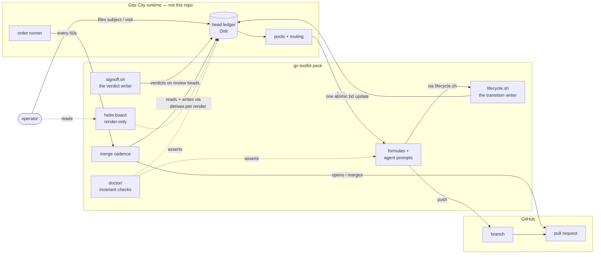

# Architecture

gc-toolkit delivers the beliefs in [foundation.md](foundation.md) by *composing
Gas City* — the multi-agent runtime it runs on — rather than by growing bespoke
machinery beside it. The pack is its workflows: **work, review, merge, visit,
feedback, patrol**. Every component belongs to one of them or is a declared
shared primitive; nothing exists because an incident once happened.

## Scope

**Mandate.** How gc-toolkit composes Gas City's primitives to deliver
foundation: the system boundary, how work moves end to end, how humans engage,
how lessons compound, and the test that keeps new work grounded.

**Boundaries.** It works at altitude. The anchor lifecycle's states, writers,
and check mechanics are owned by [state-machine.md](state-machine.md); the merge
cadence's runtime semantics by
[refinery-merge-cadence.md](refinery-merge-cadence.md); the primitive list and
the invariant→check binding by [component-model.md](component-model.md); the
filing conventions by [file-structure.md](file-structure.md); how work is
structured into epics and when an epic closes by [epics.md](epics.md).

## The boundary

Four parties, one data plane. Lifecycle transitions, routes, waits and review
verdicts are all written on beads.

**Legend.** Solid = writes state. Dashed = reads without writing. Three write
paths matter: `lifecycle.sh` is the only writer of lifecycle transitions,
`signoff.sh` is the only writer of check verdicts, and the merge cadence is the
only thing that opens or merges a PR. Everything else reads.

**Beside the ledger.** The pack also keeps files of its own. Some hold a run's
progress, such as a paced cadence arm's cursor or the job directory of the
refinery's merge gate. `gctk rig`'s check records differ, because a later call
takes a record's result in place of running the check. A record holds the
result of one of a rig's checks, such as its tests or its lint, at one commit.
[`services/gctk/README.md`](../services/gctk/README.md#rig) states which checks
are recorded and where the records live.

- **Writer.** Only `gctk rig` writes a record, from a run it made itself, in a
  checkout holding nothing HEAD does not.
- **Authority.** A record answers a later `gctk rig` call that declares the
  same run: the same command line and, for a test run, the same scope. That
  call takes the recorded result without running the check, unless it forces a
  run. A full-suite test pass also answers for every commit with the same tree.
- **Lifetime.** Every worktree of a rig clone shares the records, and they
  outlive any one worktree. A re-clone loses them, and the loss costs one run
  of each check.
- **What a record is not.** A record is evidence about a commit. It is neither
  workflow state nor a review's verdict, and both of those stay on beads,
  written by their own writers. Nor is it a judgment of whose failure a fail
  is: a caller that finds a recorded fail red on the base too writes that on a
  bead as `rig_check_pre_existing.<check>`, naming the commit it judged.
  `--publish-bead` copies a record onto a bead's `rig_check.<check>` key for
  whoever reads that bead. The record, not the copy, answers `gctk rig`.

## How work moves

One pipeline, from a filed bead to a landed change. Each step names its
performer; the full transition table with writers is
[state-machine.md](state-machine.md).

1. **File.** Something — a formula step, an event, the operator — files a bead.
2. **Route.** `gc sling` (or `deferred-dispatch.sh` when blockers must close
   first) routes it to a pool. Routed, unclaimed work is *demand*: the runtime
   spawns a session to meet it, with no operator keystroke. New work is routed
   only once it may enter a pool: a member of an epic, PR-finishing work, an
   emergency, or the operator's own move. Other new work waits for the
   operator's placement sitting first ([steering.md](steering.md)).
3. **Claim.** A polecat claims via `gc hook --claim`; the runtime writes
   assignee and claim in one step. It takes the ready bead with the most urgent
   priority first, and the pack computes that priority from what the bead
   follows ([steering.md](steering.md#priority)).
4. **Implement.** The polecat works in a per-bead worktree on a
   `polecat/<bead>` branch, driven by `mol-polecat-work`.
5. **Hand off.** Push, verify the push landed, then one atomic `gc bd update`
   carries the handoff — target, refinery assignee, cleared route (branch was
   stamped at workspace-setup). All-or-nothing: a dead session mid-handoff
   leaves either the pre-handoff state (witness orphan recovery re-routes it)
   or the complete post-handoff state, never a half. The anchor is still
   unanchored here; its first lifecycle transition is the refinery's.
6. **Gate.** The merge cadence's gate-ensure arm makes every declared check
   raisable; a review bead is routed to the polecat-codex pool; the reviewer's
   single call to `signoff.sh` records the verdict on the review bead and, on
   request-changes, files one rework child.
7. **PR.** With every `pre-open` check deriving green from its reviews,
   `pr-open.sh` opens (or adopts) the pull request.
8. **Merge.** `merge.sh` validates the full authorization set, merges pinned to
   the validated commit, then closes the anchor and records `merged_sha` in one
   `lifecycle.sh` call.
9. **Close propagates.** `closed` means *landed and verified* — the one signal
   waiting parties key on ([lifecycle-composition.md](lifecycle-composition.md)).

External facts the pack does not write — GitHub closing or retargeting a PR, a
session dying, a pool slot the runtime does not free, a provider quota park —
are handled by these reactive paths: `pr-facts.sh` (an arm of the cadence)
records PR events and files a visit, the witness patrol recovers work orphaned
by dead sessions, the `dog` pool is warrant executor for due-process recovery
of wedged sessions (demand-scaled 0-2), `pool-slot-reap.sh` closes a pool
session bead the runtime left holding its slot with no runtime and no work,
`quota-park-nudge.sh` nudges a session parked behind a provider limit,
`boot-health.sh` detects a wedged deacon (report-only by design), and
`queue-priority.sh reconcile` settles queued work after a raw priority or parent
edit no writer saw. See
[authority-map.md](authority-map.md). There is no healer category: writers
complete their own transitions, so nothing reconstructs pack-written state
after the fact.

## How humans engage

The human surface is subject / visit / takeaway on native primitives
([gascity-human-engagement.md](gascity-human-engagement.md) is the reference).

- **A subject bead is the conversation.** Its id is the conversation's
  identity; turns are small child beads that park on the helm board
  (`gc.routed_to=human`) until the operator engages one. Warm, the next turn
  vacuums onto the live sitting through the continuation group; cold,
  `gc-helm engage` spawns a fresh `converse-<model>` sitting that reconstitutes
  from the record. The record is the durable thing; sessions are disposable.
- **A visit is a filed turn** — `mol-visit` and `gc-visit-open.sh` are the
  canonical entry point. Two channels carry a signal, and which applies
  depends on who can answer it. Mail is the agent-to-agent pathway: a worker
  mails the witness, which unblocks what it can and promotes what needs a
  person. A visit is the human engagement: `escalate.sh` files or refreshes
  **exactly one open visit per situation key**, parked on the helm board
  (`gc.routed_to=human`), where the operator engages it. There is no mayor; a
  situation that needs a human is a visit, same as any other. Patrol formulas escalate rather than mail, because a patrol sits at
  the top of the agent tier and has no peer to mail.
- **A takeaway records what a sitting concluded**, and its `--waiting-on` edge
  is what makes the wait machine-answerable
  ([lifecycle-composition.md](lifecycle-composition.md)).
- **A park decides when work runs.** `gc-helm.sh park` gives a bead a `blocks`
  edge onto a gate of its own, titled with why it is parked and what releases
  it. bd's cascade keeps the routed work under the bead out of every pool's
  offer, work already in flight finishes, and closing the gate releases the
  park. [steering.md](steering.md) says what a park holds and what it does not.
- **A priority decides the order work runs in.** A bead's priority is the
  priority of the bead it follows plus its own shift, so work under an epic
  queues at the epic's priority. `gc-helm.sh priority` sets an epic's priority,
  or a member's shift, and re-ranks the work that follows it, workflows already
  poured included ([steering.md](steering.md#priority)).
- **The board is render-only.** `services/helm` (helm-svc) derives every row
  per render from the ledger. `gc-helm.sh` carries the write verbs open,
  engage, react, takeaway, demand, dismiss, accept, park and priority, and the
  read-only verbs resolve and unplaced. `gc-helm.sh unplaced` lists the placement
  sitting's queue ([steering.md](steering.md)). Everything works without the
  board: it spends no state, so it can never be wrong for longer than one
  render.

The discipline throughout is *agents earn every interaction*: prep done before
the operator arrives, the choice framed, every surface branded so the operator
lands on the question rather than re-orienting.

## How lessons compound

The feedback workflow ([feedback-learning.md](feedback-learning.md)) turns
corrective feedback into standing behavior, so attention is never spent twice:

1. **Capture.** Working agents self-report observation beads when a turn
   brings corrective feedback; the `feedback-miner` order sweeps merged PRs'
   review comments for what self-report missed; "learn this: …" is the
   operator fast path.
2. **Distill.** The `feedback-distiller` order clusters observations into
   patterns and promotes recurring ones as ordinary PRs against the pack —
   prompt edits, lint rules under `tools/lint-learned.d/`, doc changes.
3. **Land.** Promotions ride the same work→review→merge pipeline as
   everything else. A lesson is real when it is merged pack content, not when
   it is remembered.

Doctor is the same idea applied to structure: its checks assert invariants
from [component-model.md](component-model.md) §3 against the live ledger and
guard pack structure, so a property that stops holding fails a named check
instead of waiting to be rediscovered.

## The consistency test

A proposed capability must trace a straight line from a belief in
[foundation.md](foundation.md), through a primitive in
[component-model.md](component-model.md) §1, to one of the six workflows
above. [component-model.md](component-model.md) §4 indexes where every
existing component sits. Concretely
([component-model.md](component-model.md) §5):

- **Adding a component** — it must answer §1's "cost of not having it" column.
  If it cannot, it is a repair pass for a writer that should be fixed instead.
- **Adding a state** — declare it in `lifecycle/lifecycle.toml` and name its
  writer, or it does not exist.
- **Adding a metadata key** — it is state; register it in `lifecycle.toml`.
- **Adding an invariant** — name its doctor check in the same PR.

If a capability fits none of the workflows, that is the signal, and it points
one of two ways: the capability is miscast and should be recast onto the
primitives, or the model must move deliberately — and because architecture
derives from foundation, sometimes the belief upstream is what has to move
first. Either way the change is a decision on the record, not a drift.
