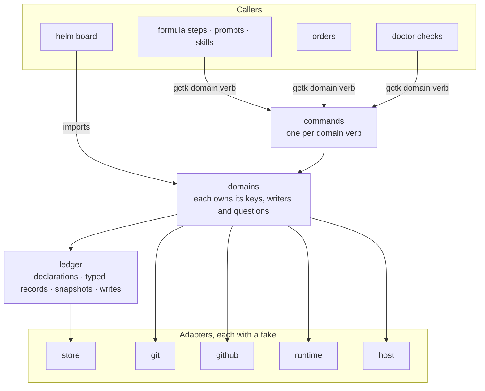

# gctk architecture

`gctk` is gc-toolkit's CLI, one Go binary that agents call
([services/gctk/README.md](../services/gctk/README.md)). Each piece of pack
logic that survives the move onto Gas City is one call of the form
`gctk <domain> <verb>`. The nouns of that surface are the domains. A domain owns
its state, the only writers of that state, and the questions asked about it.
Every other piece of code asks the domain's questions and never reads its keys.

## Scope

**Mandate.** The shape of gctk's code: the CLI surface and the intents it
carries, the domains that surface names and what each owns, the ledger, the
adapters, how commands, orders, doctor checks and the helm board compose the
domains, the one rule for whether a bead is blocked, and the rules every
domain move follows.

**Boundaries.** Which pack logic survives at all is
[built-once-target.md](built-once-target.md)'s, and how a feature is
re-expressed on Gas City is the migration member that carries it. A command's
flags, output and exit codes are its own usage text, which the
[README](../services/gctk/README.md) maps. The anchor lifecycle is
[state-machine.md](state-machine.md), and a rig check record's lifetime and
authority are in [architecture.md](architecture.md#the-boundary). The board's
UX is the Helm UX epic's. Gas City's own behavior is in
[docs/gascity/](gascity/README.md).

## The CLI

The CLI is designed from the outside in. Each call below carries one intent
that a caller expresses today and that survives the migration onto Gas City,
so the caller makes one call where it now runs a script. A domain or verb is
wrong if a caller still needs a script to turn its intent into action. An
intent the migration retires gets no call, because porting it would carry it
forward.

| Call | The intent it carries | Who calls it |
|---|---|---|
| `gctk waits blocked <bead>...` | is this bead blocked, and on what | deferred dispatch, the refinery's queue and the witness's check on it, bead-context's frontier, and doctor checks |
| `gctk waits pending <bead>...` | which of this bead's own waits have not landed, and when the last one did | the `until` disposal, gc-helm's park, release and route guards, the check that a wait is an edge, patrol findings, the mechanik's wait on an effort's summary, and the board through the package |
| `gctk waits foreign` | which wait edges point into another store, and so hold nothing | a doctor check |
| `gctk dispatch arm <bead>` | start this bead by itself once nothing holds it, on a formula if one is named | whoever files work that must wait: formula steps, prompts, skills |
| `gctk dispatch disarm <bead>` | stop an armed bead from starting by itself | the waits and work skills |
| `gctk dispatch list` | which beads are armed, and what holds each | doctor remedies and operators |
| `gctk dispatch closed` | act on what a close released: pour each armed bead that is now ready, and close each bead whose `until` targets have all closed | the event order on `bead.closed` |
| `gctk priority set <bead> <P0-P4>` and `gctk priority shift <bead> <±n>` | set the priority of a bead that follows nothing, or a member's shift, and re-rank what follows it | the operator or a sitting, through the board's priority verb |
| `gctk priority settle <bead>` | give a new bead the priority of what it follows before it can be claimed | whoever files follow-up work |
| `gctk priority reconcile` | re-settle the queue after edits no writer saw | an order |
| `gctk pr summary <bead>` | record what the change does, for its PR's summary | the work formula's submit step and an effort's summary task |
| `gctk pr compose <bead>` | the PR's conventional-commit title and managed summary region, from the bead that owns it | the step that opens or updates a PR |
| `gctk pr owner <pr>` | which bead owns this PR | the GitHub event orders, and the board's resolve verb |
| `gctk pr status <bead>` | where the PR stands: working, needs-review or needs-attention | the status label writer, and the board through the package |
| `gctk review checks` | which checks gate a change at a commit, with the rig's index laid over the pack's | the review loop and the triage method |
| `gctk review guidance <check>` | the rig's guidance for a check at the reviewed commit | the review formulas |
| `gctk review passed <bead>` | whether every lane has passed at the head: the review loop's pass-or-iterate check | the review loop |
| `gctk sessions nudge-parked` | nudge each live session parked on a provider limit, with backoff and one escalation | an order |
| `gctk sessions parked <session>` | whether this session is parked on a provider limit | the patrols |
| `gctk rig test`, `lint`, `typecheck`, `setup`, `build` | run a rig's check and record its result at the commit, or read that record | formula steps, the self-review exit condition, and the review's evidence |
| `gctk sends guard` | refuse an agent's `gh` write outside the rig's own origin, or an unmarked post on it | the tool-use hook every agent carries |
| `gctk dolt reclaim` | reclaim each store that has grown past the reclaim line | an order, and an operator previewing the plan |
| `gctk seed render` and `gctk seed check` | render what each agent and formula receives, and check that the render is current | the pre-commit hook and a doctor check |

A migration member that reshapes a domain's feature fixes that domain's verbs
in its own design. The verbs above for such a domain are the intents its
callers express today, and the member keeps the domain's name and what it owns.
The synthesis of review lanes into one verdict is judgment, so it stays in the
review formula's step text.

Of the commands gctk holds now, `rig` and `version` keep their place in the
tree, and `pr-status` takes its place as `pr status`. `lifecycle` and `merge`
carry the anchor state machine and the pack's merge rule, which retire as
merging moves onto Gas Town's refinery and GitHub's branch rules. They join the
tree unchanged and gain nothing new.

## What each domain owns

A domain owns three things. Its state is the metadata keys it declares and any
files it keeps. Its writers are its verbs, the only code that changes that
state. Its questions are what any other code asks about that state. Each domain
is one of three kinds under [foundation.md](foundation.md#boundaries)'s tests:
glue that composes native calls, a pack noun that stands on a dated warrant in
[warrants.md](warrants.md), or product the board renders.

| Domain | Kind | State it owns | Its questions |
|---|---|---|---|
| `waits` | glue over the store's rules | none of its own: a wait is an edge or a gate, and both are the store's | is this bead blocked, and on what; which of its own waits are pending; which wait edges hold nothing; whether a bead is in flight |
| `dispatch` | warranted residual: pour a formula on ready, close a bead when its `until` target closes | the arm record on a bead armed to start by itself, and the mark on a bead being disposed | which beads are armed, and what holds each |
| `priority` | warranted: priority following | a bead's priority shift, and the bd priority of every bead that follows another, its poured workflow's included | what priority a bead should carry |
| `pr` | glue, plus any merge rule GitHub cannot express, under a warrant | a bead's PR summary, and the title and managed summary region of its PR | which bead owns a PR; where a PR stands |
| `review` | glue over a formula check loop | none: the check index is config in the pack and the rig | which checks gate a change at a commit; what a check's rig guidance says; whether the lanes have passed |
| `sessions` | warranted: quota-park nudging | a nudge episode file per parked session, under the city's runtime directory | whether a session sits parked on a provider limit |
| `rig` | glue | the check records under the rig clone's git common directory, and their copies on beads | what a check's result is at a commit |
| `sends` | warranted: gh write containment | none | whether an agent's `gh` write targets the rig's own origin, and carries the city's mark |
| `dolt` | warranted: Dolt reclaim | none | which stores have grown past the reclaim line |
| `seed` | glue | the rendered audit under `generated/seed-audit/` | what each agent and formula receives; whether the render is current |

The board's ranking, bands and attention model are product and stay in helm.
The board takes every question it shares with a loop from the domain that owns
it.

## The layers

Dependencies point down the figure. A domain may ask another domain's exported
questions, and the domains form no cycle. Only the ledger reaches the store,
and only an adapter reaches an outside system.

## The ledger

The ledger is the one module that turns bead rows into typed records and back.
Nothing outside it parses a metadata value or spells a key's name.

- **A key is declared once, by its owner.** A domain declares each key it owns
  in its own package, as an unexported value that names the key, its type, its
  codec and its legacy aliases. Because the value is unexported, only the
  owner's package can read or write the key, and the compiler refuses any other
  package that tries.
- **Each key is parsed once.** The declaration's codec decodes the stored value,
  whether it is a plain string, a list, a flag, or a dated value such as
  `value@oid@since`. Every reader gets the typed value from that one decode.
- **A legacy alias lives in its key's declaration.** A key that still has an
  older spelling in some store declares the alias beside its name. The ledger
  reads either spelling and writes only the current one, and the alias goes
  once no store holds it.
- **One act is one write.** A verb's change of state is one `bd update`,
  create or close, carrying every key the act sets, so the act lands whole or
  not at all. A write that exits non-zero has failed, and no caller discards
  that status.
- **A write is read back before an act that cannot be undone.** When a close,
  a push, a dismissal or a sling rests on a write, the ledger re-reads the
  written keys from the store itself, never from the supervisor's cache, which
  can lag a fresh write, and refuses the act on a mismatch. This rests on bd's
  write durability gap, the warrant the read-back migration member records. An
  ordinary write that no such act rests on is not read back, since bd's exit
  status is honest for it.
- **A wait edge is written only onto a bead its store holds.** bd accepts an
  edge onto an id its store does not hold and reports success, and the edge
  holds nothing. So the ledger reads the target in the bead's own store first,
  and refuses the write when the store does not hold it.
- **The key registry is generated from the declarations.** Each entry names
  its key, its owner, its type, its aliases and, for a pack noun, its warrant.
  A doctor check that reads the registry reads the generated one, so the
  registry cannot drift from the code. A key that shell still writes stays in
  `lifecycle/lifecycle.toml` until its writer moves or retires, and the change
  that moves a domain moves its keys out of that file and into declarations.
  Such a key has no owner package yet, so a domain that must read one declares
  it read-only in its own package, and the change that moves the key's writer
  takes that declaration over.
- **A snapshot is one pass's read.** The ledger reads, in one pass, the beads a
  question needs, with their dependencies and the store's own blocked and ready
  answers, and types them through the declarations. A domain's question takes
  that snapshot and reads what it needs from it. A caller hands over a snapshot
  or bead ids, never facts it assembled, so every caller in one pass gets the
  same answer. A command builds a snapshot of the beads it names, and the
  board builds one per render.

## The adapters

There is one adapter per outside system. Only an adapter starts a process or
opens a connection, and each has a fake, so every domain rule is tested in Go
and CI runs those tests on every PR.

| Adapter | Outside system | How it reaches it | Its fake |
|---|---|---|---|
| store | the bead store | `gc bd` for writes and for reads that must see a fresh write, the supervisor API for other reads | in-memory rows and edges, with the store's blocked and ready answers set by the test |
| git | git | one `git` command per call, in a named directory | a scratch repository |
| github | GitHub | `gh` and the GitHub API | recorded responses |
| runtime | Gas City | `gc` (sling, session, events, runtime) and the supervisor API (runs, sessions) | recorded responses |
| host | the machine | tmux, files and the clock | in-memory files, a fixed clock and scripted panes |

The store's rules are the store's own. The store adapter asks the store whether
a bead is blocked or ready and returns its answer, and computes none itself.
The supervisor serves the ready set but no blocked set, so the adapter reads
the blocked set through `gc bd blocked`. For a bead the store marks blocked,
the listing names the bead's own waits or, when it has none, the parent it is
held through. It judges a `waits-for` edge by its spawner's status rather
than by its gate, though, and bd's close rule judges it the same way. So for a
bead with a `waits-for` edge of its own, the listing can leave the bead out,
blame a parent that holds nothing, or name a spawner whose gate has opened. The
adapter answers such a bead with an error, and answers every other bead from
the listing.

The adapter's own tests drive it through a stub `gc` on `PATH`, so they pin the
question it asks. Its acceptance test runs the bd the city runs against a
scratch store, so it pins the answer that bd gives for each kind of wait, each
gate included. The domains' tests run on the fake.

## Compositions

- **Commands.** The command tree is cobra's. Each domain verb is one command,
  `gctk <domain> <verb>`, with generated help. A command parses its flags,
  builds its domain, asks or acts, and prints the result. It holds no rule.
- **Orders.** An order runs one gctk command. An event order on `bead.closed`
  runs the verb that reacts to closes, and that verb reads the recent close
  events itself, as Gas City's own event orders do.
- **Doctor checks.** A check asks a domain's question across a store and
  reports what it finds. The check that guards a domain moves with that domain.
- **The helm board.** The board imports the domain packages and asks the same
  questions the commands ask, against one snapshot per render, so it shows what
  the loops act on. Its ranking, bands and grouping are its own. A question
  that a loop also acts on belongs to a domain, not to the board.

## Is this bead blocked?

`waits` owns the question, and the answer is the store's. A wait is a `blocks`
or `conditional-blocks` edge onto a bead in the same store that is neither
closed nor pinned, or a `waits-for` edge whose gate holds. A `waits-for` edge
names a spawner, and its gate reads the spawner's parent-child children. An
`all-children` gate, the default, holds while at least one child is neither
closed nor pinned, even after the spawner itself has closed. An `any-children`
gate holds while at least one child is neither closed nor pinned and none has
closed. An edge that a formula cook marks `also_blocks` also holds while the
spawner itself is neither closed nor pinned, whatever its children. The store
applies waits two ways, and `waits` uses each where it applies.

- **Work that has not started** is blocked while the store keeps it out of
  `bd ready` for a wait, its own or one on a parent-child ancestor, which the
  store passes down to every descendant. This is how a park holds the work
  under it ([steering.md](steering.md#a-park)). Every gate holds this way, a
  gate filed for a person's decision included.
- **Work in flight** is blocked only by its own waits, the ones bd refuses its
  close for. An ancestor's wait does not stop work that has started, because a
  wait gates claims, not running work. A bead is in flight by steering.md's
  definition ([In flight](steering.md#in-flight)): someone has claimed it, it
  carries `branch`, `merge_result` or `rejection_reason`, or a workflow poured
  for it has passed load-context.

`waits` answers two questions from that rule.

- **Is this bead blocked, and on what?** For work that has not started, the
  answer is the store's blocked set, which names the waits on the bead itself
  or, when it has none of its own, the parent it is held through. For work in
  flight, only the waits the store names on the bead itself count.
- **Which of its own waits are pending?** These are the waits on the bead
  itself that have not landed, with the time the last one did. A caller that
  asks what a bead records it waits on, what still holds its close, or whether
  its own work sits on another bead asks this: a takeaway's waits and its route
  guard, an `until` disposal, the check that a wait is an edge, and the board's
  ruled rows. An ancestor's park answers none of them, because the work it
  holds is still the bead's own.

The rest follows from the store:

- A `blocks` or `conditional-blocks` wait is resolved once its target is closed
  or pinned. A target at any other status holds, `in_progress` and `hooked`
  included. A `waits-for` wait is resolved by its gate, not by its spawner's
  status. A closed spawner with a child still open holds, and an open spawner
  whose gate has opened does not, unless the edge is marked `also_blocks`.
- An edge onto a bead in another store holds nothing, because the store
  resolves an edge only within itself. `waits` lists each such edge for a doctor
  check to report, and the ledger refuses to write one.
- A bead's own status is not a wait. Whether a bead may be claimed now is the
  store's `bd ready`, which adds the bead's status, deferral and type to the
  blocked answer. A caller that needs it, such as a pool's work query, asks the
  store directly.
- When the store cannot be read, a question returns an error, never an answer.
  What an error means for an act is the caller's policy. One caller refuses,
  another proceeds and says so, and the board shows the bead's state as
  unknown.

`waits` computes no wait itself. It reads the store's blocked set with the
blockers the store names on each bead, and the close times of the waits that
have landed. It never walks the graph and never judges a gate, so a change in
the store's rule reaches every caller at once, and the pack's use of that rule
is one package. For a bead with a `waits-for` edge of its own, the store
adapter returns an error, because bd's listing cannot answer it, and `waits`
returns that error as it returns any read it could not make.

## The rules a domain move follows

1. **Only a surviving intent moves, and it moves whole.** The change moves the
   intent's keys, its writers, its questions and every caller, among them
   formula steps, prompts, orders, doctor checks and the board. It deletes the
   shell it replaces, keeps no test that holds two copies equal, and shows its
   net in the PR's size line.
2. **Dependencies point down.** Commands, orders, doctor checks and the board
   depend on domains. Domains depend on the ledger, on adapters and on other
   domains' exported questions. The ledger depends on the store adapter.
   Adapters depend on nothing else in gctk. A Go test fails an import that
   points up or closes a cycle.
3. **An owner gathers its own inputs.** A question takes bead ids or a
   snapshot, never facts the caller assembled.
4. **Each power is one verb.** Each power [authority-map.md](authority-map.md)
   grants to a moved domain is one exported verb on its owner, and the map
   names that verb as the holder.
5. **Each rule is tested in Go.** Every rule has a Go test against the fakes,
   and CI runs gctk's and helm's Go tests on every PR.
6. **A key's name appears once.** No script, formula, prompt, doctor check or
   other package spells a key a domain declares.
7. **Retiring code gets no new work.** A domain move does not reach into code
   the deletion plan retires
   ([built-once-target.md](built-once-target.md#the-rules), rule 1). A caller
   there is replaced by the member that retires it, and that member's
   replacement asks the domain. The one exception is a shared shell definition
   that the move deletes. Each of its call sites swaps onto the domain in the
   same change, in retiring code too, and nothing else there changes.
