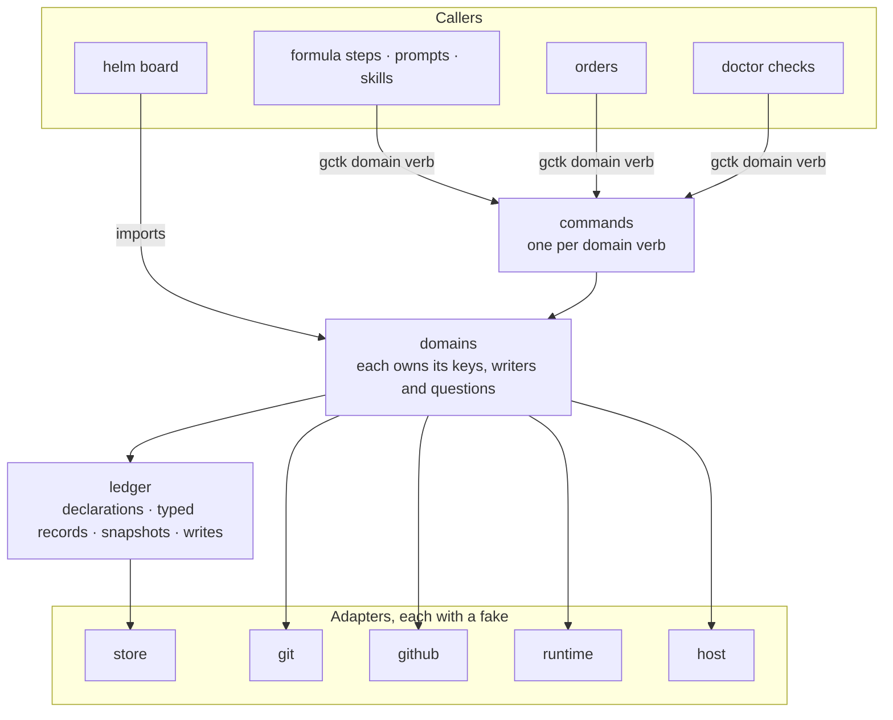

# gctk architecture

`gctk` is gc-toolkit's CLI, one Go binary
([services/gctk/README.md](../services/gctk/README.md)). The CLI is a product: a
documented interface that defends why it is shaped as it is and what each part
adds by existing. Each piece of pack logic that survives the move onto Gas City
is one verb of the form `gctk <noun> <verb>`, called by an agent, a hook or an
order. A noun is a domain. A domain owns its state, the only writers of that
state, and the questions asked about it. Every other piece of code asks the
domain's questions and never reads its keys.

## Scope

**Mandate.** The shape of gctk's code: the bar every element meets, the CLI
surface with each verb's caller class, intent and defense, the rule that names
a verb, the rule that admits an order and what an order guarantees, the code
that parallels Gas City's, the ledger, the adapters, how commands, orders,
doctor checks and the helm board compose the domains, the contract of
`bead holds`, where the one rule for what holds a bead lives, the rules
every domain move follows, and the debt where the built code falls short of
that shape.

**Boundaries.** Which pack logic survives at all is
[built-once-target.md](built-once-target.md)'s, and how a feature is
re-expressed on Gas City is the migration member that carries it. A warrant is
[warrants.md](warrants.md)'s. A command's flags, output and exit codes are its
own usage text, which the [README](../services/gctk/README.md) maps. The anchor
lifecycle is [state-machine.md](state-machine.md), and a rig check record's
lifetime and authority are in [architecture.md](architecture.md#the-boundary).
The board's UX is the Helm UX epic's. Gas City's own behavior is in
[docs/gascity/](gascity/README.md).

## The bar

- **Every element defends itself.** A verb, an order, a key or a package states
  the feature it adds over the native call it wraps, or the debt it contains
  and what retires it. An element that defends neither is cut. A caller class
  never waives the defense.
- **A feature is stated against the native call.** It names what the native
  surface cannot give, then what the element adds. The model is the ledger's
  rule for a wait edge: bd reports success for an edge that holds nothing, so
  the ledger checks the target first.
- **Debt is stated with its retirement.** It names what it compensates for and
  what retires it. The model is `pr record` and `pr reconcile` in
  [the re-implementation register](#the-re-implementation-register).
- **A warrant is cited only when [warrants.md](warrants.md) holds it.** A pack
  noun missing from that page has no warrant. A warrant whose member has not
  written it yet is cited as pending, with that member.

## Writes stay native, and pack logic reacts

- **No verb parallels a native act.** An agent writes through the native
  surface, such as `gc bd update --priority`, and never chooses between that
  and a gctk verb for the same act. A gctk verb exists where the native surface
  cannot express the act, such as a raise relative to what a bead follows, or
  an arm that names the formula its start pours.
- **Pack logic that follows a native write reacts through an order.** The
  order recomputes from durable state on its cadence, under
  [the rule that admits it](#the-rule-that-admits-an-order).
- **The order is the least the pack does after a write, not the most.** Where
  the pack owns the writer, the writer settles in the same act, as a hook, and
  the order stays as the backstop for the raw writes no writer sees. An order
  never replaces a synchronous settle the pack already performs.

## The surface

Every verb carries a caller class, agent, hook or order, and each class has a
registry that enumerates its consumers.

- **Agent.** An agent expresses one intent, and the verb carries out every step
  of it, so no agent strings together steps it could get wrong. The registry is
  this surface.
- **Hook.** Code injected into a workflow at a named place, which runs because a
  formula step, a patrol, a commit or a tool use reaches it. The registry is its
  call sites: formula steps, the doctor checks the deacon's patrol runs, and the
  git and tool-use hooks the pack installs.
- **Order.** Code the city runs on a schedule, an event or a condition. The
  registry is the orders set, and every order meets
  [the rule that admits it](#the-rule-that-admits-an-order).

Nothing callable is internal. A consumer outside these classes cannot be
enumerated, so nothing could hold its verb to the bar. The Go packages,
`waits`, the ledger and the adapters among them, are implementation beneath
the verbs, and a package that no verb of any class reaches is dead code.

A row's defense cell carries the verb's whole meaning. A verb gets a contract
section below only when no steward doc holds its semantics, and its row links
that section. `bead holds` has one, because no other doc defines what holds a
bead.

| Verb | Caller class | Intent | Defense |
|---|---|---|---|
| `gctk bead holds [--db <path>] <bead>...` | agent, hook, order | what holds each bead, in the store `--db` names or the one gc routes the first bead to: one status, the waits behind it, its own pending waits and when the last one landed, why it is in flight, its arm, and its wait edges into another store | It puts "is this blocked?" in one place, where [the census](../specs/tk-ssm8qns.2/blocked-census.md) finds 46 places deciding it by 27 rules, and it gives one consistent reading where the store's blocked mark, its close rule and its blocked listing disagree ([its contract](#the-bead-holds-contract)). A raw row read stays native, and any question about what holds a bead, or what its close waits on, is this verb. |
| `gctk bead arm <bead> --target <rig>/<pool> [--on <formula>] --reason <text>` | agent, hook | start this bead by itself once nothing holds it, on a formula | One intent over gc's lower-level sling and routing calls. Gas City keeps no launch for later ([warrants.md](warrants.md#deferred-dispatch-residual)), so the arm records one: the caller states what starts and on what, and the start performs every later step. It records the formula it pours, the one named or the target's default from the city's config, so the root each start pours carries the arm's token. It refuses an arm that could never fire or would fire wrong: a closed, dispatched or non-open bead, another arm already on it, a target with no formula, and a wait edge into another store, which bd never holds a bead on. |
| `gctk bead disarm <bead> --reason <text>` | agent, hook | stop an armed bead from starting by itself | The other half of the arm's intent. It takes the bead's dispatch lock, so once it exits 0 no start has the bead in flight and none will send it, which is what lets a stop release the bead's holds after it. |
| `gctk bead start-armed` | order | start each armed bead that nothing holds any more, exactly once, and retire the arm of a bead that closed or whose work another path delivered | Gas City slings only when asked. Its `cascade-nudge-on-blocker-close` order nudges the assignees of a closed bead's dependents and slings nothing ([warrants.md](warrants.md#deferred-dispatch-residual)). The start selects by `bd ready` with the flags Gas City renders for a pool's routed demand, so it sends what the pool would serve, and holds back the `waits-for` edges and waits into another store that bd cannot judge. It sends each arm once from Gas City's own records: `gc sling`'s exit 3 when a live workflow works the bead, and the token `arm:<bead>@<armed at>` on the root each start pours, which a start searches after an earlier attempt, so a pour whose run has ended is not made again. A root Gas City left unfinished is neither, so the start asks a person about it. Each start runs under the bead's dispatch lock, which `arm` and `disarm` take too, and the retire of a delivered bead covers the run another path poured, which carries no token ([deferred-dispatch.md](deferred-dispatch.md#exactly-once)). |
| `gctk bead park <bead> ("<text>" [--body <text>] \| --waiting-on <bead>)` | agent | hold everything under a bead that has not started behind one blocker that says why, and leave work in flight running | bd's defer holds the bead itself, and its children only while a date it names is in the future, and releases on that date or a person's undefer, never on a condition, and never one bead alone ([the search](../specs/tk-1tfzr71.226/gas-city-search.md#park-bds-deferred-status-and-its-gates)). A park composes bd's own gate: it files a plain gate titled with why the bead is parked and what releases it, born with its `blocks` edge, so bd holds the whole subtree, and closing the gate releases it. It adds what bd does not: it refuses a bead in flight, whose own edge would hold its merge and its close, finds the gate an earlier park filed under the same title, and says what the park holds and what it leaves running. |
| `gctk bead place <bead> (--under <parent> [--shift <±n>] \| --standalone) [--route <rig>/<pool>] [--on <formula>]` | agent | place a bead held for placement: its parent or none, its dispatch, then the lift of its `hold:mayor` | `gc sling` reads no hold, so a sling leaves `hold:mayor` on, and no write of Gas City's both dispatches a bead and lifts its hold ([the search](../specs/tk-1tfzr71.226/gas-city-search.md#place-gc-sling-and-the-deferred-dispatch-arm)). The verb makes the native writes in one order, each taking its exit: the route's clear, the parent, the priority, the sling or, while a wait holds the bead, the arm, then the lift with its note in one write, so a dispatch that fails leaves the bead in the queue, and a run again after a stop finishes the placement without a second run. |
| `gctk bead takeaway <bead> <text> [--waiting-on <bead>]... [--no-wait] [--release]` | agent, hook | record the one line a bead's handling concluded and whether anything still waits on it, and with `--release` stop the bead, or send it on to a pool (`--route`) or a named agent (`--assign`) | No bd field or Gas City key holds a one-line conclusion with its writer, and no primitive takes a bead out of play whole ([the search](../specs/tk-1tfzr71.220/gas-city-search.md)). bd's guarded update, Gas City's run cancel through `run-cancel.sh`, `gc sling --no-formula`, the immediate nudge and the session list each cover one part, and the verb composes them in the order that keeps a stop safe: the arm removed first, then the headline and the release in one update guarded on the status and the assignee it read, the wait edges, the run's end, then the sling. A refused guard is read again to settle which change it met: a bead closed since keeps its disposition and takes the headline alone, and any other change leaves the bead with whoever holds it now, with nothing written. A claim a live session holds is never taken, and its holder is asked to give the bead back. Each wait is a `blocks` edge, and a headline with neither a wait nor `--no-wait` reads as a hold on prose ([component-model.md](component-model.md), I1). |
| `gctk priority shift <bead> <±n>` | agent | raise or lower a bead against what it follows, and re-rank the queue, in one act | The native surface writes only an absolute priority, which carries no intent term, so the next settle reads it as drift and overwrites it. The stored shift is that term ([steering.md](steering.md#the-rule)). Its callers are sittings and the po. |
| `gctk priority settle <bead>` | hook | give a bead the priority of what it follows before anything claims or pours it | A pour copies a bead's priority once, so the bead carries its derived priority before the pour. The pack's own writers run it before they make a bead claimable: filing follow-up work, a sling, a release, and a placement. |
| `gctk priority reconcile` | order | re-settle the queued beads after raw writes no writer saw | The backstop of the shape the pack ships, ported and never replaced: the settle in the pack's writers, a rig-scoped pass every fifteen minutes that reads the queue and never the whole store, one lock per store, and the stored shift ([steering.md](steering.md#the-pass)). |
| `gctk pr summary <bead>` | agent, hook | record what the change does, for its PR's summary and title, or read the summary recorded | Gas Town's refinery fills a PR's summary from its bead's description, which is written before the work. This summary is written once the work is done, and says what the diff does. The change's subject line rides the same write as the bead's title, since the PR's title is composed from it, and a reader of a PR's text asks the verb for the summary. |
| `gctk pr compose <bead>` | hook | the PR's conventional-commit title and managed summary region, from the bead that owns it | Gas Town's refinery titles a PR with its bead's title and writes the body once, when it opens the PR. Compose puts the type prefix the repository's title check requires ahead of the title, and keeps a marked region of the body current with the summary while leaving the text people add. |
| `gctk pr record <bead> --pr <url> --head <sha> --target <branch> --refinery <address>` | hook | record the PR the bead owns as pending until its merge is verified | Gas Town's refinery keeps this record (`gastown/commands/pr-merge-reconcile`), and no gastown release the city can take carries the command. The verb writes Gas Town's two writes under the store's record lock, each guarded on the status and assignee it read, so a bead that a close or another assignment reached first gets no record, where Gas Town's unguarded second write would reopen it as blocked. The second write assigns the bead to nobody, since the refinery's work on it ends there (Gas City's meaning of an assignee, [the search](../specs/tk-1tfzr71.209/gas-city-search.md)). |
| `gctk pr reconcile --refinery <address>` | order | land the PRs on the pending record: merge a ready one with its head pinned, close its bead once the merge commit is on the target, close through the disposition writer the bead of a PR a ruling retired once the PR has closed, hand a changed head to the refinery in the write that assigns it the bead once no withdrawal and no review run holds the head, and wake the refinery for each one it can take, pour a review run for a PR open at its validated head with no passed result there or an ask a run can take, pour again a run that ended without a result and ask a person once two at one head did, mark a draft ready once the review loop has passed at its validated head, carry out the withdrawals filed on the bead, ask for the seed audit's re-render once a landing leaves the default branch's audit stale, and keep each owned PR's `status:` and `held:` labels equal to what the store derives | Gas Town's refinery reconciles one record per find-work and merges nothing. The landing order (orders/pr-reconcile.toml) runs this with no agent every minute, at the order budget the city sets ([The PR watch](refinery-merge-cadence.md#the-pr-watch)). Each run reads the store once and decides every record through that read, on the GitHub read the PR watch saved on its bead, as the displays do, so a run in which no record owes an act asks GitHub nothing and writes nothing. It reads GitHub first only for a merge, since a merge made in error puts work on the target, which no run takes back. The one-PR update re-reads the PR in full with the record lock free, and the act decides the record again under the lock on what that read saved. Every other act reads of GitHub only what it changes: a withdrawal's reads of the reviews and review threads, and a fetch of the PR's branch before a changed head goes back, since the saved read can lag a push. A withdrawal dismisses an approval only while none of its inline comments is feedback the intake has not routed, and closes only once its read of the reviews after the dismissals shows no approval standing on a commit without its head. The run pins the merge request to the head the evaluator judged on the re-read. It takes the records it decides and the PRs whose labels owe a write in a shuffled order, starts none past 45 seconds and stops each at 30, and holds the store's record lock for one act at a time, so two runs that overlap act on one record one after the other. An act that does not complete records nothing on the bead, where Gas Town's reconcile writes `pr_reconcile_error`, because the next run finds the same difference and acts on it ([the search](../specs/tk-1tfzr71.149/gas-city-search.md#what-runs-each-order-and-how-the-landing-order-starts-units-1-2-and-3)). It makes the draft cycle's ready transition, because a review run cannot tell whether the head it passed is the round's last, and it carries out a withdrawal where it reads the record, once the intake has routed the feedback a dismissal would retire. No order trigger fires on a head with no result and Gas City's PR monitor reads no review, so the run pours each review run itself, with `gc formula cook --attach` under the record lock, and reads the runs attached to a bead from its `blocks` edges onto their roots, so it re-offers one that ended without a result with no list of its own ([the search](../specs/tk-1tfzr71.108/gas-city-search.md#pouring-a-run-for-each-head-unit-4)). An assignment alone gives a running session no turn, since Gas City's demand for an open bead assigned to a session wakes only a stopped one, and its cascade nudge gives none while another blocker holds the bead, so the run wakes and nudges the refinery for each changed head it can take, because nothing holds the bead or only conversations and asks do ([deferred-dispatch.md](deferred-dispatch.md#a-named-agent-hears-through-gas-citys-hand-off), [the search](../specs/tk-1tfzr71.165/gas-city-search.md)). The run is where the city verifies a merge on its target, and Gas City's events name no merge landing on a branch, so the run checks the default branch's seed audit after a landing there, through the pack's renderer and its one re-audit writer. Nothing in Gas City, Gas Town or the github pack writes a PR's `status:` or `held:` label or keeps a retry for a failed write ([the search](../specs/tk-1tfzr71.149/gas-city-search.md#the-label-writes-and-no-record-of-one-that-failed-unit-4)), so each run compares the labels the one-PR update saved on each owned PR's bead with the ones `pr status` derives, and where they differ it has the labels' one writer, which reads the PR's labels itself, write them, reading nothing of the PR first, the comparison being the retry. |
| `gctk pr poll` | order | ask GitHub cheaply whether each PR the store's live beads own moved, and run the one-PR update for each that did | Gas City's PR monitor lists only open PRs and reads no labels, no counts of comments or reviews, no base tip and no required flag, so it misses a merge and the signs that say a PR moved, and Gas Town's reconcile reads one record's PR a call ([the search](../specs/tk-1tfzr71.149/gas-city-search.md#the-cheap-question-and-the-net-read-github-units-1-and-3)). The pass asks about each owned PR by its number, at most 50 a request with one aliased field each, so a merged PR is read too, and a pass in which nothing moved writes no bead but that of an open PR whose merge state GitHub had not yet computed. orders/pr-poll.toml runs it every minute on each rig, at the order budget the city sets ([The PR watch](refinery-merge-cadence.md#the-pr-watch)). |
| `gctk pr compare` | order | read each PR the store's live beads own in full, run the one-PR update for each part that differs from the read saved on its bead, and clear the city's labels off the PRs no live bead owns | Gas City's PR monitor lists only open PRs and reads no review decision, no review thread, no post's time and no required flag ([the search](../specs/tk-1tfzr71.149/gas-city-search.md#the-cheap-question-and-the-net-read-github-units-1-and-3)), so nothing Gas City runs sees a thread resolved, the city's reaction that answers a thread, an edit to a post that moved no sign, or a check the PR comes to require. The pass reads each owned PR by its number, at most 10 a request with one aliased field each, so each check run's required flag is read at the PR's own number, reads each list on to its end and no post's text, and writes no bead when no part differs or moved. No bead holds a PR no live bead owns, such as one whose bead closed, for the landing order to find, so the pass searches the rig's own repository for the labels' writer's labels, a page at a time until it has found 20 such PRs or the results end, and has the writer clear them. orders/pr-compare.toml runs it every hour on each rig, at the order budget the city sets ([The PR watch](refinery-merge-cadence.md#the-pr-watch)). |
| `gctk pr refresh --pr <url>` | order, hook | read the parts of a PR whose signs moved and save them on the bead that owns it | Nothing in Gas City, Gas Town, the github pack or bd keeps a PR's checks, reviews, threads or labels on the bead that owns it ([the search](../specs/tk-1tfzr71.149/gas-city-search.md#the-one-pr-update-saves-githubs-side-on-the-bead-unit-1)). The update is that read's one writer, in four parts that each keep the instant their read was sent, written once under the store's record lock and guarded on what it read, so an older read never replaces a newer one. A webhook's rule can call it for the PR an event names, as the cheap question's pass runs it for each PR that moved and the net's for each PR that differs. |
| `gctk pr draft <bead>` | agent, hook | return the PR a bead owns to draft before a writer of the city pushes onto it | Nothing in Gas City or its packs moves an open PR between draft and ready, and gh does with `gh pr ready --undo` ([the search](../specs/tk-1tfzr71.108/gas-city-search.md#the-draft-cycle-and-the-withdrawal-unit-2)). The verb reads the draft flag first and converts only a ready PR, so a round's first push returns the PR to draft, a later push changes nothing, and a retry or a person's toggle leaves the cycle to finish from where the PR stands. |
| `gctk pr withdraw <bead> --head <oid> --reason <text>` | agent | withdraw the approvals a material change leaves behind | Nothing in Gas City dismisses a GitHub review ([the search](../specs/tk-1tfzr71.108/gas-city-search.md#the-draft-cycle-and-the-withdrawal-unit-2)). Triage files the withdrawal as a bead that blocks the bead that owns the PR, so the evaluator holds the PR from the moment it is filed, and the landing order carries it out by each review's commit: it dismisses each approval given on a commit that does not contain the head, keeps every approval of the head or a later one, and asks a person through a gate when GitHub refuses. |
| `gctk pr push <bead> --held-by <conversation>` | agent | push a sitting's commits onto the branch of an open PR it edits with the operator | Gas City ships no push onto a PR's branch for the session that holds it: Gas Town's refinery pushes a PR's branch only inside its own patrol step, and its crew pushes straight to the default branch ([the search](../specs/tk-e70808f/gas-city-search.md)). The verb carries the sitting's one intent through every step of it. It proves the holding: the bead owns a PR on the pending record and waits on the conversation through the edge that holds the PR's merge, and the conversation is in progress under this session. A review run or another writer may work the branch meanwhile. It refuses a checkout whose origin fetches from or pushes to a repository other than the PR's, as git resolves the origin's URLs. It then returns the PR to draft by `pr draft`'s rule and pushes through the pack's one pusher under the lease, so a push another writer made is never overwritten. |
| `gctk pr owner <pr>` | agent, order | which bead owns this PR | Nothing in Gas City's PR concept takes a GitHub event on an open PR to the bead that owns it, and the hop is what turns a review comment into work on that bead. |
| `gctk pr status <bead>` | hook, order | where the PR stands: working, merging, needs-review or needs-attention, with each condition not met for a PR on the pending record | Nothing in Gas City gates a merge on approval or on required checks, so the pack reads both for the status label and the board. For a PR on the pending record the status renders the pr domain's evaluator over the store as it stands and the GitHub read the one-PR update saved on the PR's bead, so the verb reads no GitHub, and the label, the rig board and the landing order run one rule over the same saved read, the landing order once more over the one-PR update's re-read before a merge. A PR whose GitHub side the PR watch has not read at the head the store holds reads working until the watch's next pass. The landing order keeps the labels: each run compares the labels saved on each owned PR's bead with the ones this verb's rule gives, and writes only where they differ, so a change of any input reaches them at its next run. A pack writer that changes one of its inputs, such as a review verdict's record, also sets the label in the same act, and the merge cadence's pass walks the open beads that carry a PR in a rotation that starts no bead past the pass's deadline, writing a label only where its value changed. |
| `gctk pr post <pr>` | agent, hook | post the city's comment, review or reply on a PR, carrying the city's mark | Every agent's `gh` token is one bot account, so a post's author cannot tell the city's notice from feedback. The mark can, and this one writer owns the mark and the definition of which posts are feedback. |
| `gctk pr guard` | hook | refuse an agent's `gh` write outside the rig's own origin, or an unmarked post on it | Gas City scopes no agent's writes ([warrants.md](warrants.md#gh-write-containment)). The rule lives in the GitHub adapter, so gctk's own writes meet it, and the tool-use hook every agent carries applies it to the commands an agent types. |
| `gctk epic create <title>` | agent | file an epic with its contract, each field in its own key | bd's create checks hold no issue type to a metadata key, so nothing native refuses an epic filed with no hypothesis, which [epics.md](epics.md) makes the one hard gate on an epic. The verb refuses such an epic, files the contract in the create itself, and, under an epic, files a Delivery, which carries no contract. |
| `gctk epic unweighed [--rig <rig>]` | agent | each close and each latest shift of a rig's epics that no portfolio sync has weighed, oldest first | bd keeps only an epic's latest ruling in its keys, and its audit history keeps no ruling a read can rely on: the proxied store Gas City gives a new rig records each write with neither the row it found nor the fields it set ([the search](../specs/tk-h63alox/gas-city-search.md)). So the epic review stamps a shift's time in a key a later ruling leaves standing, the po's sync note marks each epic it weighs with the time the verb read the epics, which the verb prints first, and the verb answers each epic by its own mark, from one read of the rig's epics, leaving out each Delivery as the epic-close doctor reads one. A store that does not answer stops it, so a sync never weighs a list it could not read. Its caller is the po's portfolio sync. |
| `gctk rig test`, `lint`, `typecheck`, `setup`, `build` | agent, hook | run a rig's check and record its result at the commit, or read that record | One consistent surface that simplifies an agent's logic, caches each result at its commit, and processes every check the same way. |
| `gctk rig serve` | agent, hook | run a copy of the rig's UI from a checkout, with no address for a demo capture or at an address of its own for a person, report its state, or stop it | Gas City supervises a declared service under the supervisor's origin, one process per name, and runs no app instance from a worktree on a port of its own ([the search](../specs/tk-rymdhac/gas-city-search.md#a-copy-of-a-rigs-ui)). The verb serves both consumers on one path, running the copy as the pack's demo capture runs it, inside its sandbox for a rig whose app reads the city, and ends the copy's whole process group with the copy, at the caller's stop, or through Gas City's orphan sweep once the caller's session has ended. |
| `gctk review checks` | hook, order | which checks gate a change at a commit, with the rig's index laid over the pack's | Gas City's formula check loop runs a check script and iterates, and holds no review checks. The check index and its rig overlay are the feature. The review formula's steps read it at the reviewed commit, a lane for its own row and triage for the whole index, and the merge cadence reads it for the lanes a change needs before it dispatches them or lands the change. The loop's shape is the review-lane member's design. |
| `gctk review guidance <check>` | hook | the rig's guidance for a check at the reviewed commit, or the guidance a change edits | Part of the check index: a rig's guidance, read at the commit under review rather than the one checked out. |
| `gctk review passed <run>` | hook | whether an iteration of a review run passed: the loop's pass-or-iterate check, and with `--record` the run's result for the head and target it judged, with the asks it answered closed, at the iteration that ends the loop | The check script that a review formula's check loop runs after each round. It holds the pass rule over the lanes, their findings and rulings and the asks open on the bead, which the loop itself cannot, and reads only the store, since a check runs with no `gh`. Gas City's PR review and its PR monitor keep their reports per head SHA and record no pass on the bead that owns a PR, and a formula has no script step, so the check records the result as it ends the loop ([the search](../specs/tk-1tfzr71.108/gas-city-search.md#the-check-script-and-the-result-unit-1)). The result is the one the pr domain's evaluator counts, written under the store's record lock, and each ask closes with the work record Gas City's close reads. |
| `gctk review ask <bead> --reason <text>` | agent, hook | ask for a change on a PR's branch, or for a check at its next head | Gas City's PR monitor files a repair bead that is routed and poured as it is filed, a writer of its own ([the search](../specs/tk-1tfzr71.108/gas-city-search.md#asks-unit-1-unit-4)). An ask is a task bd files with its `blocks` edge onto the PR's bead in one create and no route, so the review run is the branch's one writer. An ask that waits on other beads (`--waiting-on`) carries its own `blocks` edge onto each in that same create, bd's `--deps blocked-by`, so no landing pass reads it clear before it waits ([the search](../specs/tk-h0sherg/gas-city-search.md)). The verb refuses a bead that owns no PR on the record and a check the index does not declare, and finds an ask of the same source and reason, open or closed, before it files, refusing one that does not wait on each bead the call names. The ledger's rule for a wait edge refuses the create, with nothing filed, when the ask's edge onto the bead or onto a bead it waits on would hold nothing: a bead of another id prefix than the store gives the ask, or one the store does not hold. |
| `gctk review step <bead>` | hook | what a review run's step judges: the iteration it runs in, the head that iteration judges and the change triage reads there, and for triage's read whether the run must stop | Gas City records a step's iteration (`gc.attempt`) and the vars a run was poured with, and says neither which head a later iteration of a check loop judges nor what changed since the last head that passed. The verb derives both from the steps' outputs and the results on the bead, and its `--stands` form stops a run whose vars do not name the bead's record, or whose PR is no longer at the head the iteration judges, with no result. |
| `gctk review output <bead> --file <path>` | hook | check the output a run's step wrote, before the step writes it | Gas City keeps a step's `gc.output_json` as written, and reads it only for a fan-out's items, so a slip shows only once the pass rule reads the output as not written, which spends an attempt, or a fan-out cannot read a triage output's checks, which stops the run. The verb checks the output in the run's shape and against the run's facts, and carries the guidance-edit guard on a correctness approve. The write stays native. |
| `gctk review comment <run>` | hook | the head's one comment: every lane's verdict there, its findings and how the round ruled each | Gas City's PR review posts one lane's report per head SHA and runs no loop ([the search](../specs/tk-1tfzr71.108/gas-city-search.md#the-runs-formulas-unit-3)), and nothing renders a loop's lanes and rulings. The comment carries every lane's verdict at the head, approvals included, and each point's answer as what the head carries for it. The post goes through `pr-post.sh`, the city's one writer of posts. |
| `gctk memory due [--limit N \| --count]` | hook | the agent memory notes due for the feedback distiller's judge, oldest first | Claude Code keeps memory notes with no lifecycle and documents no command that prints where a session's memory is ([the search](../specs/tk-zlot608.8/gas-city-search.md)). The verb asks Claude Code itself in each rig's checkout and the city's root, reads each directory against its list, which stands on its warrant ([warrants.md](warrants.md#memory-note-waits)), and hashes a note's body alone, so neither a Claude Code save nor a recorded use brings a note due. |
| `gctk memory apply <decisions>` | hook | record the judge's decision on each memory note it judged | bd's waits hold only an issue, and a note is a file ([warrants.md](warrants.md#memory-note-waits)). The verb records a note's wait or its next date on the list, keeps a dropped note's text before it removes it, acts only on the text the judge read, and takes out the pointers to a note it removed from the index and the collection notes. |
| `gctk memory settle` | hook | end each memory note's wait that is done | Nothing in Gas City ends a wait that holds a file. The verb reads the beads notes wait on through the ledger, one read per store, then one more for each pattern's follow-ups and each integration branch's landing bead it has not read, removes a note whose fix reached its repository's default branch, by the merge record and `git merge-base --is-ancestor`, an integration branch's landing bead followed, makes due a note whose wait ended with no fix, and keeps one finding through `patrol-finding.sh` for a place Claude Code names no memory directory for. |
| `gctk distiller start` | order | start the city's one feedback distiller run in the pack's home rig, the rig whose checkout holds the pack, unless one is open there | Gas City registers a pack's order once per importing rig or once for the city, and only the city's config picks the rigs an order runs in, while a formula order of city scope pours into the city's store, where a rig's pool does not reliably claim it ([the search](../specs/tk-zlot608.13/gas-city-search.md)). So the city's order runs the verb, which finds the home rig by the `pack.toml` its checkout holds and the rig's polecat pool by `gc agent list`, and slings the formula with `gc sling`, which pours the run in that rig's store. Each pass reads the rig list, the roster, each rig's `pack.toml` and the home store's live roots of the formula. It slings only while no live root Gas City stamped as a run of the formula is there, so an open run, however it was poured, holds the next. A read that does not answer, a second rig holding the pack and a pool that is not one each sling nothing. The dispatcher keeps the order's own passes apart, and `gc order run` and a start by hand pass no such gate, so the start takes a lock of its own without waiting, `distiller-start.lock` beside the dispatch locks in the city's `.gc/runtime/packs/gc-toolkit`, and holds it from before its read of the store to the sling's end. Of starts that overlap, the one that holds it reads and slings, and each other starts nothing. No other pack writer pours the formula, so every writer of a run takes that lock. |
| `gctk reaction check <bead> --run <root>` | hook | whether this run may still react to its subject | A subject's state can change between its reaction's sling and the claim of its step. Gas City retires a run whose subject closed or took an assignee before the claim and checks nothing else then, so the check, the reaction's first act, applies the sling's refusals again. |
| `gctk reaction sling <bead>` | agent, hook | sling a first reaction on a bead nobody has decided on, through the rig's proactive pool | `gc sling` pours on a bead whatever already speaks for it, such as a hold label, a human gate, an assignee or a live run of another formula. The verb refuses a bead whose next move is someone's, and leaves a second live reaction to `gc sling`'s own refusal. |
| `gctk reaction sweep [--dry-run]` | order, agent | sling a first reaction at each ready bead in the rig that nobody has decided on | Nothing in Gas City starts work on a bead nobody slung, and its work query offers only routed work, so the sweep runs on its order's cadence. Its dry run shows an agent what a sweep would take. |
| `gctk reaction dispose <bead> --disposition <exit>` | agent | take one of a first reaction's exits on its subject: route it, recommend an action, hold it on its wait, hand it to a validating closer, or put it to the operator | One intent over the native writes each exit makes. It applies intake's rule ([steering.md](steering.md)). |
| `gctk reaction accept <bead> [--var <key>=<value>]...` | agent | take a first reaction's recommendation: answer the gate that asks it and dispatch its formula at the bead, once | `gc sling` refuses a second launch of a formula at a bead only while the first root is live, and no flag of it checks an earlier root by a caller's key ([the search](../specs/tk-1tfzr71.226/gas-city-search.md#accept-gc-slings-launch-lock)). So the acceptance runs under its own lock ([warrants.md](warrants.md#accepts-lock)), titles its root with its token, which a later run searches before it slings, and records the dispatch's input on the gate, so whoever finishes an acceptance an earlier run left slings what was accepted. bd's gate resolve exits 0 on a gate already closed, so the verb reads which answer the gate took, and the first answer stands. |
| `gctk session title` | agent | give a session a title its record and its terminal show | `gc session rename` writes only the title on Gas City's record. An agent's terminal shows the name the agent's own `/rename` sets, typed into its input box, so the verb renames the session and has Gas City type `/rename <title>` into it through `gc session submit`, for Claude Code and Codex alike. |
| `gctk seed render` | hook, order | render every agent's prompt and every formula's recipe into the audit under `generated/seed-audit/` | Gas City renders one prompt or recipe on demand and keeps no copy. The audit keeps them all in the tree, so a PR's diff shows what each agent will receive. It writes only the output it owns, which is what lets an order run it. |
| `gctk seed check` | hook | whether the render is current | The pre-commit hook and a doctor check read it, so a stale audit is caught before it lands. |
| `gctk dolt reclaim` | order | reclaim each store at or over the reclaim line | The reclaim line is a store's on-disk noms size of `GC_DOLT_RECLAIM_THRESHOLD_MIB`, 2048 MiB by default, the size at which Gas City's `dolt-noms-size` doctor check warns. The supervisor runs no Dolt GC, and scheduled compaction skips a store under its commit threshold ([warrants.md](warrants.md#dolt-reclaim)). |
| `gctk doctor run --accepted <file>` | order | run gc doctor once and record the run as one event: each check that fails and since when, each the run did not measure, each the operator accepted, and each monitor order's last good run | Gas City keeps no doctor result: `gc doctor --json` prints its report and stores nothing, and the supervisor's API serves no doctor route ([the search](../specs/tk-1tfzr71.158/gas-city-search.md#the-doctor-order-gctk-doctor-run-and-its-event)). So the verb records each run with `gc event emit` as one `gc-toolkit.doctor.ran` event, and the event log is the record. It adds what no primitive does. Each failing check carries the time it first failed and its streak, the runs in a row that measured it failing, from the previous run's event, so a reader can show only what two runs found. A run that did not complete, or did not measure a check, adds to no streak and ends none, as its help says. The checks `doctor/accepted.toml` names are marked accepted, which `[doctor]` config cannot express. Each monitor's newest `order.completed` is read from the events, because the city deletes a closed order-tracking bead. It runs `gc doctor` with no `--fix` under a deadline, and writes no bead. |
| `gctk session progress` | order | find each pool seat that prints but has written nothing for three hours, and record them as one `gc-toolkit.seat-progress.stalled` event | Gas City's work ladder paces only a quiet pool seat, and nothing in Gas City reads a session's own writes ([the search](../specs/tk-1tfzr71.158/gas-city-search.md#gctk-session-progress)). The verb judges each busy pool seat by its newest write as the identity its claim is assigned to, in the claim's store and the city's, from no earlier than its last wake, and writes no bead. |
| `gctk refinery stuck` | order | find each refinery handoff that has sat unprepared past four hours with nothing holding it, and record them as one `gc-toolkit.refinery-queue.stuck` event | Gas Town's check-refinery nudges the refinery and mails a report of the queue, and doctor's `pool-idle-routed-work` reads the routed work a pool leaves, not a refinery's assigned queue ([the search](../specs/tk-1tfzr71.158/gas-city-search.md#gctk-refinery-stuck-and-gctk-mail-finding)). The verb reads each rig's queue at the identity of the refinery `gc agent list` names for that rig, asks `bead holds` what holds each handoff past the bound, and writes no bead. |
| `gctk deployment report --rig <rig> [--environment <name>]` | order | report a rig's run of failed deployments to an environment as one patrol finding in its store, and clear its situation once a deployment succeeds | Gas City reads no deployment, and bd's `bd github` syncs issues alone ([the search](../specs/tk-vkio7qb/gas-city-search.md)). GitHub keeps each deployment's status, but nothing in the city reads it, so a deployment that fails is seen only by someone who opens the host. The verb reads the environment's newest deployments in one GitHub call, decides from the newest finished one, and files, notes or clears the finding through `patrol-finding.sh`, which dedups it on its key and slings its first reaction. Its text is made from the run alone, so a pass that finds nothing new only counts on the finding. |
| `gctk mail notify --agents <names>` | order | request a turn for each named agent's session that holds unread mail no notice will tell it of | Gas City requests a recipient's turn only when the sender passes `--notify`, and the API's send and reply, which the dashboard uses, cannot ask for one ([warrants.md](warrants.md#mail-wake), and [the search](../specs/tk-qpnzxnj/gas-city-search.md)). The verb reads the sessions of the named agents that can wake, their unread mail and the notices still queued for them, and sends one wait-idle `gc session nudge` naming each new message's sender, so mail from any sender requests the turn. Its ledger keeps each message nudged for while the message stays unread, so a pass that runs again on the same mail requests no second turn. It is debt: once a Gas City release wakes a session on its mail, as gastownhall/gascity#1966 rules it will, the verb retires with its two orders. |
| `gctk version` | hook | the revision this binary was built from | The build stamps one hash over gctk's inputs, services/gctk and the root go.mod and go.sum, so a doctor check can tell whether the deployed binary is the one the checkout builds. |
| `gctk lifecycle transition <bead> --to <value>` | hook | write a bead's `merge_result` outside the pending record, with the work record a landing writes | Gas City's `bd update` writes the fields. The verb composes into that one update what `lifecycle.sh`'s callers share: the landing's work record (`gc.work_outcome`, `gc.work_commit`, `gc.work_branch`), the route and takeaway checks, and the dated-key rule. It checks no edge between values, and the doctor checks the beads after the write. |

What each noun owns:

- **`bead`:** the arm record on a bead armed to start by itself, and a bead's
  takeaway: the headline its handling concluded, who wrote it and when, and
  whether anything still waits on it, which the `takeaway` package declares.
  The takeaway's keys stand on design decision 5 of
  [the board's design](../specs/tk-1tfzr71.213/design.md) until tk-1tfzr71.216
  decides whether they retire onto the bead's notes or stay with a warrant.
  A park and a placement write only native state: a gate with its `blocks`
  edge, and a parent, a dispatch and a label's lift.
- **`priority`:** the derivation, which is a bead's shift and the computed bd
  priority of every bead that follows another, its poured workflow's included.
  The field itself is bd's. The derivation is a feature: work takes the
  priority of the epic it belongs to, a raise of specific work is a stored
  shift, and code computes both rather than a prompt. It stands on its warrant
  ([warrants.md](warrants.md#priority-following)).
- **`pr`:** a bead's PR summary, the title and managed summary region of its
  PR, Gas Town's pending-through-merge record on the bead that owns the PR,
  with the branch the bead's work is on and the store's record lock that each
  writer of the record takes, the withdrawal of the PR's approvals that triage
  files, and the GitHub read the one-PR update saves on that bead when the PR
  moves.
  The read is GitHub's facts about the PR, in four parts that each keep the
  instant their read was sent, over which the evaluator's rule decides for the
  displays and for the landing order without reading GitHub, and it holds no
  answer. It stands on its warrant
  ([warrants.md](warrants.md#saved-github-read)).
  The noun starts
  from Gas City's own PR concept. Gas Town's refinery opens a PR
  with a title and a body taken from its bead, Gas City's PR monitor and
  `gc github pr backfill` read a PR's readiness when something runs them, and
  a `gh:pr` gate resolves when its PR merges. A pr verb is only what those
  leave out.
- **`epic`:** the contract an epic is filed with, its fields' keys in
  `lifecycle/lifecycle.toml`'s `[metadata.epic_stewardship]`, and the question
  of which closes and shifts no portfolio sync has weighed, which it reads from
  the ruling's keys, the shift's time and each sync's mark there.
- **`rig`:** actions specific to, or on, the rig an agent works in. The check
  records are the first: the records under the rig clone's git common
  directory, and their copies on beads. Beside them is the record of each copy
  of the rig's UI that runs.
- **`seed`:** the rendered audit under `generated/seed-audit/`.
- **`review`:** a review run's result on the bead that owns a PR, in
  `review_results`, which the pr domain's evaluator reads through its reading
  face, and the checks an ask sends back, in `review_checks`. The check index is
  config in the pack and the rig, and what a run judged is in its steps' outputs,
  which Gas City keeps on the run's beads, in the shape the review domain
  declares and checks.
- **`memory`:** each memory directory's list, the units the judge kept with the
  bead each waits on or the day it is next due, and the text of each unit it
  removed, under the pack's state directory and keyed by the SHA-256 of the
  directory's real path. It owns no key on a bead: it reads the distiller's
  `task_kind`, `proposal_bead` and `eng_bead` read-only, and a landing through
  the pr record's reading face. Its one bead write is the patrol finding
  `memory-intake.places`, for the places Claude Code names no memory directory
  for, which it files and clears through the runtime adapter's
  `patrol-finding.sh`.
- **`distiller`:** the start's lock, `distiller-start.lock` in the city's
  `.gc/runtime/packs/gc-toolkit`, which each start holds from its read of the
  home rig's store to its sling. It reads the rig list, the roster, the
  `pack.toml` each rig's checkout holds, and the stamps Gas City writes on a
  run's root at the pour, and its one write is a sling.
- **`reaction`:** the recommendation a first reaction's `recommend` exit leaves
  for the operator's Accept, in `gc.recommended_formula`, and an acceptance's
  record: its dispatch input on the recommendation's gate, in `gc.acceptance`,
  and the dispatch it made, in `gc.recommended_formula_dispatched`. A reaction
  itself is a Gas City run of `mol-first-reaction`, and each record its exits
  leave has another owner: the human gate and the hold label are Gas City's,
  the headline is the takeaway's, and the arm is `bead`'s.
- **`doctor`:** the record of each doctor run, the `gc-toolkit.doctor.ran` event,
  which `doctor run` alone records, and the shape of its payload. The accepted
  file it reads, `doctor/accepted.toml`, is config in the pack, and a PR the
  operator approves is the ruling on each entry.
- **`session`:** the record of each seat-progress look, the
  `gc-toolkit.seat-progress.stalled` event, and the shape of its payload. A
  session's state and its title are Gas City's record and the agent's own
  terminal.
- **`refinery`:** the record of each queue look, the
  `gc-toolkit.refinery-queue.stuck` event, and the shape of its payload.
- **`deployment`:** nothing of its own. It reads each deployment from GitHub
  again on every pass, and its one bead write is the patrol finding
  `deployment.<environment>` in the rig's store, which it files, notes and
  clears through the runtime adapter's `patrol-finding.sh`.
- **`mail`:** the notify ledger, `mail-notify.json` in the city's
  `.gc/runtime/packs/gc-toolkit`, which holds each unread message its pass has
  requested a turn for, and the lock every pass holds while it reads and writes
  the ledger, `mail-notify.lock` beside it. Each message, its mailbox and its
  read mark are Gas City's, and the pass's one write outside its own files is a
  nudge.
- **`dolt`:** nothing.

What gets a verb:

- **A verb carries an intent that survives the migration onto Gas City.** An
  intent the migration retires gets no verb, because porting it would carry it
  forward. The exceptions are `bead holds`, which is the proof's and defends
  itself, and the commands gctk holds now, below.
- **A verb is wrong if its caller still needs a script** to turn its intent
  into action.
- **A migration member fixes the verbs of a feature it reshapes,** in its own
  design. The verbs above for such a noun are the intents its callers express
  today, and the member keeps the noun and what it owns.
- **Judgment gets no verb.** The synthesis of review lanes into one verdict
  stays in the review formula's step text.
- **The commands gctk holds keep their place.** `epic`, `rig`, `session` and
  `version` stand on their own rows, `pr status` is the pr noun's status verb,
  and `lifecycle` sits in the tree with its own flag parsing.

## The rule that names a verb

A term's relation to its native meaning decides its name.

- **Same meaning, same word.** A noun means what Gas City and bd mean by it, as
  `bead`, `pr`, `rig` and `dolt` do. A status value is the word the board's
  labels show for the same state, so `pr status` answers in the words its
  `status:` label shows.
- **A verb that does the whole act over a native primitive keeps its word.**
  When agents are documented onto the verb alone, no agent chooses between it
  and the primitive beneath it, so its word misleads no one. `bead arm` slings
  through `gc sling` once nothing holds the bead, and an agent that wants that
  learns only the arm.
- **A verb whose answer can differ from the native call it would be taken for
  gets a fresh word, always.** A shared word would tell an agent the two are
  one. `bd blocked` answers differently for work in flight and for a bead with
  a `waits-for` edge of its own, so the bead read is `bead holds`, a word no
  native call uses.

Each verb takes one test: is there a native call it could be mistaken for, and
could the two answers ever differ? When both hold, the verb takes a fresh word
or is cut.

## The rule that admits an order

An order is admissible only when all of these hold.

- **It converges from durable state.** Each pass recomputes from what the store
  and the files hold. Gas City's event bus is lossy by design. Recording is
  best-effort, a `bead.updated` is dropped when the write's re-read fails, a
  repeated payload is deduplicated, delivery is at least once, and an exec
  order's cursor moves before its script runs, so a failed run never sees
  those events again. So an event cuts latency and never decides.
- **It is idempotent.** It writes only where the computed state differs from
  the stored one.
- **It tolerates lag.** A consumer that reads the state before the order reacts
  is at worst mis-ordered, never wrong.
- **Every intent it must keep is stored.** Each divergence the pass must not
  flatten exists as stored data before the order ships. The priority shift is
  the model.
- **Its scan is bounded.** It reads a declared bounded set, never the whole
  store, under a per-pass call and time budget its suite asserts.
- **Its writes are guarded.** It takes one lock shared with every pack writer of
  the field it writes.

These are not admissible, and each is a synchronous hook or an adapter rule
instead:

- a value a consumer copies before any order can run. A pour copies a bead's
  priority once, so the fix is a pour and a claim that read the derived value,
  at the hook point, never an order chasing the copy;
- an external effect that must happen exactly once, except as a nudge with a
  dedup ledger;
- a write that must be refused or normalized before anyone sees it;
- logic that must see every transition.

## What an order guarantees

- **Per cadence, never per change.** Nothing may rely on an order having run
  because a write happened. Each pass recomputes from durable state, so a raw
  write is never lost, only late: by up to one cadence, plus the orders lane's
  wait, the pass's own run and any delay a loaded store adds, and the next pass
  heals it. An event can start a pass sooner but bounds nothing shorter than
  the cadence, because no write is sure to reach an order as an event. The bus
  is lossy by design, and the cache rescan that carries a bare `bd` write to
  it by default skips some changes.
- **What the city gives an order** (read at Gas City 221b1476dc10,
  2026-10-28):
  - A write through bare `bd`, an agent's or a person's, emits no event of its
    own. Gas City installs no bd hooks, and `[beads] event_hooks` changes
    nothing. Such a write reaches the bus when the controller's cache rescans
    the store, every 30 to 120 seconds by store size, or within a second from
    the journal when `[beads] ledger_feed` is `auto`, which is off by default.
    The rescan skips a change to labels alone and the close of a bead the
    cache never held.
  - The orders lane evaluates every trigger once per `[daemon]
    patrol_interval`, 30 seconds by default, and starts at most `[orders]
    max_dispatches_per_tick` cooldown, cron or event orders a pass, 4 by
    default. An event trigger is polled on that pass, never woken by its
    event.
  - An exec order receives no event payload, only its environment. A script
    that reacts to events re-reads them with `gc events --since`, as the core
    pack's own do.
- **The residual is a stated cost.** After a raw agent write, a claim can read a
  stale priority until the order reacts. Priority accepts that cost, because a
  priority orders work and gates nothing. A field where that residual is
  unacceptable cannot be kept this way at all. It needs a refusal before the
  write is visible, in an adapter or the ledger, or a pack write verb defended
  under the bar, and no such field exists today.

## The re-implementation register

Every row stands on the register: no verb parallels Gas City's logic except
where an entry here says why.

Where gctk parallels Gas City's logic, it states why it is re-implemented, keeps
the goal of staying in step with upstream, and carries the divergence risk as a
stated burden.

- **`pr record` and `pr reconcile`.** They write Gas Town's pending-through-merge
  record, with its values and their meanings
  (`gastown/commands/pr-merge-reconcile` in gascity-packs at 7f86098c04ea). They
  are re-implemented because no gastown release carries the command and the
  city imports no gastown pack. The goal is that the record stays Gas Town's,
  so a gastown release that carries the command, writes nothing on a bead that
  a close or another assignment reached first and leaves a bead someone else is
  assigned to that assignee, replaces their writes, and the pack keeps the
  readiness check and the merge request. The
  risk is that Gas Town's record changes before then, and the two drift.
- **The store adapter's compensations.** The `waits-for` error for a bead with
  a `waits-for` edge of its own and the marks read that checks bd's blocked
  listing ([The adapters](#the-adapters)) stand in for bd's own answers where
  its listing cannot give them. The goal is that every answer stays the
  store's. The risk is that the marks read repeats the query `bd blocked`
  starts from, so a change upstream to that query that the adapter does not
  follow makes the check disagree with the store.
- **The store adapter's reading of the config.** The store adapter finds a
  bead's store by its id's prefix from the city's config
  (`gc config show --json`), which prints a prefix only where the config sets
  one, a rig's folder as the config gives it, and a city name or prefix that
  `city.toml` still sets in place of the one `.gc/site.toml` binds. So it
  derives the rest of the prefixes from the store's name as Gas City's
  `DeriveBeadsPrefix` does (`internal/config/config.go`), takes a relative
  folder under the city's as `resolveRigPaths` does
  (`cmd/gc/beads_provider_lifecycle.go`), and reads the city's name and prefix
  from `.gc/site.toml` first as `applyWorkspaceIdentityBinding` does
  (`internal/config/site_binding.go`, all at gastownhall/gascity f5302d1dcf).
  It is re-implemented because no gc command names the store that holds a bead
  id, and `gc rig list --json`, which prints each store's name, prefix and
  folder as Gas City resolves them, asks the supervisor, the bead store and
  tmux for each rig's `running` flag. The goal is that Gas City names the store
  itself: the lookup moves onto a Gas City command that names the store holding
  a bead id once the city's gc carries one (tk-35lc762), and these rules go
  with it. The risk is that Gas City changes one of them first, and the lookup
  looks for a store under its old name, prefix or folder.
- **The run link.** `waits` tells which bead a live workflow run works from
  the input convoy its root names and the bead that convoy tracks, or from a
  classic molecule's issue variable, as `assets/scripts/run-lib.sh` defines
  the link and Gas City's launch lock reads it. It is re-implemented because
  Gas City serves no read of it: a run on the supervisor's run routes carries
  no bead, and its lookup of a bead's live workflows keys on a source key that
  a pour over an input convoy never stamps
  ([the search](../specs/tk-ssm8qns.11/gas-city-search.md)). The goal is that
  the link read stays the one Gas City writes, so a read Gas City adds retires
  this copy and run-lib.sh's together. The risk is that Gas City changes how a
  pour links its root to its bead and the copy, held to run-lib.sh's fixture,
  keeps reading the old link.

## The layers

Dependencies point down the figure. A domain may ask another domain's exported
questions, and the domains form no cycle. Only the ledger reaches the store,
and only an adapter reaches an outside system.

## The ledger

Every row stands on the ledger: a verb reads and writes bead state only
through it.

The ledger is the one module that turns bead rows into typed records and back.
Nothing outside it parses a metadata value or spells a key's name.

- **A key is declared once, by its owner.** A domain declares each key it owns
  in its own package, as an unexported value that names the key, its type, its
  codec and its legacy aliases. Because the value is unexported, only the
  owner's package can read or write the key, and the compiler refuses any other
  package that tries.
- **Each key is parsed once.** The declaration's codec decodes the stored value,
  whether it is a plain string, a list, a flag, or a dated value such as
  `value@oid@since`. Every reader gets the typed value from that one decode.
- **A legacy alias lives in its key's declaration.** A key that still has an
  older spelling in some store declares the alias beside its name. The ledger
  reads either spelling and writes only the current one, and the alias goes
  once no store holds it.
- **One act is one write.** A verb's change of state is one `bd update`,
  create or close, carrying every key the act sets, so the act lands whole or
  not at all. A write that exits non-zero has failed, and no caller discards
  that status. A close carries the runtime's work record, `gc.work_outcome`,
  and for work that shipped `gc.work_commit` and `gc.work_branch`, which Gas
  City's close reads and no domain owns, so the ledger sets them as part of the
  act that closes the bead.
- **A write's exit decides whether it landed.** Nothing reads a write back to
  confirm it, before an act that cannot be undone or anywhere else, so a close,
  a push, a dismissal or a sling that rests on a write goes ahead once the write
  exits 0. A degraded server can roll back a write it reported, and bd guards
  only its coordination writes, such as a claim, against that. The ledger takes
  the cost bd takes for every other write: the rare record lost that way reads
  as never written. A read that settles a race is not a read-back. bd's gate
  resolve exits 0 on a gate already closed and leaves its answer, so an
  acceptance reads which answer the gate took to tell its own from one that
  reached the gate first, and a write guarded by `--if-status` cannot stand in,
  because it writes no answer.
- **A wait edge is written only onto a bead of its own prefix that its store
  holds.** bd accepts an edge onto an id its store does not hold and reports
  success, and the edge holds nothing. bd also keeps an edge between beads of
  two id prefixes as one into another store, which holds nothing even when this
  store holds the far bead. So the ledger refuses, with nothing written, a wait
  edge onto a bead of another prefix, then reads the target in the bead's own
  store and refuses one the store does not hold. A filing (`Create`) checks
  the edge from each bead it blocks and the edge onto each bead it waits on
  against the prefix the store gives the new bead, and `AddBlocker` checks the
  blocker against the bead that waits on it. Its refusal is `ErrNotHeld`, which
  a caller tells from any other failure.
- **The key registry is generated from the declarations.** It is
  `services/gctk/key-registry.json`, and a test fails when it is stale. Each
  entry names its key, its owner, its type, its aliases and, for a pack noun,
  its warrant, and a key no domain owns yet names the packages that read it.
  A doctor check that reads the registry reads the generated one, so the
  registry cannot drift from the code. A key that shell still writes stays in
  `lifecycle/lifecycle.toml` until its writer moves or retires, and the change
  that moves a domain moves its keys out of that file and into declarations.
  Such a key has no owner package yet, so a domain that must read one declares
  it read-only in its own package, and the change that moves the key's writer
  takes that declaration over.
- **A snapshot is one pass's read.** The ledger reads, in one pass, the beads a
  question needs and every parent-child ancestor, with their dependencies and
  the store's own blocked answers, and types them through the declarations. A domain's question takes
  that snapshot and reads what it needs from it. A caller hands over a snapshot
  or bead ids, never facts it assembled, so every caller in one pass gets the
  same answer. A command builds a snapshot of the beads it names, and the
  board builds one per render. A domain that must find beads by a key, as the
  bead read finds the runs that work a bead, selects them through the ledger
  by the key's declaration, so it never spells the key.
- **A pass reads a store once.** A pass is a ledger whose every read of a bead
  answers with the row it kept when it first read that bead. Once it has read
  every live bead, it answers a selection of live beads from those rows, and
  it reads the store again only for a bead it has not read, such as a closed
  one. Every domain asked through one pass answers from one read of each
  bead, and a pass takes no write.

## The adapters

Every row stands on the adapters: a verb reaches an outside system only
through one.

There is one adapter per outside system. Only an adapter starts a process or
opens a connection, and each has a fake, so every domain rule is tested in Go
and CI runs those tests on every PR.

| Adapter | Outside system | How it reaches it | Its fake |
|---|---|---|---|
| store | the bead store | `gc bd` for writes, for reads that must see a fresh write and for the blocked set, the supervisor API for other reads | in-memory rows and edges, with the store's blocked answers set by the test, and the work-record close gate `gc bd` enforces under `GC_WORK_RECORD_ENFORCE` when a test turns it on |
| git | git | one `git` command per call, in a named directory | a scratch repository |
| github | GitHub | `gh` and the GitHub API | in-memory PRs a test sets, and recorded answers in the adapter's own tests |
| feedback | the pack's one definition of feedback, `pr-post.sh feedback-def` | jq, applying the definition as each shell reader does | answers a test sets |
| runtime | Gas City | `gc` (sling, config, session, rig, agent, doctor, events and event emit, runtime), the supervisor API (runs, sessions), the settings file Gas City starts each Claude session with, the pack's scripts that ask a person, `human-gate.sh` and `gc-helm.sh`, the one that files a patrol finding, `patrol-finding.sh`, the priority writer, `queue-priority.sh`, the subject resolver, `gc-helm.sh resolve`, the seed audit's, `render-seed-audit.sh` and `seed-audit-reaudit.sh`, the disposition writer, `bead-rehome.sh`, run as the actor a close needs, and the run's end, `run-cancel.sh`, which calls the supervisor's run cancel | recorded responses |
| claude code | Claude Code | one bounded `claude -p` per ask, run as a city session runs with its hooks off, reading the stream's init record, which then removes each directory the ask made | answers a test sets |
| host | the machine | `os/exec` and kill(2) for the processes it starts and signals, `ps` for the process table, `lsof` for a port's listeners, a dial for whether a loopback port answers, and `demo-engine-lib.sh` for a start as a demo capture runs one, inside its sandbox for a rig whose app reads the city | a machine in memory whose processes are goroutines running the programs a test names, with process groups, signals and loopback ports, on the fake clock of a `testing/synctest` bubble |

The store's rules are the store's own. The store adapter asks the store whether
a bead is blocked or ready and returns its answer, and computes none itself.
The supervisor serves the ready set but no blocked set, so the adapter reads
the blocked set through `gc bd blocked`. For a bead the store marks blocked,
the listing names the bead's own waits or, when it has none, one of its
parents. It judges a `waits-for` edge by its spawner's status rather
than by its gate, though, and bd's close rule judges it the same way. So for a
bead with a `waits-for` edge of its own, the listing can leave the bead out,
blame a parent that holds nothing, or name a spawner whose gate has opened. The
adapter finds that edge among the edges it reads with the bead, and answers
such a bead with the `waits-for` error, whatever the listing says of it.

The listing can also lose beads to a read that failed. When its read of parents
fails, `gc bd blocked` leaves out every bead held only through a parent and
still exits 0. So the adapter also reads the ids the store marks blocked,
through `gc bd sql` with the query the listing starts from, and answers a
marked bead that the listing leaves out with a read error, the error any read
that fails returns. It answers every other bead from the listing. The two reads
are not one transaction, so a bead that changes between them can get a read
error, which the next read clears. The blocked mark on the supervisor's bead
rows cannot stand in for that read, because it is Gas City's readiness answer,
which also holds a bead whose blocker closed with `gc.work_outcome=blocked`.

The marks also decide which parent holds a bead. A bead can have several
parents, and bd marks a bead blocked when any of them is marked. The listing
names one of them, the one its query for the bead's parents returns last,
which can be a parent that holds nothing. So the adapter answers a bead the
listing holds through a parent with a parent the store marks blocked: the one
the listing names when the store marks it, else the first by id that the store
marks. It answers with a read error when the store marks none of the bead's
parents.

The adapter's errors are distinct types. The `waits-for` error comes from a
bead's own edges and stands until bd's repair, and a read error says only that
one read could not answer, so a caller tells them apart by type alone.

The ledger's snapshot reads the store's listing, `gc bd list`, which names each
edge's far bead by its id and the edge's type alone: one read of the beads
named, then for each generation of ancestors one read of the far beads their
wait and parent-child edges name, so a snapshot of any number of beads costs a
few reads. `gc bd show` hydrates each far bead whole, at seconds per hundred
beads. Each record's edge carries its far bead's title, issue type, await type,
status and close time from that bead's own row, and an edge whose far bead the
read does not return is left out, as a show row leaves it out. A wait edge the
listing has and the record lacks is one into another store once a read of its
far bead finds the store does not hold it.

Every read `waits` makes names one store with bd's `--db`: the store its caller
names, or the store gc routes a read of the first bead named to. That is the
one `gc bd where` says gc resolves when its prefix begins the bead's id, and
otherwise the one whose prefix does, from the city's config (`gc config show`).
gc routes a read that names a bead and no store by the bead's prefix, and a
read that names none to the store it resolves, so unpinned reads would mix
stores: a read of a far bead in another rig would find it and hide the edge.

The compensations retire with one repair of bd. Once the bd the city runs
judges a `waits-for` edge by its gate and returns an error when its read of
parents fails (tk-ssm8qns.5), the adapter drops the `waits-for` error and the
marks read (tk-ssm8qns.6).

The adapter's own tests drive it through a stub `gc` on `PATH`, so they pin the
questions it asks. A marked bead that the stub listing leaves out gets a read
error, and a bead with a `waits-for` edge of its own gets the `waits-for` error
whether the stub listing names it or not. Its acceptance tests run the bd the
city runs against a scratch store, so they pin the answer that bd gives for
each kind of wait, each gate included, the beads it marks blocked, and the
prefix its create mints an id from. The domains' tests run on the fake.

The host adapter's own tests start real processes, so they pin what its fake
stands in for: a group that ends whole, a start that leads a session of its own
with its caller's environment, a port's listeners as `lsof` reads them, and a
start through the library that runs it as a demo capture does. A domain's tests run on its fake inside a
`testing/synctest` bubble, so a wait or a grace a rule sets passes on the
bubble's clock, and no rule's test needs a tool on the machine.

## Compositions

- **Commands.** The command tree is cobra's. Each domain verb is one command,
  `gctk <domain> <verb>`, with generated help. A command parses its flags,
  builds its domain, asks or acts, and prints the result. It holds no rule.
- **Orders.** An order runs one gctk command. An event order on `bead.closed`
  runs the verb that reacts to closes, and that verb reads the recent close
  events itself, as Gas City's own event orders do.
- **Doctor checks.** A check asks a domain's question across a store and
  reports what it finds. The check that guards a domain moves with that domain.
- **The helm board.** The board imports the domain packages and asks the same
  questions the commands ask, against one snapshot per render, so it shows what
  the loops act on. Its rig page reads each rig's store through `listing`, one
  pass that lists the store once, decodes each key the page shows through the
  listing's declarations, and answers `waits`, `prstatus` and `queue` from those
  rows. The page lists work in the order `queue` gives for the open work the
  page names, the order the work is expected to land in. Beside those rows it
  shows when GitHub was last asked about the rig's pull requests: the start of
  the newest run of the rig's `pr-poll` order that exited 0, read from Gas
  City's run history through the supervisor's API, since a pass in which
  nothing moved writes nothing to a pull request's bead. Its ranking, bands and
  grouping are its own. A question that a loop also acts on belongs to a domain,
  not to the board.

## The `bead holds` contract

`gctk bead holds` answers what holds a bead, through the `waits` package, and
the answer is the store's. Whether the bead is blocked is one question inside
it. [The census](../specs/tk-ssm8qns.2/blocked-census.md) holds the store's
rules, every place in the pack that decides that question, and where those
places disagree.

What `waits` adds over the store's answer:

- **The rule that applies, by where the work is.** Work that has not started is
  blocked while the store keeps it out of `bd ready` for a wait, its own or one
  on a parent-child ancestor. Work in flight is blocked only by its own waits,
  the ones bd refuses its close for, because a wait gates claims, not running
  work.
- **In flight, as adopted debt.** A bead is in flight by steering.md's
  definition ([In flight](steering.md#in-flight)). The test exists because a
  bead's execution state lives at once in its status, its metadata stamps and
  the position of a workflow poured for it. `waits` holds the test in one
  definition, and the test goes once execution state has one home.
- **Own or inherited.** Each answer names the waits on the bead itself, or the
  ancestor it is held through.
- **One status.** A bead is `blocked` when a wait of its own holds it, and
  `held` when only an ancestor's wait holds it and its work has not started.
  It is `unjudged` when it has a `waits-for` edge of its own. bd's listing
  cannot answer such a bead, so the adapter answers it with the `waits-for`
  error, and `waits` reads that error, and no other, as this status. Every
  caller that acts treats the edge as a wait that holds. Otherwise the bead is
  `clear`. A read that fails returns an error, never a status, and so does a
  marked bead the listing lost. A listing that misses a bead for one read
  therefore never stands as `unjudged`, and the next read clears it.

The status rests on these answers.

- **Is this bead blocked, and on what?** For work that has not started, the
  answer is the store's blocked set, which names the waits on the bead itself
  or, when it has none of its own, a parent it is held through. For work in
  flight, only the waits the store names on the bead itself count.
- **Which of its own waits are pending?** These are the waits on the bead
  itself that have not landed. A caller that asks what a bead records it waits
  on, what still holds its close, or whether its own work sits on another bead
  asks this: a takeaway's waits and its route guard, and the check that a wait
  is an edge. An ancestor's park answers none of them, because the work it
  holds is still the bead's own.
- **When did the last wait that applies to it land?** This is the latest close
  among the waits the rule for where its work is applies: its own, and for work
  that has not started each live ancestor's too. A caller that ages the time
  since nothing held a bead, as the check on owed dispatches does, reads it.

No surviving intent maps to `waits`. It exists to prove that one rule can live
in one place, so its defense is its own. `waits` computes no wait itself. It
reads the store's blocked set with the blockers the store names on each bead,
and the close times of the waits that have landed. The ancestor it names for a
held bead is the one the store's own answers lead to, parent by parent. It
never walks the graph to compute a hold and never judges a gate, so a change in
the store's rule reaches every caller at once, and the pack's use of that rule
is one package.

## The rules a domain move follows

1. **Only a surviving intent moves, and it moves whole.** The change moves the
   intent's keys, its writers, its questions and every caller, among them
   formula steps, prompts, orders, doctor checks and the board. It deletes the
   shell it replaces, keeps no test that holds two copies equal, and shows its
   net in the PR's size line.
2. **Dependencies point down.** Commands, orders, doctor checks and the board
   depend on domains. Domains depend on the ledger, on adapters and on other
   domains' exported questions. The ledger depends on the store adapter.
   Adapters depend on nothing else in gctk. A Go test fails an import that
   points up or closes a cycle.
3. **An owner gathers its own inputs.** A question takes bead ids or a
   snapshot, never facts the caller assembled.
4. **Each power is one verb.** Each power [authority-map.md](authority-map.md)
   grants to a moved domain is one exported verb on its owner, and the map
   names that verb as the holder.
5. **Each rule is tested in Go.** Every rule has a Go test against the fakes,
   and CI runs gctk's and helm's Go tests on every PR.
6. **A key's name appears once.** No script, formula, prompt, doctor check or
   other package spells a key a domain declares.
7. **Retiring code gets no new work.** A domain move does not reach into code
   the deletion plan retires
   ([built-once-target.md](built-once-target.md#the-rules), rule 1). A caller
   there is replaced by the member that retires it, and that member's
   replacement asks the domain. The one exception is a shared shell definition
   that the move deletes. Each of its call sites swaps onto the domain in the
   same change, in retiring code too, and nothing else there changes.

## Debt

Each entry is a place where the built code falls short of the layers above,
why a reader must know it, and the work that retires it.

- **`gctk pr status` reads around the ledger.** Its command builds the store
  that `prstatus` reads over the store adapter and gathers the PR's facts
  itself (`internal/cli/prstatus.go`), and `prstatus` spells the keys it
  reads, so the key registry does not show it reading them. For the same
  reason `listing` hands `prstatus` each record's metadata whole, as the
  ledger renders it. A new pr verb takes neither shape. `prstatus` moves under
  the pr domain, onto the ledger, with the GitHub-intake member
  (tk-1tfzr71.21), which rewrites its facts off the posture.
- **The pr domain reads which posts are feedback through the pack's shell.**
  Its evaluator asks the feedback adapter, which runs `pr-post.sh feedback-def`
  through jq, because that script holds the one definition every reader of
  feedback applies. The move of the city's PR posts into gctk (tk-ssm8qns.8)
  brings the definition into the pr domain, whose post verb owns it, and the
  adapter goes.
- **`epic create`, `session title` and `rig`'s checks start processes outside
  an adapter.** `epic create` files the epic with its own `gc bd create`,
  `session title` runs `gc session rename` and `gc session submit`, and the
  rig domain runs a check's command itself.
  `epic create` and `session title` also read beads through the store adapter,
  around the ledger. The runtime adapter's `Runtime` (`internal/gascity`)
  holds no session rename or submit, and the host adapter only what a copy of
  a rig's UI needs, so the tests of these verbs stub `gc` on `PATH` or run
  real processes, and none of these verbs is the model for a new one.
  tk-ssm8qns.16 puts them behind the ledger and the adapters.
- **Readers outside the `bead` domain read the arm's keys.** The arm's record
  (`services/gctk/arm/record`) declares the arm's keys and is their one writer,
  but the scripts, doctor checks and skills that read an arm still read its
  keys themselves, `dispatch-path.sh`'s dispatch path and `check-po-queue-only`
  among them, against rules 1 and 6. The arm is a residual under its warrant
  ([warrants.md](warrants.md#deferred-dispatch-residual)): Gas City's fix for a
  launch that waits on its input bead retires the arm, and a migration of its
  readers built now would be rebuilt then. The operator ruled this exception in
  conversation tk-au9jrqt. It retires with the arm.
- **`lifecycle` writes the store through its adapter, around the ledger.** It
  is the plain write `lifecycle.sh` execs for the direct landing
  (`direct-merge-push.sh`), `pr-facts.sh` and `gate-ensure.sh`, which name the
  keys it writes, so no domain declares them. tk-ssm8qns.16, which puts the
  other commands that read the store around the ledger behind it, carries this
  one too.
- **Shell still reads and clears the recommendation `reaction` owns.**
  `gc.recommended_formula` is declared in `reaction`, whose `recommend` exit is
  its one setter and whose accept clears it, but
  `converse-invalidate-recommendation.sh` clears it and `converse-signoff.sh`
  reads it and `gc.recommended_formula_dispatched`, each spelling the keys,
  against rules 1 and 6, so the keys stay registered in
  `lifecycle/lifecycle.toml`. tk-ssm8qns.23 moves those reads and clears onto
  the domain, and the keys' entries in `lifecycle/lifecycle.toml` go with the
  last of them.
- **Shell still reads the takeaway's keys.** `gc.takeaway` and the keys beside
  it are declared in `takeaway`, whose `bead takeaway` writes them, but shell
  reads them itself, spelling each key, against rules 1 and 6:
  `bead-context.sh`, the `converse-recheck-premise` skill's close,
  `doctor/check-claim-advancing` and `doctor/check-root-advancing`, which count
  a headline as a hold on purpose, `doctor/check-wait-is-an-edge`, which reads
  the headline as a hold marker through `lifecycle/lifecycle.toml`'s `[holds]`,
  and the liveness recheck, which tk-1tfzr71.174 retires. The keys are also
  written by `gctk lifecycle --takeaway`, for `pr-facts.sh`, which the
  GitHub-intake member (tk-1tfzr71.21) retires. So the keys stay registered in
  `lifecycle/lifecycle.toml`. tk-1tfzr71.216
  decides whether the keys retire onto the bead's notes or stay with a warrant,
  and that decision moves these reads onto the domain or retires them with the
  keys.
