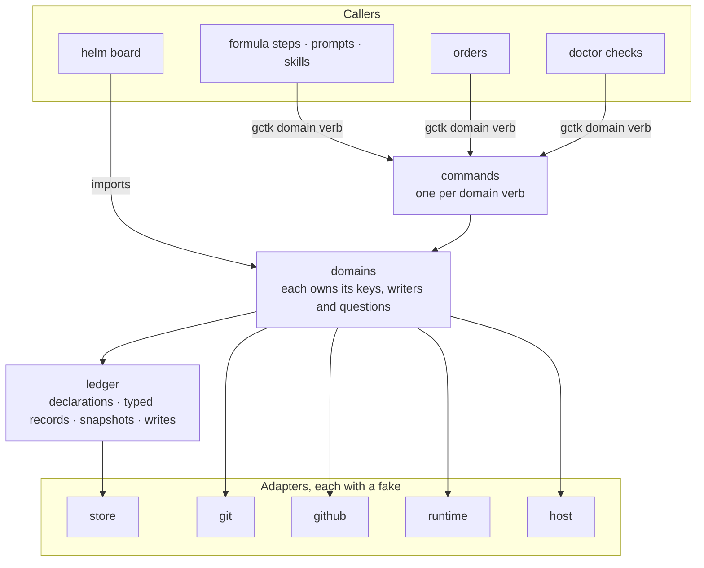

# gctk architecture

`gctk` is gc-toolkit's CLI, one Go binary
([services/gctk/README.md](../services/gctk/README.md)). The CLI is a product: a
documented interface that defends why it is shaped as it is and what each part
adds by existing. Each piece of pack logic that survives the move onto Gas City
is one verb of the form `gctk <noun> <verb>`, called by an agent, a hook or an
order. A noun is a domain. A domain owns its state, the only writers of that
state, and the questions asked about it. Every other piece of code asks the
domain's questions and never reads its keys.

## Scope

**Mandate.** The shape of gctk's code: the bar every element meets, the CLI
surface with each verb's caller class, intent and defense, the rule that names
a verb, the rule that admits an order and what an order guarantees, the code
that parallels Gas City's, the ledger, the adapters, how commands, orders,
doctor checks and the helm board compose the domains, the contract of
`bead holds`, where the one rule for what holds a bead lives, and the rules
every domain move follows.

**Boundaries.** Which pack logic survives at all is
[built-once-target.md](built-once-target.md)'s, and how a feature is
re-expressed on Gas City is the migration member that carries it. A warrant is
[warrants.md](warrants.md)'s. A command's flags, output and exit codes are its
own usage text, which the [README](../services/gctk/README.md) maps. The anchor
lifecycle is [state-machine.md](state-machine.md), and a rig check record's
lifetime and authority are in [architecture.md](architecture.md#the-boundary).
The board's UX is the Helm UX epic's. Gas City's own behavior is in
[docs/gascity/](gascity/README.md).

## The bar

- **Every element defends itself.** A verb, an order, a key or a package states
  the feature it adds over the native call it wraps, or the debt it contains
  and what retires it. An element that defends neither is cut. A caller class
  never waives the defense.
- **A feature is stated against the native call.** It names what the native
  surface cannot give, then what the element adds. The model is the ledger's
  rule for a wait edge: bd reports success for an edge that holds nothing, so
  the ledger checks the target first.
- **Debt is stated with its retirement.** It names what it compensates for and
  what retires it. The model is `lifecycle` and `merge` in
  [the re-implementation register](#the-re-implementation-register).
- **A warrant is cited only when [warrants.md](warrants.md) holds it.** A pack
  noun missing from that page has no warrant. A warrant whose member has not
  written it yet is cited as pending, with that member.

## Writes stay native, and pack logic reacts

- **No verb parallels a native act.** An agent writes through the native
  surface, such as `gc bd update --priority`, and never chooses between that
  and a gctk verb for the same act. A gctk verb exists where the native surface
  cannot express the act, such as a raise relative to what a bead follows, or
  an arm that names the formula its start pours.
- **Pack logic that follows a native write reacts through an order.** The
  order recomputes from durable state on its cadence, under
  [the rule that admits it](#the-rule-that-admits-an-order).
- **The order is the least the pack does after a write, not the most.** Where
  the pack owns the writer, the writer settles in the same act, as a hook, and
  the order stays as the backstop for the raw writes no writer sees. An order
  never replaces a synchronous settle the pack already performs.

## The surface

Every verb carries a caller class, agent, hook or order, and each class has a
registry that enumerates its consumers.

- **Agent.** An agent expresses one intent, and the verb carries out every step
  of it, so no agent strings together steps it could get wrong. The registry is
  this surface.
- **Hook.** Code injected into a workflow at a named place, which runs because a
  formula step, a patrol, a commit or a tool use reaches it. The registry is its
  call sites: formula steps, the doctor checks the deacon's patrol runs, and the
  git and tool-use hooks the pack installs.
- **Order.** Code the city runs on a schedule, an event or a condition. The
  registry is the orders set, and every order meets
  [the rule that admits it](#the-rule-that-admits-an-order).

Nothing callable is internal. A consumer outside these classes cannot be
enumerated, so nothing could hold its verb to the bar. The Go packages,
`waits`, the ledger and the adapters among them, are implementation beneath
the verbs, and a package that no verb of any class reaches is dead code.

A row's defense cell carries the verb's whole meaning. A verb gets a contract
section below only when no steward doc holds its semantics, and its row links
that section. `bead holds` has one, because no other doc defines what holds a
bead.

| Verb | Caller class | Intent | Defense |
|---|---|---|---|
| `gctk bead holds <bead>...` | agent, hook, order | what holds each bead: one status, the waits behind it, its own pending waits and when the last one landed, its arm, and its wait edges into another store | It puts "is this blocked?" in one place, where [the census](../specs/tk-ssm8qns.2/blocked-census.md) finds 46 places deciding it by 27 rules, and it gives one consistent reading where the store's blocked mark, its close rule and its blocked listing disagree ([its contract](#the-bead-holds-contract)). A raw row read stays native, and any question about what holds a bead, or what its close waits on, is this verb. |
| `gctk bead arm <bead>` | agent, hook | start this bead by itself once nothing holds it, on a formula if one is named | One intent over gc's lower-level sling and routing calls. The caller states what starts and on what, and the machinery performs every later step. |
| `gctk bead disarm <bead>` | agent, hook | stop an armed bead from starting by itself | The other half of the arm's intent. |
| `gctk bead start-armed` | order | start each armed bead that nothing holds any more: sling one armed for a pool, or send its notice to the named agent one is assigned to | Gas City slings only when asked. Its `cascade-nudge-on-blocker-close` order nudges the assignees of a closed bead's dependents and slings nothing ([warrants.md](warrants.md#deferred-dispatch-residual)). A notice takes cascade-nudge's shape with a dedup ledger. A sling rests on a mark on the arm, which lands first, unproven, in one write with the attempt count. A sling that fails takes the mark off in one write, so the next pass tries again. One that returns makes the mark proven before the arm is cleared, so a pass that finds a proven mark clears the arm without a sling, and one that finds an unproven mark slings again ([deferred-dispatch.md](deferred-dispatch.md#what-performs-it)). That leaves one window, a sling that lands before its mark is proven, where the next pass slings a second time. A pass that dies after the sling lands and before the proven mark opens it, and so does a sling that fails after it lands. Gas City's per-bead launch lock refuses a second pour of a graph.v2 formula while the first run is live, and the rest of the window is debt the deferred-dispatch member (tk-1tfzr71.16) retires in its design of this order. |
| `gctk bead dispose-resolved` | order | close each open, unassigned bead whose `until` targets have all closed, with a pointer to what resolved it | An `until` edge closes nothing in bd or Gas City ([warrants.md](warrants.md#deferred-dispatch-residual)). Gas City's own `convoy-autoclose-backstop` order is the precedent: a close that follows from durable state, recomputed each pass. |
| `gctk priority shift <bead> <±n>` | agent | raise or lower a bead against what it follows, and re-rank the queue, in one act | The native surface writes only an absolute priority, which carries no intent term, so the next settle reads it as drift and overwrites it. The stored shift is that term ([steering.md](steering.md#the-rule)). Its callers are sittings and the board. |
| `gctk priority settle <bead>` | hook | give a bead the priority of what it follows before anything claims or pours it | A pour copies a bead's priority once, so the bead carries its derived priority before the pour. The pack's own writers run it before they make a bead claimable: filing follow-up work, a sling, a release, and the board's priority verb. |
| `gctk priority reconcile` | order | re-settle the queued beads after raw writes no writer saw | The backstop of the shape the pack ships, ported and never replaced: the settle in the pack's writers, a rig-scoped pass every fifteen minutes that reads the queue and never the whole store, one lock per store, and the stored shift ([steering.md](steering.md#the-pass)). |
| `gctk pr summary <bead>` | agent, hook | record what the change does, for its PR's summary | Gas Town's refinery fills a PR's summary from its bead's description, which is written before the work. This summary is written once the work is done, and says what the diff does. |
| `gctk pr compose <bead>` | hook | the PR's conventional-commit title and managed summary region, from the bead that owns it | Gas Town's refinery titles a PR with its bead's title and writes the body once, when it opens the PR. Compose puts the type prefix the repository's title check requires ahead of the title, and keeps a marked region of the body current with the summary while leaving the text people add. |
| `gctk pr owner <pr>` | agent, order | which bead owns this PR | Nothing in Gas City's PR concept takes a GitHub event on an open PR to the bead that owns it, and the hop is what turns a review comment into work on that bead. |
| `gctk pr status <bead>` | hook, order | where the PR stands: working, needs-review or needs-attention | Nothing in Gas City gates a merge on approval or on required checks, so the pack reads both for the status label and the board. A pack writer that changes one of its inputs, opening the PR or recording a review verdict, sets the label in the same act. The order is the backstop: the merge cadence's pass walks the open beads that carry a PR, a set bounded by the open PRs, in a rotation that starts no bead past the pass's deadline, and writes a label only where its value changed. |
| `gctk pr post <pr>` | agent, hook | post the city's comment, review or reply on a PR, carrying the city's mark | Every agent's `gh` token is one bot account, so a post's author cannot tell the city's notice from feedback. The mark can, and this one writer owns the mark and the definition of which posts are feedback. |
| `gctk pr guard` | hook | refuse an agent's `gh` write outside the rig's own origin, or an unmarked post on it | Gas City scopes no agent's writes ([warrants.md](warrants.md#gh-write-containment)). The rule lives in the GitHub adapter, so gctk's own writes meet it, and the tool-use hook every agent carries applies it to the commands an agent types. |
| `gctk rig test`, `lint`, `typecheck`, `setup`, `build` | agent, hook | run a rig's check and record its result at the commit, or read that record | One consistent surface that simplifies an agent's logic, caches each result at its commit, and processes every check the same way. |
| `gctk review checks` | hook, order | which checks gate a change at a commit, with the rig's index laid over the pack's | Gas City's formula check loop runs a check script and iterates, and holds no review checks. The check index and its rig overlay are the feature. The review formula's steps read it at the reviewed commit, a lane for its own row and triage for the whole index, and the merge cadence reads it for the lanes a change needs before it dispatches them or lands the change. The loop's shape is the review-lane member's design. |
| `gctk review guidance <check>` | hook | the rig's guidance for a check at the reviewed commit | Part of the check index: a rig's guidance, read at the commit under review rather than the one checked out. |
| `gctk review passed <bead>` | hook | whether every lane has passed at the head: the loop's pass-or-iterate check | The check script that a review formula's check loop runs after each round. It holds the pass rule over the lanes, which the loop itself cannot. |
| `gctk quota-park nudge` | order | nudge each live session parked at a provider's limit banner, backing off per session and telling a person once an episode | Nothing in Gas City wakes a live session idle under a limit banner ([warrants.md](warrants.md#quota-park-nudging)). A nudge costs a busy or still-blocked agent nothing, and the pass polls rather than trusting the banner's reset time, because quota returns by routes no banner predicts. The standing revisit of its cadence, backoff and scope is tk-vtnyw8d. |
| `gctk quota-park status <session>` | hook | whether this session is parked on a provider limit | The patrols read it, rather than the session's pane, before they warrant a session. |
| `gctk seed render` | hook, order | render every agent's prompt and every formula's recipe into the audit under `generated/seed-audit/` | Gas City renders one prompt or recipe on demand and keeps no copy. The audit keeps them all in the tree, so a PR's diff shows what each agent will receive. It writes only the output it owns, which is what lets an order run it. |
| `gctk seed check` | hook | whether the render is current | The pre-commit hook and a doctor check read it, so a stale audit is caught before it lands. |
| `gctk dolt reclaim` | order | reclaim each store at or over the reclaim line | The reclaim line is a store's on-disk noms size of `GC_DOLT_RECLAIM_THRESHOLD_MIB`, 2048 MiB by default, the size at which Gas City's `dolt-noms-size` doctor check warns. The supervisor runs no Dolt GC, and scheduled compaction skips a store under its commit threshold ([warrants.md](warrants.md#dolt-reclaim)). |
| `gctk version` | hook | the revision this binary was built from | The build stamps the module's subtree hash, so a doctor check can tell whether the deployed binary is the one the checkout builds. |
| `gctk lifecycle`, `gctk merge` | hook | the anchor state machine and the pack's merge rule | Debt, in [the re-implementation register](#the-re-implementation-register). |

What each noun owns:

- **`bead`:** the arm record on a bead armed to start by itself, and the mark on
  a bead being disposed.
- **`priority`:** the derivation, which is a bead's shift and the computed bd
  priority of every bead that follows another, its poured workflow's included.
  The field itself is bd's. The derivation is a feature: work takes the
  priority of the epic it belongs to, a raise of specific work is a stored
  shift, and code computes both rather than a prompt. It stands on its warrant
  ([warrants.md](warrants.md#priority-following)).
- **`pr`:** a bead's PR summary, and the title and managed summary region of its
  PR. It starts from Gas City's own PR concept. Gas Town's refinery opens a PR
  with a title and a body taken from its bead, Gas City's PR monitor and
  `gc github pr backfill` read a PR's readiness when something runs them, and
  a `gh:pr` gate resolves when its PR merges. A pr verb is only what those
  leave out.
- **`rig`:** actions specific to, or on, the rig an agent works in. The check
  records are the first: the records under the rig clone's git common
  directory, and their copies on beads.
- **`quota-park`:** the nudge episode of each parked session, under the city's
  runtime directory.
- **`seed`:** the rendered audit under `generated/seed-audit/`.
- **`review` and `dolt`:** nothing. The check index is config in the pack and
  the rig.

What gets a verb:

- **A verb carries an intent that survives the migration onto Gas City.** An
  intent the migration retires gets no verb, because porting it would carry it
  forward. The exceptions are `bead holds`, which is the proof's and defends
  itself, and the commands gctk holds now, below.
- **A verb is wrong if its caller still needs a script** to turn its intent
  into action.
- **A migration member fixes the verbs of a feature it reshapes,** in its own
  design. The verbs above for such a noun are the intents its callers express
  today, and the member keeps the noun and what it owns.
- **Judgment gets no verb.** The synthesis of review lanes into one verdict
  stays in the review formula's step text.
- **The commands gctk holds now keep their place.** `rig` and `version` stay,
  `pr-status` becomes `pr status`, and `lifecycle` and `merge` join the tree
  unchanged.

## The rule that names a verb

A term's relation to its native meaning decides its name.

- **Same meaning, same word.** A noun means what Gas City and bd mean by it, as
  `bead`, `pr`, `rig` and `dolt` do. A status value is the word the board's
  labels show for the same state, so `pr status` answers in the words its
  `status:` label shows.
- **A verb that does the whole act over a native primitive keeps its word.**
  When agents are documented onto the verb alone, no agent chooses between it
  and the primitive beneath it, so its word misleads no one. `bead arm` slings
  through `gc sling` once nothing holds the bead, and an agent that wants that
  learns only the arm.
- **A verb whose answer can differ from the native call it would be taken for
  gets a fresh word, always.** A shared word would tell an agent the two are
  one. `bd blocked` answers differently for work in flight and for a bead with
  a `waits-for` edge of its own, so the bead read is `bead holds`, a word no
  native call uses.

Each verb takes one test: is there a native call it could be mistaken for, and
could the two answers ever differ? When both hold, the verb takes a fresh word
or is cut.

## The rule that admits an order

An order is admissible only when all of these hold.

- **It converges from durable state.** Each pass recomputes from what the store
  and the files hold. Gas City's event bus is lossy by design. Recording is
  best-effort, a `bead.updated` is dropped when the write's re-read fails, a
  repeated payload is deduplicated, delivery is at least once, and an exec
  order's cursor moves before its script runs, so a failed run never sees
  those events again. So an event cuts latency and never decides.
- **It is idempotent.** It writes only where the computed state differs from
  the stored one.
- **It tolerates lag.** A consumer that reads the state before the order reacts
  is at worst mis-ordered, never wrong.
- **Every intent it must keep is stored.** Each divergence the pass must not
  flatten exists as stored data before the order ships. The priority shift is
  the model.
- **Its scan is bounded.** It reads a declared bounded set, never the whole
  store, under a per-pass call and time budget its suite asserts.
- **Its writes are guarded.** It takes one lock shared with every pack writer of
  the field it writes.

These are not admissible, and each is a synchronous hook or an adapter rule
instead:

- a value a consumer copies before any order can run. A pour copies a bead's
  priority once, so the fix is a pour and a claim that read the derived value,
  at the hook point, never an order chasing the copy;
- an external effect that must happen exactly once, except as a nudge with a
  dedup ledger;
- a write that must be refused or normalized before anyone sees it;
- logic that must see every transition.

## What an order guarantees

- **Per cadence, never per change.** Nothing may rely on an order having run
  because a write happened. Each pass recomputes from durable state, so a raw
  write is never lost, only late: by up to one cadence, plus the orders lane's
  wait, the pass's own run and any delay a loaded store adds, and the next pass
  heals it. An event can start a pass sooner but bounds nothing shorter than
  the cadence, because no write is sure to reach an order as an event. The bus
  is lossy by design, and the cache rescan that carries a bare `bd` write to
  it by default skips some changes.
- **What the city gives an order** (read at Gas City 221b1476dc10,
  2026-10-28):
  - A write through bare `bd`, an agent's or a person's, emits no event of its
    own. Gas City installs no bd hooks, and `[beads] event_hooks` changes
    nothing. Such a write reaches the bus when the controller's cache rescans
    the store, every 30 to 120 seconds by store size, or within a second from
    the journal when `[beads] ledger_feed` is `auto`, which is off by default.
    The rescan skips a change to labels alone and the close of a bead the
    cache never held.
  - The orders lane evaluates every trigger once per `[daemon]
    patrol_interval`, 30 seconds by default, and starts at most `[orders]
    max_dispatches_per_tick` cooldown, cron or event orders a pass, 4 by
    default. An event trigger is polled on that pass, never woken by its
    event.
  - An exec order receives no event payload, only its environment. A script
    that reacts to events re-reads them with `gc events --since`, as the core
    pack's own do.
- **The residual is a stated cost.** After a raw agent write, a claim can read a
  stale priority until the order reacts. Priority accepts that cost, because a
  priority orders work and gates nothing. A field where that residual is
  unacceptable cannot be kept this way at all. It needs a refusal before the
  write is visible, in an adapter or the ledger, or a pack write verb defended
  under the bar, and no such field exists today.

## The re-implementation register

Every row stands on the register: no verb parallels Gas City's logic except
where an entry here says why.

Where gctk parallels Gas City's logic, it states why it is re-implemented, keeps
the goal of staying in step with upstream, and carries the divergence risk as a
stated burden.

- **`lifecycle` and `merge`.** They carry the anchor state machine and the
  pack's merge rule. They are re-implemented because the city runs the pack's
  own refinery and imports no Gas Town pack, so Gas Town's refinery flow does
  not run here. The goal is that the states they record stay the ones Gas
  Town's refinery records, so that moving merging onto that flow under
  GitHub's branch rules retires them (tk-1tfzr71.20). The risk is that a change
  to Gas Town's refinery flow does not reach the pack's refinery before then, so
  the two drift. They gain nothing new.
- **The store adapter's compensations.** The `waits-for` error for a bead with
  a `waits-for` edge of its own and the marks read that checks bd's blocked
  listing ([The adapters](#the-adapters)) stand in for bd's own answers where
  its listing cannot give them. The goal is that every answer stays the
  store's. The risk is that the marks read repeats the query `bd blocked`
  starts from, so a change upstream to that query that the adapter does not
  follow makes the check disagree with the store.

## The layers

Dependencies point down the figure. A domain may ask another domain's exported
questions, and the domains form no cycle. Only the ledger reaches the store,
and only an adapter reaches an outside system.

## The ledger

Every row stands on the ledger: a verb reads and writes bead state only
through it.

The ledger is the one module that turns bead rows into typed records and back.
Nothing outside it parses a metadata value or spells a key's name.

- **A key is declared once, by its owner.** A domain declares each key it owns
  in its own package, as an unexported value that names the key, its type, its
  codec and its legacy aliases. Because the value is unexported, only the
  owner's package can read or write the key, and the compiler refuses any other
  package that tries.
- **Each key is parsed once.** The declaration's codec decodes the stored value,
  whether it is a plain string, a list, a flag, or a dated value such as
  `value@oid@since`. Every reader gets the typed value from that one decode.
- **A legacy alias lives in its key's declaration.** A key that still has an
  older spelling in some store declares the alias beside its name. The ledger
  reads either spelling and writes only the current one, and the alias goes
  once no store holds it.
- **One act is one write.** A verb's change of state is one `bd update`,
  create or close, carrying every key the act sets, so the act lands whole or
  not at all. A write that exits non-zero has failed, and no caller discards
  that status.
- **A write is read back before an act that cannot be undone.** When a close,
  a push, a dismissal or a sling rests on a write, the ledger re-reads the
  written keys from the store itself, never from the supervisor's cache, which
  can lag a fresh write, and refuses the act on a mismatch. This rests on bd's
  write durability gap, whose warrant is pending: the read-back member
  (tk-1tfzr71.11) records it. An ordinary write that no such act rests on is not
  read back, since bd's exit status is honest for it.
- **A wait edge is written only onto a bead its store holds.** bd accepts an
  edge onto an id its store does not hold and reports success, and the edge
  holds nothing. So the ledger reads the target in the bead's own store first,
  and refuses the write when the store does not hold it.
- **The key registry is generated from the declarations.** Each entry names
  its key, its owner, its type, its aliases and, for a pack noun, its warrant.
  A doctor check that reads the registry reads the generated one, so the
  registry cannot drift from the code. A key that shell still writes stays in
  `lifecycle/lifecycle.toml` until its writer moves or retires, and the change
  that moves a domain moves its keys out of that file and into declarations.
  Such a key has no owner package yet, so a domain that must read one declares
  it read-only in its own package, and the change that moves the key's writer
  takes that declaration over.
- **A snapshot is one pass's read.** The ledger reads, in one pass, the beads a
  question needs, with their dependencies and the store's own blocked and ready
  answers, and types them through the declarations. A domain's question takes
  that snapshot and reads what it needs from it. A caller hands over a snapshot
  or bead ids, never facts it assembled, so every caller in one pass gets the
  same answer. A command builds a snapshot of the beads it names, and the
  board builds one per render.

## The adapters

Every row stands on the adapters: a verb reaches an outside system only
through one.

There is one adapter per outside system. Only an adapter starts a process or
opens a connection, and each has a fake, so every domain rule is tested in Go
and CI runs those tests on every PR.

| Adapter | Outside system | How it reaches it | Its fake |
|---|---|---|---|
| store | the bead store | `gc bd` for writes and for reads that must see a fresh write, the supervisor API for other reads | in-memory rows and edges, with the store's blocked and ready answers set by the test |
| git | git | one `git` command per call, in a named directory | a scratch repository |
| github | GitHub | `gh` and the GitHub API | recorded responses |
| runtime | Gas City | `gc` (sling, session, events, runtime) and the supervisor API (runs, sessions) | recorded responses |
| host | the machine | tmux, files and the clock | in-memory files, a fixed clock and scripted panes |

The store's rules are the store's own. The store adapter asks the store whether
a bead is blocked or ready and returns its answer, and computes none itself.
The supervisor serves the ready set but no blocked set, so the adapter reads
the blocked set through `gc bd blocked`. For a bead the store marks blocked,
the listing names the bead's own waits or, when it has none, the parent it is
held through. It judges a `waits-for` edge by its spawner's status rather
than by its gate, though, and bd's close rule judges it the same way. So for a
bead with a `waits-for` edge of its own, the listing can leave the bead out,
blame a parent that holds nothing, or name a spawner whose gate has opened. The
adapter finds that edge among the edges it reads with the bead, and answers
such a bead with the `waits-for` error, whatever the listing says of it.

The listing can also lose beads to a read that failed. When its read of parents
fails, `gc bd blocked` leaves out every bead held only through a parent and
still exits 0. So the adapter also reads the ids the store marks blocked,
through `gc bd sql` with the query the listing starts from, and answers a
marked bead that the listing leaves out with a read error, the error any read
that fails returns. It answers every other bead from the listing. The two reads
are not one transaction, so a bead that changes between them can get a read
error, which the next read clears. The blocked mark on the supervisor's bead
rows cannot stand in for that read, because it is Gas City's readiness answer,
which also holds a bead whose blocker closed with `gc.work_outcome=blocked`.

The adapter's errors are distinct types. The `waits-for` error comes from a
bead's own edges and stands until bd's repair, and a read error says only that
one read could not answer, so a caller tells them apart by type alone.

The compensations retire with one repair of bd. Once the bd the city runs
judges a `waits-for` edge by its gate and returns an error when its read of
parents fails (tk-ssm8qns.5), the adapter drops the `waits-for` error and the
marks read (tk-ssm8qns.6).

The adapter's own tests drive it through a stub `gc` on `PATH`, so they pin the
questions it asks. A marked bead that the stub listing leaves out gets a read
error, and a bead with a `waits-for` edge of its own gets the `waits-for` error
whether the stub listing names it or not. Its acceptance test runs the bd the
city runs against a scratch store, so it pins the answer that bd gives for each
kind of wait, each gate included, and the beads it marks blocked. The domains'
tests run on the fake.

## Compositions

- **Commands.** The command tree is cobra's. Each domain verb is one command,
  `gctk <domain> <verb>`, with generated help. A command parses its flags,
  builds its domain, asks or acts, and prints the result. It holds no rule.
- **Orders.** An order runs one gctk command. An event order on `bead.closed`
  runs the verb that reacts to closes, and that verb reads the recent close
  events itself, as Gas City's own event orders do.
- **Doctor checks.** A check asks a domain's question across a store and
  reports what it finds. The check that guards a domain moves with that domain.
- **The helm board.** The board imports the domain packages and asks the same
  questions the commands ask, against one snapshot per render, so it shows what
  the loops act on. Its ranking, bands and grouping are its own. A question
  that a loop also acts on belongs to a domain, not to the board.

## The `bead holds` contract

`gctk bead holds` answers what holds a bead, through the `waits` package, and
the answer is the store's. Whether the bead is blocked is one question inside
it. [The census](../specs/tk-ssm8qns.2/blocked-census.md) holds the store's
rules, every place in the pack that decides that question, and where those
places disagree.

What `waits` adds over the store's answer:

- **The rule that applies, by where the work is.** Work that has not started is
  blocked while the store keeps it out of `bd ready` for a wait, its own or one
  on a parent-child ancestor. Work in flight is blocked only by its own waits,
  the ones bd refuses its close for, because a wait gates claims, not running
  work.
- **In flight, as adopted debt.** A bead is in flight by steering.md's
  definition ([In flight](steering.md#in-flight)). The test exists because a
  bead's execution state lives at once in its status, its metadata stamps and
  the position of a workflow poured for it. `waits` holds the test in one
  definition, and the test goes once execution state has one home.
- **Own or inherited.** Each answer names the waits on the bead itself, or the
  ancestor it is held through.
- **One status.** A bead is `blocked` when a wait of its own holds it, and
  `held` when only an ancestor's wait holds it and its work has not started.
  It is `unjudged` when it has a `waits-for` edge of its own. bd's listing
  cannot answer such a bead, so the adapter answers it with the `waits-for`
  error, and `waits` reads that error, and no other, as this status. Every
  caller that acts treats the edge as a wait that holds. Otherwise the bead is
  `clear`. A read that fails returns an error, never a status, and so does a
  marked bead the listing lost. A listing that misses a bead for one read
  therefore never stands as `unjudged`, and the next read clears it.

The status rests on these answers.

- **Is this bead blocked, and on what?** For work that has not started, the
  answer is the store's blocked set, which names the waits on the bead itself
  or, when it has none of its own, the parent it is held through. For work in
  flight, only the waits the store names on the bead itself count.
- **Which of its own waits are pending?** These are the waits on the bead
  itself that have not landed, with the time the last one did. A caller that
  asks what a bead records it waits on, what still holds its close, or whether
  its own work sits on another bead asks this: a takeaway's waits and its route
  guard, an `until` disposal, the check that a wait is an edge, and the board's
  ruled rows. An ancestor's park answers none of them, because the work it
  holds is still the bead's own.

No surviving intent maps to `waits`. It exists to prove that one rule can live
in one place, so its defense is its own. `waits` computes no wait itself. It
reads the store's blocked set with the blockers the store names on each bead,
and the close times of the waits that have landed. It never walks the graph and
never judges a gate, so a change in the store's rule reaches every caller at
once, and the pack's use of that rule is one package.

## The rules a domain move follows

1. **Only a surviving intent moves, and it moves whole.** The change moves the
   intent's keys, its writers, its questions and every caller, among them
   formula steps, prompts, orders, doctor checks and the board. It deletes the
   shell it replaces, keeps no test that holds two copies equal, and shows its
   net in the PR's size line.
2. **Dependencies point down.** Commands, orders, doctor checks and the board
   depend on domains. Domains depend on the ledger, on adapters and on other
   domains' exported questions. The ledger depends on the store adapter.
   Adapters depend on nothing else in gctk. A Go test fails an import that
   points up or closes a cycle.
3. **An owner gathers its own inputs.** A question takes bead ids or a
   snapshot, never facts the caller assembled.
4. **Each power is one verb.** Each power [authority-map.md](authority-map.md)
   grants to a moved domain is one exported verb on its owner, and the map
   names that verb as the holder.
5. **Each rule is tested in Go.** Every rule has a Go test against the fakes,
   and CI runs gctk's and helm's Go tests on every PR.
6. **A key's name appears once.** No script, formula, prompt, doctor check or
   other package spells a key a domain declares.
7. **Retiring code gets no new work.** A domain move does not reach into code
   the deletion plan retires
   ([built-once-target.md](built-once-target.md#the-rules), rule 1). A caller
   there is replaced by the member that retires it, and that member's
   replacement asks the domain. The one exception is a shared shell definition
   that the move deletes. Each of its call sites swaps onto the domain in the
   same change, in retiring code too, and nothing else there changes.
