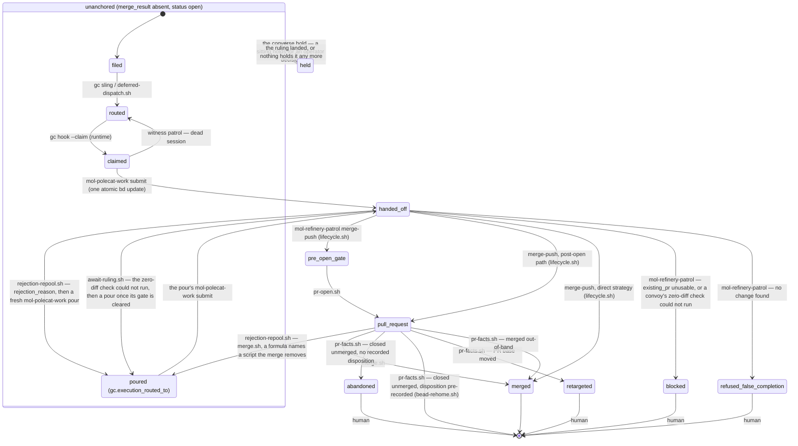
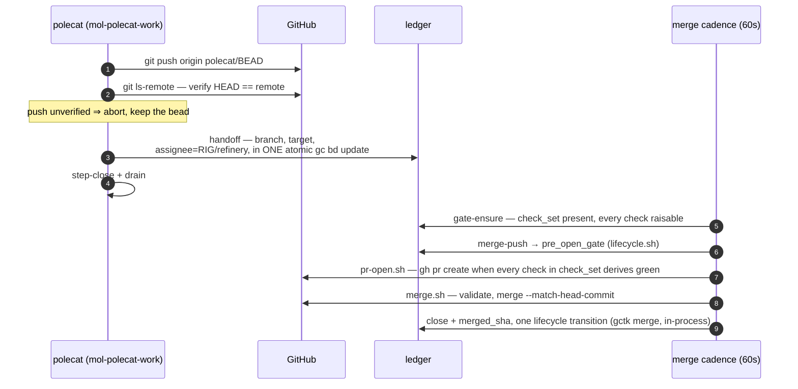

# The anchor state machine

A unit of work has exactly one **anchor** bead. Its state is
`status` × `merge_result`, and the state space is **declared, closed, and
single-writer**: `lifecycle/lifecycle.toml` enumerates every state, every legal
transition, and every pack-written metadata key, and
`assets/scripts/lifecycle.sh` is the only thing that writes a transition —
validate, one atomic `bd update` carrying every field of the transition, read
back. An unknown `merge_result` value is an error: every reader surfaces it via
`escalate.sh`, and `doctor/check-state-space` catches it. A bead closed while
`merge_result` is a non-closed state is repaired by `lifecycle.sh reopen`
(human-invoked; `merge_result` untouched).

`lifecycle.sh` is the command every caller invokes, and `gctk lifecycle`
(`services/gctk`) implements it: the script `exec`s the compiled binary the
`gctk-build` order publishes. With no binary to run, the call is refused with
exit 1 and nothing is written. The binary carries the one executable copy of the
table declared here, and `assets/scripts/lifecycle.test.sh` holds it against
`lifecycle/lifecycle.toml`.

## Scope

**Mandate.** The anchor lifecycle: states, transitions, writers, the check
vocabulary, and the merge condition.

**Boundaries.** The cadence that drives the merge-side writers is
[refinery-merge-cadence.md](refinery-merge-cadence.md). The invariants over
this machine and their doctor checks are
[component-model.md](component-model.md) §3. How completion propagates to a
waiting conversation is [lifecycle-composition.md](lifecycle-composition.md).

## The machine

No transition here is performed by a repair pass. Writers complete their own
transitions in one atomic write; the only reactive edges respond to facts the
pack does not write — GitHub closing or retargeting a PR (`pr-facts.sh`), a
session dying (witness orphan recovery).

`handed_off` is the unanchored bead after the polecat's single handoff write
(branch recorded, assignee = refinery, `merge_result` still absent). `poured`
is an unanchored bead a `mol-polecat-work` workflow is driving: it carries no
assignee and no `gc.routed_to`, only the pour's `gc.execution_routed_to`, which
no queue reads (`assets/scripts/dispatch-path.sh`). The anchored states are the
`merge_result` values. `merged` is the only state with
`status = closed`, and `lifecycle.sh` refuses to enter it without a non-empty
`merged_sha`, the landing the state names; the human states stay open, routed
to human.

The write that enters `merged` also records what the landing shipped, which is
the work record the runtime's close gate checks: `gc.work_outcome=shipped`,
`gc.work_commit` set to the `merged_sha`, and `gc.work_branch` set to
`merged_target`. A landing that names no commit id, such as the
`unverified:PR#<n>` sentinel, or no `merged_target` records none of the three,
and the bead keeps the record it already had. The gate asks the rig's checkout
whether that commit is on `origin/<merged_target>`. A squash GitHub made is not
there until the checkout fetches it, so the transition fetches that branch into
`$GC_RIG_ROOT` first whenever the commit is missing from it. With no
`GC_RIG_ROOT`, or a target git does not accept as a branch name, it fetches
nothing and prints one WARN line naming the landing.

`held` is the one human state a sitting writes rather than the refinery, and it
is entered only from `unanchored`. `merge.sh`, `gate-ensure.sh` and `pr-facts.sh`
each enumerate anchors by their gating state, so moving a live anchor to `held`
to record a conversation would drop it from all three for as long as the hold
lasts. An anchor already carries a state and a reader; an unanchored subject
carried neither, which is what the state exists to fix.

`pre_open_gate` and `pull_request` are the declared *detached* states
(`detached_states`). The merge cadence drives them and no queue offers them, so
the anchor rests unrouted and unheld, and `lifecycle.sh` writes both halves on
entry to one: it clears `gc.routed_to`, and it clears the assignee of a bead
still at `status=open`.

The route exception is `park_route` (`human`), the sentinel a hold leaves for
a person. No pool claims that value, so a transition
that finds it leaves it in place. Any other route on a detached anchor is pool demand
for work that is already in the merge queue. A worker claims it, the claim moves
the bead out of `--status=open`, and `merge.sh` and `pr-facts.sh` both enumerate
from there.

An assignee is the same anchor still sitting in the refinery's own find-work
queue, which is assignee-keyed and flags a `merge_result`-bearing bead it finds
there rather than taking it. There is no park sentinel on this side: no
component holds an anchor by assignee, and the polecat handoff pointer that put
one there is spent the moment the anchor is gated. The clear stops at
`status=open` for two reasons that agree. A live claim is a hold to escalate,
not to overwrite; and bd refuses an assignee edit on a bead another actor holds
`in_progress`, dropping the whole atomic update with it
([gascity/routing-model.md](gascity/routing-model.md#clearing-an-assignee-can-be-refused-and-the-refusal-drops-the-whole-update)).

A write that records on an anchor staying in its state, rather than moving it,
passes `--keep-route`: the transition writes no route, so neither a human
state's park default and park guard nor a detached state's route clear applies,
and the anchor keeps the `gc.routed_to` it carries, an empty one included.
`lifecycle.sh` refuses it with `--route`, and on an edge into another state,
which takes that state's routing. `pr-facts.sh` writes the rank of an anchor's
PR-finishing work this way ([steering.md](steering.md#pr-finishing-work)), so
recording it re-parks no anchor and drops no route a person gave one.

A detached anchor that is nonetheless claimed or held into a non-open status —
by a route stamped on it out of band, or a direct claim — is the residual this
leaves open. Every anchor enumeration is `--status=open`, so it drops out of
`pr-open`, `merge`, `pr-facts` and `gate-ensure` at once and stalls unseen until
the claim resolves. `doctor/check-state-space` also reads the non-open live
statuses, so it reports all three violations: a detached anchor carrying a
route, one carrying an assignee, and one that has left `status=open`.

Leaving a state can owe a write of its own, declared in `exit_sets`. A
transition out of `pull_request` into another open state sets
`pr_finishing_settled` to `unsettled` and clears `pr_head_oid` in the same
update, because the rank of an anchor's PR-finishing work is approved only while
the anchor rests there, under a posture read at the PR head `pr-facts.sh` last
recorded ([steering.md](steering.md#pr-finishing-work)). So whichever writer
makes such a transition leaves a record that no return to `pull_request` reads
as settled, and an approval that no return counts until `pr-facts.sh` has read
the PR again. A caller that writes the key itself keeps its own value, and a
transition into a closed state writes none.

## Transition table

| From → To | Writer | Trigger |
|---|---|---|
| filed → routed | `gc sling` (runtime); `deferred-dispatch.sh` when blockers must close first | dispatch |
| routed → claimed | `gc hook --claim` (runtime) | pool demand spawns a session |
| claimed → routed | witness patrol (`mol-witness-patrol`) | session died with the claim held |
| claimed → handed_off | `mol-polecat-work` submit step (ONE atomic `gc bd update`) | push verified on the remote |
| handed_off → pre_open_gate | `mol-refinery-patrol` merge-push, via `lifecycle.sh` | checks armed, branch accepted |
| handed_off → pull_request | `mol-refinery-patrol` merge-push (post-open path), via `lifecycle.sh` | a usable PR already exists |
| handed_off → merged | `mol-refinery-patrol` merge-push (direct strategy), via `lifecycle.sh` | FF merge pushed and verified on the target, or found there by a later patrol through the bead's `direct_landing_sha` stamp; record + close in one call |
| pre_open_gate → pull_request | `pr-open.sh` (cadence arm 3) | every `pre-open` check in `check_set` derives `green`; the PR opens as a draft when `check_set` names an `open-as-draft` check, else ready |
| pull_request draft → ready | `pr-open.sh` (cadence arm 3, draft-to-ready) | every `pre-open` and `open-as-draft` check derives `green`; `gh pr ready` surfaces it. GitHub `isDraft` flips; `merge_result` stays `pull_request` |
| pull_request → merged | `merge.sh` (cadence arm 2) | full authorization set validated (incl. the universal approval rule; a draft PR is skipped); close + record in one call |
| pull_request → merged | `pr-facts.sh` (cadence arm 7) | GitHub merged the PR out-of-band; record only |
| pull_request → abandoned | `pr-facts.sh` | PR closed unmerged externally with no recorded disposition; files a rework-or-close human gate |
| pull_request → closed (disposed) | `pr-facts.sh` → `bead-rehome.sh` | PR closed unmerged carrying a pre-recorded disposition (`pr-dispose.sh`); auto-disposed through the sanctioned terminal close, no gate |
| pull_request → retargeted | `pr-facts.sh` | PR base moved externally; files a human gate |
| handed_off → blocked | `mol-refinery-patrol` | recorded `existing_pr` unusable, or a graduated convoy's zero-diff check could not run three patrols in a row, its park held by the human gate, filed on it, that names git's error |
| handed_off → refused_false_completion | `mol-refinery-patrol` | the zero-diff check found no change on the handed-off branch, and the target carries no `direct_landing_sha` stamp |
| handed_off / pull_request → poured | `mol-refinery-patrol` (rejection), and `merge.sh` on a PR that removes a pack script a formula still names, each through `assets/scripts/rejection-repool.sh` | `rejection_reason` written and the assignee and `gc.routed_to` cleared, then a fresh `mol-polecat-work` pour dispatches the rebuild and stamps `gc.execution_routed_to` |
| handed_off → poured | `mol-refinery-patrol` merge-push, through `assets/scripts/await-ruling.sh` | the zero-diff check could not run three patrols in a row: a human gate names git's error and blocks the bead, which waits on it unassigned and armed, until clearing the gate pours a fresh `mol-polecat-work` run on it |
| poured → handed_off | the pour's `mol-polecat-work` submit step | push verified on the remote |
| unanchored → held | `skills/converse-hold`, a converse sitting's hold, via `lifecycle.sh`, only beside a human gate that blocks the bead | a sitting is waiting on an operator decision; state + route in one write |
| held → unanchored | `assets/scripts/converse-signoff.sh`, a converse sitting's sign-off; `gc-helm.sh accept`, before it dispatches the recommendation; `skills/converse-recheck-premise`, a moot or benign close; each via `lifecycle.sh`; or human | the ruling landed; Accept's answer read back; or the premise re-check found the conversation moot or benign, and no open human gate still holds the bead |

A request-changes verdict does NOT transition the anchor: `signoff.sh` files one
routed rework child that blocks the anchor, with the reviewer's findings and the
lane's validation pass beside it. The anchor stays `pull_request` (or
`pre_open_gate`). The child's and the pass's `blocks` edges hold the merge, and
so does the lane, since a request-changes close backs no lane.

## Checks

**Vocabulary.** The anchor declares its checks in `check_set`, a comma list of
check names. `none` and `off` are sentinels that declare no check at all (`none`
is the spelling the rest of this pack uses). `approval` is a third name a
check_set may carry, but it is a universal merge rule, not a check (below). The
one resolver, `review-checks.sh --resolve --check-set <cs> --through <phase> --at <oid>`,
reads the check index at the commit the reader judges, drops all three and
returns the checks whose phase gates `<phase>`, so no reader re-derives that
drop: `gate-ensure.sh`, `pr-open.sh`, `merge.sh`, `pr-facts.sh`,
`review-outcome.sh`, `liveness-sweep.sh` and `bring-current-guard.sh` all ask it
rather than tokenizing `check_set` themselves.

Every other name is opaque to the machinery: gate-ensure dispatches whatever
it finds there, `signoff.sh` records the verdict on that check's review bead,
and `merge.sh` requires every such name to derive green. Which names an anchor starts with is
configuration, not doctrine. Two writers put them there and neither reads the
diff: `mol-refinery-patrol` stamps its `check_set` var on every transition
into a gating state, and `gate-ensure.sh --default` normalizes an anchor whose
set is absent or empty, taking its value from `REFINERY_RECONCILE_CHECK_SET`.
No patrol pour passes `check_set`, so each patrol wisp renders it from the
formula default as it stands when that wisp is poured.
The registry records the same value at `lifecycle/lifecycle.toml`
`[gates] check_set_default`. Who may depart from it is
[authority-map.md](authority-map.md).

`correctness` is one such review check, opaque like the rest, and it declares a
**phase** in the index: the stage transition by which it must derive green. The
four phases are ordered `pre-open < open-as-draft < ready-for-review < merge`,
each fixed by what the check consumes — a check that reads only the diff is
`pre-open`, one that needs the deployed preview is `open-as-draft`. The stage
transitions gate on the checks their phase reaches, not one shared list:
`pr-open.sh` publishes once every `pre-open` check derives green; the
draft-to-ready flip waits on the `open-as-draft` checks too; and `merge.sh`
merges once every check, of every phase, derives green. An empty `check_set` is
not the opt-out at any transition: it means never normalized, and gate-ensure
stamps the default earlier in the same pass. A `check_set` whose checks are all
`pre-open` (gc-toolkit today) opens its PR ready at once — the draft stage
appears only when a check names a later phase. The index is the pack's
`review-checks.toml`, which declares every check the pack ships, with the rows
of the rig's own `review-checks.toml` at the commit being judged laid over it, so
a rig that keeps none has the pack's checks. A name no layer declares takes
`pre-open`, so it gates every transition. A declared phase outside the four is
an index error: every transition whose check_set names that check holds until
the index is fixed.

Each check is a **lane**. A lane's state is derived from the anchor's beads and
never stored on the anchor, and it is a state of the lane, never a claim about a
commit. `lane-state.sh` derives `green`, the one state every gating reader
asks; the others name what holds a lane short of it:

| State | Derives from | Merge effect |
|---|---|---|
| `reviewing` | a review bead for this lane on the anchor is open | holds |
| `validating` | a validation pass on the anchor is open | holds |
| `fixing` | a must-fix finding on this lane is open | holds |
| `green` | a closed review backs the lane (`signoff_verdict=approve`, a `reviewed_oid`, not superseded), or an operator's APPROVED GitHub review does, and no review for the lane is open | merges |
| `unreviewed` | nothing backs the lane and nothing is in flight on it | holds |

**Green survives new commits.** A push creates and closes no bead the
derivation reads, so it does not move a lane out of `green`, does not stale it,
and does not buy a review, and no pass re-gates a branch for having grown a
commit. A lane returns to `unreviewed` only when the reviews backing it are
superseded (`review-outcome.sh`, [authority-map.md](authority-map.md)): the
validator rules a fresh whole-diff review warranted, an operator ruling's
rework child is dispatched, or the ruling on a conflicted bring-current round
reopens the lane. The full lane state machine is
[specs/tk-ztapg/review-cycle-architecture.md](../specs/tk-ztapg/review-cycle-architecture.md).

`approval` is not a check and has no lane: it is a **universal merge rule**. `merge.sh` requires every PR to carry a latest APPROVED review by
an account other than the city's, with a standing CHANGES_REQUESTED from any
other account a veto. An approval stands across later pushes until it is
dismissed, so it counts whatever commit it was given at. A dismissed review is
dropped before each reviewer's latest review is taken, so it neither approves
nor vetoes, and it does not hide its author's older approval. A small fix after
an approval lands on it. An outside approval is dismissed by
`bring-current-guard.sh` when the ruling on a conflicted
[bring-current round](#bringing-a-branch-current) lifts it, and by
`approval-withdraw.sh` when the validator rules a fresh whole-diff review
warranted. Each dismisses every approval an account has not had dismissed (the
guard, every one given before the round), not only its latest, because an older
approval would otherwise count again. A ruling that
lifts the approval also draws a line on the anchor, `bring_current_lifted_at`,
at the round's time, and no approval submitted at or before it counts, so a
dismissal GitHub refuses cannot land the PR and an approval given after the
round lands it. No `check_set` token arms it or opts out, and GitHub branch
protection is an extra layer, not the authority.
`lifecycle/lifecycle.toml` records the rule.
What the *reviewer* did short of a verdict is posture, not a check:
see [Posture](#posture) below. **`signoff.sh` is the single writer of check
verdicts** (component-model I7): it closes the review bead with
`signoff_verdict`, the record a lane's green derives from. A verdict binds to no
commit: the reviewed oid is recorded on the review bead and named in the posted
artifact, and a lane's green does not compare it to a head.

### Operator feedback

Feedback from a person is review the branch has never been answered against.
`pr-facts.sh` enters it into the finding/validation graph by opening a
validation pass on the batch (see "Review cycle",
`specs/tk-ztapg/review-cycle-architecture.md`): `gate-ensure.sh`'s quiescence
holds a fresh whole-diff review off the anchor while the validator rules the
batch. What makes an item feedback is its provenance, not its author: every
review, inline comment, and conversation comment that is not the city's own
post is feedback, whoever wrote it, unless it is not for review. A comment is
not for review when its body opens with gc-toolkit's no-review mark or with a
prefix its rig declares for a third-party integration
([not-for-review.md](not-for-review.md)). A review's state is not its body: an
approval or a change request counts whatever its body carries. The city's own
post is one that `assets/scripts/pr-post.sh` marked, which is every post the
pack makes —
`signoff.sh`'s verdicts, `pr-open.sh`'s verdict replay, the write-back's
replies and its ruled-finding comments, the sitting reminder, a demo delivery,
`pr-dispose.sh`'s closing comment. An unmarked post under the city's login
after its PR's provenance cutover, described next, is feedback like a person's,
whoever posted it. Rework hand-backs post nothing.

A PR's posts from before the city marked anything carry no mark. Each anchor
records the instant `pr-facts.sh` first read its open PR
(`pr_provenance_since`), and an unmarked post under the city's login from
before that instant is still the city's own, so the notices already on a PR do
not turn into feedback all at once. A post counts from the moment it was
published: an inline comment from its review's submission, not from its draft,
so a review drafted before the instant and submitted after it is feedback whole.
Without the instant, or with a stamp that is not a UTC instant, every post under
that login is the city's own. `tools/lint-learned.d/pr-post-bypass.sh` fails any
post in the pack that does not go through the helper, and the agents' gh guard
refuses an unmarked one an agent types ([gh-origin-guard.md](gh-origin-guard.md)).

`pr-facts.sh` records each batch once: it opens the validation pass, routes the
batch, and advances the watermark, which stops the batch being re-read once its
comments are answered and the posture stops being `commented`.

The city posts no `CHANGES_REQUESTED`: `signoff.sh` records both of its
verdicts as COMMENT reviews, and `pr-post.sh` has no change-request verb. A
codex veto is therefore a marked COMMENT review, the city's own, and raises no
batch; `signoff.sh`'s rework loop answers it. A `CHANGES_REQUESTED` under the
city's login from before the cutover is the city's own the same way. Every
other `CHANGES_REQUESTED` is feedback, including an unmarked one under the
city's login after the cutover, and it routes on the same terms as any other
feedback, to a rework child or a human gate, and opens a validation pass. GitHub
refuses a change request from a PR's author, so on a PR the city opened only
another login can leave one.

The validator rules each finding in that batch, and every ruling ends the
finding closed or puts it to a person: a `must-fix` holds the merge until its
fix lands, a `deferred` files a claimable follow-up and closes, a `declined`
closes with an answer posted to the raiser, and a `needs-you` — a comment only
the operator can judge — files a human gate on the anchor and stays open. A
comment whose question an open human gate on the anchor's feedback already
carries is `needs-you` on that gate: the rework minted for its batch may have
put the question to the operator before the validator ran, and `finding.sh`
refuses every other ruling of the finding while such a gate blocks that rework.
A gate on the anchor itself refuses nothing, because an anchor gathers gates
about anything, so the validator judges whether one carries the question. Only
a fix's thread is resolved behind its answer: the thread of a declined or
deferred finding stays
open for the operator to accept or overrule. A `CHANGES_REQUESTED`
that is feedback is auto-dismissed once every finding it raised has closed and
every answer one of them owes its raiser (a decline's reason, a deferral's
follow-up, a `needs-you` finding's gate) is on the PR, and
its author is asked for a fresh review, unless the author is the city's own
login, which has no review queue to return to. A `needs-you` finding holds that
review open until the operator clears the human gate holding its question with
a reason headed `ruled:` and the work the ruling calls for lands, while the
others let it clear. A re-home hands the question on to the bead its
`gc.superseded_by` names, and a gate cleared `moot:` or `benign:` releases
nothing. Such a finding stays open until its anchor closes, and the review it
holds stays changes-requested until the operator's own approval replaces it. A
sitting cut short leaves the gate open, so the later sitting that rules on the
question clears that same gate, and the finding follows it. The review the
operator reads on the PR therefore always matches what is still owed.

The review bead carries the `mol-review` formula (attached at dispatch via
`gc sling --on`); the reviewing polecat follows its steps. The dispatch pins
`reviewed_oid=<live head>` on the review bead, naming the commit the reviewer
read, and nothing moves or clears it afterwards: `signoff.sh` refuses a
verdict that names another commit. The pin binds no lane state, and a push
that only adds commits on top (the branch growing) leaves the pin `on` the
branch and is not this check's business. What the pin still guards against is
a rewrite: `signoff.sh` asks
whether `reviewed_oid` is still an ancestor of the live head
(`git merge-base --is-ancestor`, with a GitHub compare consulted first when a
PR is open); a rebase, amend, or force-push that takes the pinned commit off
the branch answers `gone`, and **both verdicts are refused** — findings about
a diff the branch no longer carries would mint a rework child with nothing to
implement. The refusal is not a dead end an operator must clear by hand: it
closes the review bead `gc.outcome=superseded` with its pin in place, so
gate-ensure's in-flight probe stops seeing it and pours a fresh review at the
live head on its next pass. No verdict is recorded either way. A close the
store does not take exits 2, and the next claimant reviews the same departed
commit once more before its verdict meets the same refusal.

`signoff.sh` writes the commit the verdict names back to the review bead as
`reviewed_oid` before it posts anything, on both verdicts and whether or not
the PR is open: the pin, or on a review whose record carries none, the commit
the call names or else the live head. The lane state itself names no commit, so that record is
the whole of what a city verdict leaves behind: the city posts no APPROVED
GitHub review, and `lane-state.sh` derives a lane's green only against a
review bead carrying it. A store that will not take the record costs a
re-run: signoff exits 2 with nothing posted and the review left open.

Pre-open, the verdict body is read back off the same bead on the same terms.
Its notes are the only copy: `pr-open.sh` replays them as the PR's first
comment when it opens one, and a request-changes child names the bead it came
from in `source_review_bead` and has nowhere else to read its findings. So an
append that did not land also costs a re-run, rather than a backing or a
rework child standing on findings nobody can read.

`signoff.sh` closes the review bead itself, last, stamping
`signoff_verdict=<approve|request-changes>` in the same write as the close —
`lane-state.sh` reads it to tell an approving review bead from one that
recorded request-changes, and so does `doctor/check-gate-marker-provenance`. A
bead that is already closed therefore had its verdict recorded, was retired
unjudged by `review-sweep.sh`, or was closed `superseded` by the ancestry
refusal above, and either verdict against it is refused on the same terms:
nothing written.

**Merge condition** (validated by `merge.sh`, every field re-read immediately
before merging): `check_set` is non-empty (empty is never the `none` opt-out —
an unnormalized anchor holds); every check named in `check_set` derives `green` (`lane-state.sh`); a
latest APPROVED review from a non-city account, given at any commit, not
dismissed since and not given at or before the anchor's
`bring_current_lifted_at`, with no standing CHANGES_REQUESTED (the universal
approval rule); no unclosed rework or review
child; PR base equals `merged_target`; GitHub reports CLEAN; no holds
(`merge_hold`, `rebase_hold`, `tracking_only`). The merge is
pinned with `--match-head-commit <validated oid>`, so a mid-pass head move
fails closed. One anchor per PR is asserted structurally by
`doctor/check-one-anchor-per-pr`; `merge.sh` still refuses a second anchor on
sight as fail-closed defense.

## Posture

Checks record what the machine decided. **Posture** records what the pull request
is doing, head-pinned the same way, written by `pr-facts.sh` on every open
non-draft anchor and read off the bead by everything downstream. Declared in
`lifecycle/lifecycle.toml` `[posture]`.

| Key | Value | Meaning |
|---|---|---|
| `pr_posture` | `<posture>@<oid>@<since>` | the review posture at `<oid>`, and when it was first read there |
| `pr_merge_state` | `<mergeStateStatus>@<oid>` | GitHub's own value, verbatim and uppercase |
| `pr_comment_watermark` | `<id>` | highest routed `pulls/N/comments` id |
| `pr_review_watermark` | `<id>` | highest routed `pulls/N/reviews` id |
| `pr_comment_answered` | `<id>` | every inline comment above `pr_comment_watermark`, through this id, was answered by its thread at the last read |
| `pr_review_answered` | `<id>` | every counted review body above `pr_review_watermark`, through this id, was answered by its threads at the last read |
| `pr_comment_disposition` | `rework:<id>` / `human:<id>` | what the last outstanding batch was routed to: a rework child, or a human gate |
| `pr_provenance_since` | `<UTC instant>` | when `pr-facts.sh` first read the open PR; an unmarked post under the city's login from before it is the city's own |
| `pr_finishing_settled` | `approved` / `unapproved` / `unsettled` | the rank all of the anchor's PR-finishing work was last settled at, or `unsettled` while a re-rank is owed; absent while no pass has recorded one |
| `pr_head_oid` | `<oid>` | the PR head `pr-facts.sh` last read, a draft's included; empty once the anchor leaves `pull_request`, until a pass reads the PR again |

The postures, in the precedence the derivation applies:

| Posture | When | Merge effect |
|---|---|---|
| `changes_requested` | GitHub reports a standing `CHANGES_REQUESTED` | holds (`merge.sh` vetoes on the review itself) |
| `commented` | an unanswered review comment sits above its watermark, and no veto stands | holds |
| `approved` | GitHub reports `APPROVED`, and an approval stands that the anchor's `bring_current_lifted_at` did not set aside | none |
| `review_required` | GitHub reports `REVIEW_REQUIRED`, or reports `APPROVED` while every standing approval was given at or before `bring_current_lifted_at` | none; the anchor is waiting on a human approval and now says so |
| `none` | no `reviewDecision` applies | none |

The priority function reads the posture too. An `approved` posture on an anchor
that rests in `pull_request`, read at the head `pr_head_oid` records, ranks the
anchor's PR-finishing work at P0, so the pass of `pr-facts.sh` that records a
posture or a head moving into or out of that rank re-ranks that work, and so
does an anchor leaving `pull_request`. `pr_finishing_settled` records the rank
all of it settled at, and the write that moves the rank marks it `unsettled`:
the posture write, or the transition out of `pull_request` (`exit_sets`, above).
The work is settled again while that record differs from the rank the anchor's
state, posture and head give, by every pass for an
anchor in `pull_request` and by every full pass for one resting elsewhere, so a
re-rank a failed settle left short is finished on a later pass
([steering.md](steering.md#pr-finishing-work)).

A comment outranks an approval on purpose: one reviewer's approval does not
answer another reviewer's question. `merge.sh` holds on a recorded `commented`
whatever head it is pinned to, because a comment survives a head move. An
**absent** posture never holds there, since that is a fact not yet recorded
rather than a fact recorded as bad. What refuses the absence is the cadence:
`pr-facts.sh --posture-only` runs immediately before the merge arm and exits
non-zero when it could not make an anchor's posture current, which holds the
merge arm for that pass. Only the arm that did the reading can tell "no comment"
from "could not read", so the hold lives there rather than in the reader. A
posture recorded a pass earlier could not see a comment that arrived since, and
no consumer asks GitHub to find out, merge.sh's own terminal re-read included. A
read that fails records nothing rather than something weaker, so a standing
`commented` keeps holding through an unreadable pass, and an anchor already held
that way is not one the arm holds the pass over.

**The watermarks** separate a comment already routed from a new one. Each is the
highest id routed in its own id space, and each advances only after the routing
reads back, so a comment nothing answered cannot fall below the mark. For a
rework child that is three stamps: the `prepare_mode` it must resume in, the
`task_kind` and `anchor_bead` role marker that tells the child from its anchor,
and the route that makes it claimable. The two spaces are never merged: a reply
can land on an old review, so review ids cannot stand in for comment ids. They
rest on one assumption — that ids rise with visibility.

Both spaces are review spaces: the inline comments on `pulls/N/comments`, and
the bodies of COMMENTED and CHANGES_REQUESTED reviews on `pulls/N/reviews`. An
empty body raises nothing in the review space — the inline comments underneath
it are what the comment space already sees, and counting the review would leave
a posture no comment id can answer. A plain conversation comment on the PR is an
issue comment, carries no review, and raises no posture.

An inline comment above the watermark is not outstanding once its review thread
has answered it: the thread is resolved, and it holds a reply written after the
comment that is the city's own post. That is how feedback answered by a path
other than this arm, such as a sitting that replies in-thread and resolves the
thread, stops holding the merge. A comment written after the city's last reply in
the thread stays outstanding, because a reply does not reopen a resolved thread,
and a thread resolved with no reply from the city answers nothing. An unmarked
reply under the city's login after the cutover is feedback, not an answer. The
write-back's awaiting answer says only that the comments before it wait on a
person, so it is not an answer either. A review body
above its watermark is answered once the thread read has answered every inline
comment the review carries, since the body frames those comments. A review with
no inline comment has no thread to answer it and stays on the watermark.

Nothing routes answered feedback, so nothing moves a watermark past it. Each
thread read records how far it found the feedback answered past each watermark,
in `pr_comment_answered` and `pr_review_answered`, and a pass whose newest
feedback sits at or below both skips the read. The answered marks never move the
watermarks, which only a routing writes. A thread unresolved after its answered
mark passed it routes nothing until a new comment brings the read back, the same
as an unresolve under the watermark.

A `changes_requested` posture reads and watermarks the same ids a `commented`
one does. The veto holds the merge; it answers nothing, and the objections
under it are exactly the feedback that most needs routing. A human's
`CHANGES_REQUESTED` body therefore joins the review id space beside a
COMMENTED one, and the inline comments underneath join the comment space. The
city's own verdicts raise no batch, because every space counts only ids that
are not the city's own post (see [Operator feedback](#operator-feedback)) —
`signoff.sh`'s rework loop owns them, and reaches them through the review bead
rather than through this arm. A review that is later
dismissed leaves both `COMMENTED` and `CHANGES_REQUESTED`, so the same read
that would have counted it drops it. The comment space asks a narrower question
of each inline comment's parent review: whether that review was dismissed. A
dismissal therefore retires the comments it carried along with the body, and an
approving review's inline comments stay in the batch, because an approval
retires nothing it carried. A comment behind no review, or behind one the review
list does not carry, stands on its own and is counted.

**Outstanding feedback routes to something.** It becomes a fix-pool rework
child carrying the review bodies and inline comments verbatim in its
description, or, when there is nowhere to route work (no fix pool, or the PR
head branch is unresolved), one human gate per batch on the anchor, filed
through `human-gate.sh` under the batch's `pr-comments.<num>.<review>.<comment>`
key. A hold on the anchor does not send the batch to a person. `merge_hold`,
`rebase_hold`, `gc.routed_to=human`, an open human gate on the anchor and
an armed re-dispatch all leave the batch a rework child, routed like any other,
and each keeps gating what it gates elsewhere, among them the merge, the
stale-base merge-in and the red-check rework. The child is the batch's fix
unit: a must-fix ruling on one of the batch's findings hangs its close-ordering
edge on it, so a held batch with no child would leave those findings holding
the merge with nothing acting on them. The child brings the branch current by
merge as it answers, as every rework child does, and a conflicting branch is no
exception: an anchor that owes feedback skips the stale-base arm and its skip
guards entirely. Either way the filed bead holds the merge until it closes,
each through its `blocks` edge onto the anchor, and nothing is stamped on the
gate: it names the anchor through that edge. `pr_comment_disposition` records
which was chosen. Silence is not one of the options.

## The status label (GitHub projection)

Posture is recorded on the bead. Its projection onto GitHub's pull request list is
a workflow-owned label from a mutually-exclusive `status:` group, so a person
scanning the list sees whose move each open PR is without opening it. An open PR
carries exactly one value, and setting one removes any other `status:` value.

| Label | Whose move | When |
|---|---|---|
| `status: working` | the city's, changing the PR | an unapproved PR with live work on the anchor (a rework or fix child, a validation pass, a review, a finding), or a draft the city opened that still waits on the checks that flip it ready |
| `status: merging` | the city's, landing the PR | an approved PR with no known blocker: its required checks may still be running, a merge-in rework or other city work may be in flight, or it waits for the merge pass |
| `status: needs-review` | a human's review | an unapproved PR with nothing in flight and nothing holding it: opened check-green or flipped from draft to ready, reworked and handed back, or a non-blocking review left comments |
| `status: needs-attention` | a person's, to clear a blocker | a blocker stands that the city will not clear on its own: an operator freeze, a rebase hold, anything a `held:` label names, a blocked verdict the merge pass recorded at the current head ([The machine axis](#the-machine-axis)), or a recorded posture, verdict or cause outside its writer's vocabulary, a state the derivation cannot name |

Precedence when inputs overlap: `needs-attention` > `merging` > `working` >
`needs-review`. It follows from the middle column. A blocker the city will not
clear holds the PR whatever else is in flight. An approved PR with nothing
blocking it is the city's to land, whatever work is in flight on the way. City
work on an unapproved PR comes before the verdict it leads to, and the verdict
is what remains when neither stands. A hold that only a human can release reads
`needs-attention` with no rule of its own.

Beside the one `status:` value, a workflow-owned `held:` label names each thing
that holds an open PR which the city will not clear on its own. Each value is a
label of its own, so more than one can stand at once, and a PR nothing holds
carries none.

| Label | What holds the PR | Read from |
|---|---|---|
| `held: gate` | an open human gate blocks the anchor | the anchor's `blocks` edges, kept to the human gates that are not closed (`bd_human_gates`), one a person has claimed included |
| `held: review` | review feedback the city has not answered, or a review thread the merge waits on, and nothing in flight acts on it | the merge pass's count of review threads waiting on the city's answer (`pr.unanswered_threads`), by the rule below, or its `blocked` verdict with cause `review-threads`, as `prstatus.Blocked` counts it |
| `held: blocked` | a live blocker holds the PR that no automated actor will clear, on the anchor or on a parked run whose steps call a script the merge removes | the merge pass's `blocked` verdict with cause `blocker`, as `prstatus.Blocked` counts it, or a live bead the anchor's `blocks` edge names that is routed to a person or is a decision |

Any `held:` label reads `status: needs-attention`, because each names something
a person has to act on. The merge freeze and the rebase hold carry no `held:`
value, and neither do a failed required check, a deferred merge-in, a base gone
`BEHIND` or a rule the merge pass cannot name: each reads `needs-attention` on
its own. A blocker the city is landing, one an automated actor holds and no
person owes, is no hold, and the PR keeps its status.

`held: review` stands on any base, approved or not, for review feedback the city
has not answered. On every open PR it visits that is not a draft, the merge pass
counts the review threads that wait on the city's answer and records the count
as `pr.unanswered_threads`, pinned to the head it read. A thread waits when it is
unresolved and the newest of its posts that asks or answers is feedback
(`gc_thread_awaits_answer` in `pr-post.sh`). A post not for review neither asks
nor answers, whoever posted it. Neither does a post the city marked handled with
the THUMBS_UP that `pr-facts.sh`'s write-back puts on a post it owes nothing
more, which is the only answer a point declined with no reply owed gets. Nor
does a post a dismissal retired (`live_comments` in `review-dismissal.sh`). The
count holds the PR at the head the posture was read at, while nothing is in
flight on the anchor, because work in flight is the city answering, and while
no feedback waits for `pr-facts.sh` to route it (posture `commented`). A thread
the city answered and left open for the reviewer, such as a point it declined
or deferred, waits on the reviewer and not on the city, so the PR reads as the
reviewer's queue: `needs-review` before approval. Where the base requires
thread resolution, the merge pass's `review-threads` verdict holds an approved
PR for any unresolved thread, answered or not. The merge does not read the
count, so on a base that requires no thread resolution an approved PR still
lands while `held: review` stands.

`prstatus.Held` is the rule, and the helm board shows the same values as a row's
`pr_held`, from the same derivation over the same facts: the anchor's
`pr.unanswered_threads` among them, and the same in-flight set, every bead
carrying the anchor's `anchor_bead`, any `task_kind`, at a live status
(`prstatus.InFlightStatuses`), which the board's beads source reads as
`gctk pr-status derive` does.

A blocked machine verdict whose cause is outside its writer's vocabulary holds
the PR wherever it was recorded, as any state the derivation cannot name does.
Any other blocked verdict holds the PR only at the head the posture was read at,
because a verdict at another head was reached about another commit. It holds
only while nothing is in flight on the anchor: the merge pass records most
causes only when no live bead holds the merge, so work that arrives afterwards
is the city acting on the cause, and the next pass replaces the verdict. Cause
`blocker` holds whatever is in flight, because the merge pass records it after
weighing the live holders, and the stuck holder is often one of them, such as a
must-fix finding no fix unit answers. `prstatus.Blocked` is that rule. The helm
board applies it too, over the in-flight set the labels count, and by it decides
a blocked row's phase, whether the operator's queue lists the row, and the row's
needs phrase.

A read that does not answer changes no label. When gctk is unavailable, or the
anchor, its in-flight set or its blockers do not read, `pr-status-label.sh`
exits 2 and leaves both families as they are. Otherwise it writes both from one
derivation in one edit: the `status:` value and a `held:` label for each held
value, with every other label under either prefix taken off. A `held:` label
comes off on the first derivation after its condition clears.

The labels come off when the PR merges or closes, where GitHub's own Merged or
Closed state takes over. `pr-facts.sh` takes them off in the full pass that
records an out-of-band merge or a close. `gctk merge` takes them off for a merge
it made, or one whose record it recovered. Each takes them off before the write
that records the merge or the close, because that write closes the anchor or
moves it out of `pull_request`, and no pass enumerates it as an open PR again.
A clear that does not land is recorded on the anchor as
`status_label_clear_owed=<pr number>`: `gctk merge` carries the key in its
record, and `pr-facts.sh` writes it before its record, leaving the anchor open
for the next pass when that write does not land either. Every full pass of
`pr-facts.sh` lists the anchors carrying the key, in any status, retries each
clear, and unsets the key once it lands. The retry clears only the PR the
anchor's `pr_url` names, so a write that records the key on an anchor with no
`pr_url` records the live PR's url beside it, the one its writer validated
against origin.

An open human gate holds the anchor through its `blocks` edge onto it, read by
the one reader rule every reader of a bead's human gates makes (`bd_human_gates`
in `assets/scripts/bd-lib.sh`: the bead's `blocks` edges, kept to the gates
whose await type is human). The merge pass's finalize gate (`finalize-gate.sh`)
refuses the merge while one is open on the anchor, and the labels count each
human gate on the anchor that is not closed, one a person has claimed included.
A conversation about the anchor tracks it and blocks nothing, so it holds no
label.

The labels read the city's own state — the refinery-computed posture on the
anchor, the merge cadence's machine verdict and its cause, its holds, any open
human gate on it, the blockers its `blocks` edges name, its draft-stage
markers, and its live work — not GitHub's review posture, merge state or draft
flag directly. GitHub reports `BLOCKED` for a
required check still running as it does for a wedge, and the merge pass, which
reads the branch's rules, is what tells the two apart. The
`working`->`needs-review` flip rests on the live work, which closes as the fix
lands, so a sticky `CHANGES_REQUESTED` never traps the label in `working` after a
rework hands back.

The label is workflow state and never says a PR may merge: machine readiness
rides `pr.machine`. The draft flag is a phase signal, not a merge signal — a PR
opens as a draft when its `check_set` names an `open-as-draft` check, and
`pr-open.sh` flips it to ready once every `pre-open` and `open-as-draft` check
derives green ([Checks](#checks)); merge readiness waits on every phase and the
universal approval besides. A draft the city opened carries `opened_as_draft`
and, unless it is approved, reads `working` until `pr-open.sh` records
`draft_readied`, because until then the city still owes the checks that flip it
and the flip itself. A draft anyone else made, or one re-drafted after the city
readied it, reads like any other PR.
`assets/scripts/pr-status-label.sh` is the single writer of both families, and
every call that derives one writes the other. `pr-open.sh` sets the labels when
it opens a PR and when it records a draft ready, whether it flipped the draft or
found it already ready, and `signoff.sh` re-derives them on each of the city's
own verdicts. A human's review moves them in the merge cadence's posture and
feedback arms, in the pass that records the review. The posture arm re-derives
the labels for an anchor whose posture value it changes: an approval, a comment,
a change request, or a dismissal. The feedback arm re-derives them for an anchor
whose feedback batch it routes into live work. A head or merge state that moves
under an unchanged posture value does not re-derive the labels there. GitHub
reports `UNKNOWN` while it computes a PR's mergeability, so those moves are most
posture writes, and re-deriving on them would cost a derivation for dozens of
open PRs at once. The full `pr-facts.sh` pass re-derives the labels for each open
PR its walk reaches, so those moves, the other inputs, and a missed event
self-heal there. The walk is paced: it visits
first the PRs that left the open list, owe a merge-in, or changed on GitHub
since its last visit, then rotates through the rest until its deadline, and a
PR it does not reach waits for a later pass.

Nothing re-derives the labels when a human gate or a blocker is filed or cleared,
and such a change does not put its anchor first in that walk. The labels follow it on the
next full pass that reaches the anchor: within one reconcile pass while the walk
reaches every open PR, and after more passes when the deadline stops it short.
The labels likewise read the machine verdict and the thread count the last merge
pass recorded, so they follow a new verdict, or a thread answered or resolved, on
the next pass that derives them after the merge pass's visit. Every write is
pinned to the origin, and a label is not an approval.

## The machine axis

Checks say whether one review passed. **`pr.machine`** says what the merge cadence
can do with the anchor as a whole on its next pass, so a reader learns whether an
anchor is moving without re-implementing two scripts' predicates. Declared in
`lifecycle/lifecycle.toml` `[machine_axis]`, written by `gate-ensure.sh`
through `lifecycle.sh`, and by `merge.sh` through the lifecycle writer that
`gctk merge` runs in-process, at the points where each already reaches the
verdict, from `pre_open_gate` onward — an anchor can stall before its PR number
exists, so a key written only for open pull requests would miss the pre-open
ones.

| Value | Meaning |
|---|---|
| `progressing` | some automated actor will act: one holds a live blocker, a declared lane is short of green, a required check is still running, or a conflicting branch waits on its merge-in rework |
| `settled` | every declared check derives `green`; the cadence is done, and the PR waits on approval, on the merge pass, or on nothing |
| `blocked` | a hold no automated actor will clear and no review verdict is owed on. The cause rides `pr.machine_cause` as one of the values below and `pr.machine_reason` as a sentence, and the board and the `status:` label show it as needs-attention rather than folding it into the awaiting-review tail |

The merge pass classifies an approved PR it cannot merge by what holds it, and
records `blocked` only for a cause no automated actor will clear:

| `pr.machine_cause` | Recorded when |
|---|---|
| `review-threads` | branch protection requires resolved review threads and one is unresolved |
| `check-failed` | a required check's newest run failed at the head: a check run concluded `FAILURE`, `TIMED_OUT`, `CANCELLED`, `ACTION_REQUIRED` or `STARTUP_FAILURE`, or a status context reads `FAILURE` or `ERROR`; or the `UNSTABLE` arm holds the head on a superseded run that ended without passing |
| `conflict` | the branch conflicts with its base (`DIRTY`), and something defers the merge-in rework `pr-facts.sh` would file: a `rebase_hold` on the anchor or on any bead naming its branch, or an armed re-dispatch |
| `behind` | the base moved ahead (`BEHIND`), which no automation brings current |
| `blocker` | a live blocker holds the anchor, and no automated actor holds any of its live blockers; or the merge removes a pack script open steps call, and a person's gate parks one of their runs, which is the blocker that holds it |
| `rule` | GitHub reports `BLOCKED` and the pass can name no cause: no unresolved required thread, no approval owed and no required check whose newest run failed or is still running |

GitHub reports `BLOCKED` for every unmet rule, so the pass reads the branch's
rules before it names a cause. An unresolved required thread is
`review-threads`, an approval still owed is `settled`, and otherwise it reads the
required checks. The check rollup lists every run on the head, so a required
check re-run on the same head keeps its failed run beside the re-run. The pass
judges each required check by its newest run, the one started last, and a run
waiting to start is newer than every run that has started. A run that ended
without starting, such as one cancelled while queued, has no start to order it
by, so it is the newest run only when no other run of its check started or
waits to start. A check whose newest run
failed is `check-failed`. One whose newest run is still queued or running, or
one that has not reported yet (GitHub shows it as Expected), is `progressing`,
and every required check's newest run green leaves `rule`. The `UNSTABLE` arm
holds the merge while any run of a required check on the head is not green, a
superseded run included, and records the verdict the `BLOCKED` arm records for
the same required checks. Where only superseded runs hold it, the hold lasts
until a push moves the head once one of them has ended without passing, and the
arm records `check-failed`. While each of them is still queued or running, it
can end green and release the hold, and the arm records `progressing`. A
conflict with nothing in flight is `progressing`, because
`pr-facts.sh`'s conflict arm files the merge-in rework for an approved PR on its
next pass. It is `blocked` only when something defers that merge-in: a
`rebase_hold` on the anchor, an armed re-dispatch, or a `rebase_hold` on any bead
naming the branch, in any status. The pass reads that last freeze by the rule the
conflict arm applies, `pr-facts.sh`'s marked `branch-freeze` block, and
`merge.test.sh` holds the pass and the block to one answer. A read that does
not answer (the branch rules, the review threads, the required-check set, the
check rollup, the beads naming the branch) records nothing, and the verdict the
last pass recorded stands.

An anchor a live blocker holds is `progressing` when an automated actor holds
any of its live blockers, `blocked` with cause `blocker` when none does, and
gets no verdict when every live blocker is routed to a person.
`assets/scripts/blocker-holder.sh` answers that question for each writer of
the axis. An automated actor holds a blocker routed to a pool or an agent, one
an agent has claimed, and one a live run works. A rework handed back to the
refinery is claimed by it until it lands, and a graph.v2 pour leaves the bead
it works unrouted and unassigned, so its run is the only mark. The
`gc.execution_routed_to` stamp a pour leaves outlives the run, so it is not
one.

`gate-ensure.sh` records its own `progressing` or `settled` after the merge pass
in the same reconcile pass. It replaces a `blocked` verdict at the same head
only when an automated actor is due to act: a lane short of green or, for any
cause but `blocker`, a fix unit, rework child or validation pass in flight. For
the `blocker` cause it asks `blocker-holder.sh`, as the merge pass did, because
quiescence counts a rework child or validation pass by its status alone. Only an
actor holding a blocker replaces that verdict, and an answer that does not
resolve leaves it. The merge pass records `blocked` only once every lane derives
green, after weighing holds `gate-ensure.sh` does not read, such as a live
blocker no automated actor holds. So its `settled` adds nothing to a `blocked`
verdict, and neither does a `progressing` it reaches only because a must-fix
finding has nothing answering it or a quiescence probe did not answer. A verdict
at a head the branch has left is replaced.

A standing non-city `CHANGES_REQUESTED` is not `blocked`: a review verdict is
what it waits on. While a fix unit answering it is in flight the anchor reads
`progressing`. Once nothing is in flight the merge pass records `settled`, the
PR waits on that reviewer's re-review, and the standing review rides the
posture axis.

A merge held for open runs that call a pack script it removes, or for the rig
checkout to stop naming one, is `settled`: every lane is green and the PR waits on
the merge pass. A person's gate that parks one of those runs makes it `blocked`,
cause `blocker`, with a reason that names the gate
([refinery-merge-cadence.md](refinery-merge-cadence.md), arm 2).

**Dated keys.** `pr.machine` and `pr_posture` carry a third component,
`<value>@<oid>@<since>`, under one write rule that `lifecycle.sh --set-dated`
owns: keep the existing instant while the value and the oid both hold, stamp the
current one when either differs. The reconcile cadence re-derives the same
verdict at the same head every few minutes, so a naive clock would restart a
three-day wait on every pass. The instant lives inside the value rather than in a
key beside it, because a timestamp that can be written when the value is not ends
up dating a state that no longer holds, with nothing in either key saying so.

## The handoff

The one boundary crossing between the work and merge workflows is a single
atomic write. There is nothing to reconstruct afterward: a session that dies
before the write leaves a claimed bead the witness patrol re-routes; one that
dies after it leaves a complete handoff the cadence picks up.

## Rejection and rework loops

A rework child is discriminable by metadata alone. It carries
`task_kind=rework` and `anchor_bead=<anchor>`, stamped by whichever component
files it, and it resumes the anchor's own branch. Without those two keys its
metadata is the anchor's, and the title prefix is the only thing telling them
apart. A review bead carries `task_kind=review`. An anchor carries
`merge_result` and neither key. Every consumer that selects on `anchor_bead`
also narrows by `task_kind=review` or by title, so a marked child joins no
review's result set.

- **Rejection** (refinery judgment): the anchor's branch is not accepted.
  `mol-refinery-patrol` hands the bead back through `rejection-repool.sh`, and
  so does the merge pass when a PR removes a pack script a formula still names
  ([refinery-merge-cadence.md](refinery-merge-cadence.md), arm 2): one
  lifecycle transition writes `rejection_reason`, then a fresh
  `mol-polecat-work` pour dispatches the rebuild. It is a pour, not a route on
  the bead, because the bead is a member of its epic and bd's blocked flag
  cascades down parent-child edges, while a poured workflow's root has no
  parent, so a hold on the epic leaves the rebuild running. The bead rests
  `poured`, and the polecat running the pour starts from the recorded reason.
  The rejection never pours a convoy, such as a graduation's anchor, because a
  run poured onto a convoy works on the beads it tracks. A convoy's rebuild is
  poured onto its rebuild child instead, an ordinary task that carries the
  reason, resumes the convoy's branch and blocks it, and merge-push anchors the
  convoy once the child's work lands on the branch.
- **Rework** (review verdict): `signoff.sh --verdict request-changes` files
  and slings exactly one rework child through `rework-child.sh`, with the
  reviewer's findings and the lane's validation pass beside it. The validator
  rules on the findings, and once the must-fix set closes it rules whether the
  lane has converged or owes a fresh whole-diff review. Convergence is judged by
  the validator, not counted in rounds
  (`specs/tk-ztapg/review-cycle-architecture.md`), so request-changes files a
  child every round and nothing in the cadence bounds them. One writer, one
  verdict: no second component writes a verdict.
- **Ruling** (operator, via converse): a ruling that reaches an open PR,
  whether given at the sign-off or on a turn that answers a gate without
  signing off (`--answer`), must say what it does to the PR
  (`converse-signoff.sh --rework`, `--no-rework` or `--retire <kind>`), and one
  that says none of them is refused. It reaches the subject when the subject
  is an open PR, and each open PR that a gate it answers releases, such as a
  member of an epic subject. The rework or the retirement acts on one PR,
  which `--pr-anchor` names when the ruling reaches more than one, and each
  other one stands. Each runs before any gate the ruling answers is resolved,
  because a gate can be what holds the merge, and in that PR's own rig, after
  the conversation records which PR it acts on (`gc.ruling_consequence`), so a
  re-run of the same ruling acts on the same PR even once it has closed.
  `--retire` records the
  disposition and closes the PR through `pr-dispose.sh`, and `pr-facts.sh`
  then takes the anchor through the `pull_request → closed (disposed)`
  transition. On `--rework`, `converse-rework.sh` files the same fix
  unit through `rework-child.sh`, sourced by `source_ruling_bead=<conversation>` in
  place of a verdict's `source_review_bead`: `task_kind=rework`, the anchor's
  branch resumed, a `blocks` edge holding the merge. A ruling on a published PR
  so becomes demand the refinery lands rather than prose nobody reads. A ruling
  has no lane of its own and rules the whole diff, as a human feedback batch
  does, so once the child is dispatched `converse-rework.sh` returns every lane
  the anchor declares to `unreviewed` (`review-outcome.sh supersede-anchor`).
  Quiescence holds each lane's dispatch while the child is open, and gate-ensure
  re-reviews the whole diff at the head the child lands. Two things can still
  back a lane through the ruling: a review already in flight when the ruling is
  filed, whose verdict is on the head it read, and an operator's GitHub
  approval, which until it is dismissed backs every lane but one a later
  bring-current round reopened. converse never pushes code; the molecule does.
- **Quiescence** (`gate-ensure.sh`): no review is dispatched while anything is
  acting on the anchor — a fix unit in flight (including the one answering an
  open `must-fix` finding on any lane), a validation pass in flight, or a full
  review already in flight on the lane. A `must-fix` finding no fix unit answers
  holds the merge, not the dispatch. One authority computes the set, so it
  cannot disagree with itself about whether a review was already out, and a
  review that read a mid-change diff would raise only the no-op rework the
  declination texts are full of.
  There is no dispatch ceiling: quiescence forbids the redundant round a ceiling
  would have bounded, and the runaway shapes left — a reviewer that dies after
  claim, a rework child filed with its dependency edge reversed — stop the PR
  moving rather than spin the dispatcher.
- **External rework** (`pr-facts.sh`): a CONFLICTING PR that is approved — a
  standing APPROVED review from an account other than the city's and no
  standing CHANGES_REQUESTED, the rule merge.sh lands on
  (`assets/scripts/review-verdict.sh`) — gets one merge-in rework child while
  none is in flight. An unapproved one records its posture and gets nothing: a
  bring-current costs a polecat round and a CI run and goes stale whenever main
  moves, and a PR nobody approved cannot land however current its branch is.
  The child's handoff runs `bring-current-guard.sh`, which holds the round to
  the worker's audit. A round that conflicted goes to triage
  ([Bringing a branch current](#bringing-a-branch-current)).
  A live child on the branch — dispatched or
  parked — stands a second dispatch down, so re-runs never duplicate it; a
  closed child does not, so a branch still CONFLICTING with nothing in flight is
  re-dispatched, on every head it conflicts at rather than only the PR's first
  (an approved PR gone dirty after its round would otherwise wedge unseen). A
  hold (`merge_hold`, `rebase_hold`) or an open human gate on the anchor or on
  its live rework child dispatches no rework child at all: bringing the branch
  current is routinely one horn of what a person is being asked, so a child
  filed under one answers the question by performing it. Clearing the gate is
  what releases the dispatch. A conflict that is not drift gets no child
  either. When a change that landed first deleted or rewrote code the branch
  edits, `branch-supersession.sh` files a human gate under
  `rework-base-supersession` on the anchor, because whether the branch still
  has work to do is the operator's call. That gate holds the dispatch while it
  is open. Clearing it `benign:` (the overlap was incidental) lets the next pass
  send the merge-in child, because the call declares a quiet window that keeps
  the answer standing.
  `pre-open-rebase.sh` applies the same guard to an anchor with no PR yet.
- **Disposal** (`review-sweep.sh`, cadence arm 8): a review outlives its own
  subject when the anchor closes and the branch is deleted before any verdict
  lands. There is no commit left for a verdict to name, so the arm closes
  the review with `gc.outcome=moot` and records the reason on it, and writes
  nothing to the anchor. It requires both the closed anchor and the absent
  branch, so an unfetched branch and a still-gating anchor each hold.
- **Duplicate / superseded disposal** (`bead-rehome.sh`, the one evidence-gated
  close-with-successor writer): a bead that duplicates another or was fixed
  upstream closes through `bead-rehome.sh --kind duplicate|fixed-upstream`, which
  gates its own evidence — the named successor resolves and is closed or shipped
  in the same store AND the origin recorded no work (`work_outcome=no-op` or no
  work-product key at all), unless the origin carries the operator's
  pre-recorded PR-close disposition for that kind and successor — and holds on
  anything it cannot establish. Converse and operator dispositions use the same
  writer, and so does `duplicate-sweep.sh` (cadence arm 10). The sweep reads
  the `duplicate_of` marker a polecat stamps when it diagnoses and parks a
  duplicate dispatch: polecats never close work beads, so the bead has no other
  way out. It checks the same evidence before it calls the writer. It also
  closes an unmarked rework twin: an open rework child that was never
  dispatched (no dispatch metadata, no convoy tracking it) whose source is
  closed (the review it answers, or the conversation a ruling's child answers) and
  whose same-source, same-anchor sibling landed. That twin would otherwise hold
  its anchor forever; the sweep records `gc.work_outcome=no-op` on it before the
  close. A first reaction never closes a bead: it hands a confident no-op to the
  validating closer (`mol-validate-close`).
- **No re-gate on head move**: a new commit stales nothing. gate-ensure
  dispatches on the lane — a declared check that is neither `green` nor in
  flight gets one review bead (stamp first, then attach `mol-review` via `gc
  sling --on`, read the pour back) — and a lane that already derives `green`
  keeps deriving it however far the branch advances. Re-review is a judgement
  the validator or an operator ruling makes, or triage's ruling on a
  bring-current round that conflicted, not a trigger a push pulls.
  gate-ensure holds dispatch rather than pouring a second review while an open
  rework child is already in flight for the lane — a `blocks`-dep bead on the
  anchor carrying a non-empty `source_review_bead` or `source_ruling_bead` (the
  review or the ruling the rework answers).

### Bringing a branch current

A branch is brought current by merging its base in, never by a rebase. The
shapes that do it are the merge-in child `pr-facts.sh` files for an approved PR
that conflicts, the child `pre-open-rebase.sh` files for a pre-open branch that
no longer merges, a rework answering review feedback or an operator ruling that
merges the base in as it resumes, and an anchor the refinery's prepare re-queues
on a conflict. Each resumes
through `mol-polecat-work`'s resume block, which starts a round: it stamps
`bring_current_from` (the PR head the round starts from) and
`bring_current_scope` (`merge-only` when the rejection asked for nothing but the
bring-current, else `with-work`), and clears the previous round's audit.

**The worker writes the audit.** For each file git could not merge, the worker
resolves it and records one entry with `bring-current-audit.sh add`: what
collided (the two intents), what it decided and why, what a reviewer should
check, and its own rating, `routine` (an adjacent-line collision, an
overlapping comment edit, an obvious composition) or `judgment` (an inferred
intent, a side chosen on substance, something new). An edit beyond what the
merge needed owes an entry too, and on a `merge-only` bead so does each file a
commit of the bead's own changes. A conflict the worker cannot resolve without
guessing is a question, not a guess: `bring-current-audit.sh ask` files a human gate
on the anchor carrying the entries so far and the question, the merge is
aborted, nothing is pushed, and the bead is held until a person answers.

**The guard enforces coverage and routes; it weighs no round.** At the
handoff, `bring-current-guard.sh` reads the round on any branch that carries a
review to keep current (its anchor is gating, or a PR stands on it):

- **Clean**: every commit the round adds is a merge of the base whose tree is
  git's own result. Nothing was resolved by hand; the round is recorded on the
  anchor and lands quietly.
- **Conflicted**: anything else. Each item git did not produce on its own (a
  conflicted file, an edit beyond the merge, a merge of something but the base,
  a rewritten history) must have an audit entry, or the handoff is refused and
  the worker completes the audit. A covered round is stored on the anchor as
  `bring_current_record` with the guard's evidence beside each entry (what git's
  replay of the conflict shows the resolution kept), and the triage lane is
  reopened: it is added to `bring_current_reopened` with the round's time,
  `bring_current_round_at`, and its standing review is superseded. An anchor
  whose `check_set` declares no triage lane (`correctness` alone, say) gains
  `triage` in the same write, with a note saying why, so triage rules on its
  conflicted round and the merge, which waits on every declared lane, waits
  for that ruling.
- **Conflicted, on an opt-out anchor**: the `none` and `off` opt-outs are the
  one case where the guard rules on a round itself. Only a person sets or
  widens an opt-out, so the guard leaves the `check_set` as it is, and no
  review weighs the round. Approval is the one merge rule the opt-out leaves,
  so nothing reopens and the approval given before the round is lifted, the
  lift line drawn as for triage's ruling below, with no gate. The ruling is
  stored in the record marked `by: guard`, and a re-run of the same hand-off
  carries it out again, so a lift that stopped half-way is finished.

Generated renders (linguist-generated) owe no entry. A hand-off with no
`bring_current_from` stamp that pushed nothing past the origin head it started
from is refused rather than read as clean, because nothing records where its
work began. A round whose resume stamped `bring_current_from` but not
`bring_current_scope` owes no entries: that resume step asks for no audit, and
the submit step poured with it drains on any refusal, so a refusal would only
re-offer the same hand-off. Its items are stored with the guard's evidence
alone, and the round is routed to triage like any other.

**Triage decides what reopens.** gate-ensure dispatches triage again, and its
verdict (`signoff.sh --reopen <lanes>|none --round-reason <why>
[--dismiss-approval]`) is the round's ruling, refused when absent: nothing; lanes
that run again on the merged code (any the anchor declares, and any it adds with
`--add-gates`); and whether the round made a call that is the operator's to
make. Only such a call lifts the human approval: the round changed what the PR
does, by inferring one side's intent or by choosing between two live designs,
and the ruling's reason names that call. A round that only changed how the
approved behavior is achieved reopens the lanes that can check it, and the
approval stands. `bring-current-guard.sh decide` records the ruling in the
anchor's record and supersedes each reopened lane. A ruling that lifts the
approval first draws the
lift line: the round's time is stored as `bring_current_lifted_at` and read
back, and from then on the approval rule counts no approval submitted at or
before it. Each approver is then re-requested and each standing approval given
before the round is dismissed; one submitted after the round saw the merged
code and stands. When GitHub refuses a dismissal, the line still holds the
merge, the failure is noted on the anchor, and an approval given after the
round lands the PR with nothing else to clear. A later round whose ruling keeps
the approval leaves the line where it was. A lane in `bring_current_reopened`
is backed by a GitHub approval only when the approval was submitted after
`bring_current_round_at` (`lane-state.sh`), so a standing approval neither lets
the merge skip a reopened lane nor keeps its review from being dispatched. A
round can therefore keep the approval while its lanes re-run, and only a call
that is the operator's removes it.

**Every message is composed from the stored record.** Triage's posted verdict
opens, like every review comment, with the verdict and then the one decision it
needs from the operator, or that nothing does. The round's account sits
collapsed beneath that line, rendered from the record with
`bring-current-audit.sh` the same way whether or not the approval was lifted:
what the round needed and the ruling, then each judgment entry in full (what
collided, what was decided and why, what to check) and each routine entry on
one line. An item no entry covers is listed with the guard's evidence alone.
When the ruling lifts the approval, the call it names opens the verdict and is
the note on the dismissed approval. A lifted approval files no gate: the
re-request, the dismissal note and triage's posted verdict are what a person
reads, and the PR's posture reads `review_required` until a new approval
stands, so the board shows the approval as owed. A ruling the guard made itself
posts no verdict, so its dismissal note tells it as the guard's, points at no
triage comment, and names the entries itself. The one human gate a round
files is the question the worker could not resolve, rendered from its entries
so far and its question.

What no guard reaches: the refinery's own prepare merge, which aborts on any
conflict and so only ever pushes git's own result; and a merge the worker ran
by hand, outside the resume block, and pushed before submit, which the guard
reads only from the push's own start.

## Disposition

A close that is not a landing must say so from the store the bead lived in:
`assets/scripts/bead-rehome.sh` closes the bead with `gc.superseded_by` +
`gc.superseded_by_store` (and stamps the inverse `gc.supersedes*` on the
successor), so a sound disposition and a careless false close are
distinguishable on read. Four kinds — `re-homed`, `folded`, `fixed-upstream`,
`duplicate` — say the work relocated, and the pointer names the bead that
carries it now. The fifth, `not-needed`, says nothing carries it: the bead
was not needed, and the pointer names the evidence that concluded so,
typically the conversation of the sitting that ruled. The pointer is required
under every kind, because it is the whole of that distinction. The kind is
read from the close reason, which opens with the kind's phrase and the
successor, as in `not needed, per <successor> in <store>`. When the pointer is
added after an earlier close, a `Disposition recorded` note carries that reason
instead. The read side searches every store before concluding a close was
false. Consumers: the mechanik/converse close paths
(`template-fragments/bead-disposition.template.md`), `duplicate-sweep.sh` (the
cadence's reader for `duplicate_of`, and the closer of never-dispatched rework
twins), the deferred-dispatch reconcile pass (`deferred-dispatch.sh`, the closer
of a bead its `until` dependency resolved), `preexisting-failure.sh` (a
pre-existing-failure gate follows a closed tracker's pointer to the live bead
that carries its failure, and a `not-needed` close ends that chain), and any
patrol judging a closed bead.

`bead-rehome.sh` proves the evidence kinds itself. Under `fixed-upstream` and
`duplicate` it re-establishes that the successor is closed or shipped in the
same store and that the origin recorded no work, unless the origin carries the
operator's pre-recorded PR-close disposition for that kind and successor.
Under `re-homed`, `folded` and `not-needed` it applies only the checks every
kind gets: the origin is not a review bead, a step bead or a workflow root, and
no other session holds it in progress. The judgment that the bead should close
is the caller's. A hand disposition, by the mechanik, converse or the operator,
judges the bead itself. An automated caller proves its own case before it
calls, and [authority-map.md](authority-map.md) records the power in its
Close-with-successor row. The deferred-dispatch reconcile pass passes
`folded` only for a pure wait: an open, unassigned bead whose own `until`
targets have all closed, whose `until` edge to the successor still stands, that
no open `blocks` blocker of its own holds, and that carries no live work as
`assets/scripts/live-work.sh` defines it. The pass checks them on its
pass-start listing and again on a fresh read of the bead and what depends on
it, made just before the call under a claim the pass takes on the bead. Both
reads take the bead's edges from its `bd list` row, because `bd show` leaves
out an edge whose target has no row in this store, so an `until` target, a
`blocks` blocker or a parent the store cannot read leaves its condition
unproven. It leaves a bead that fails any of them, or that it cannot prove
meets one, as it is and never calls `bead-rehome.sh` on it. It runs
`bead-rehome.sh` as its claim, and reads the bead once more after the close:
anything that landed on the bead or its edges while the pass held it makes the
pass withdraw the disposal, reopening the bead and removing the pointer
([deferred-dispatch.md](deferred-dispatch.md), "The resolved-by consumer").
Whoever judges, `bead-rehome.sh` stays the one writer of the pointer and the
close. It stamps the pointer in one write bd applies only while the bead still
has the status and assignee its gates read, so a caller whose gates passed
before another actor claimed the bead stamps nothing while that claim holds.
The one other write to the pointer is the pass's withdrawal of a pointer it
had `bead-rehome.sh` stamp under its claim: after a close its check finds
raced, and when the close is held or fails, in the write that gives the bead
back. Under its claim no other caller's stamp lands, and the pass marks the
bead with the successor before `bead-rehome.sh` runs, so it removes only a
pointer that is its own. A pointer on an open bead is live work to the pass,
so it never disposes a bead another closer has pointed.

A disposition ends the bead's branch, the way a merge ends a landed one
through the repository's delete-on-merge setting. Once the close reads back,
`bead-rehome.sh` hands the branch the bead names in `metadata.branch` to
`assets/scripts/branch-end.sh`, which deletes it from the git remote. The
branch stays while a live owner names it. A live owner is a bead in the rig's
store whose status is outside the `done` category and whose `metadata.branch`
or `metadata.target` is the branch: another anchor, work not yet handed off, a
convoy or a member landing on its integration branch, or a successor that
resumed the branch. The retired bead's own review scaffolding, the beads whose
`anchor_bead` names it, is not an owner. `scaffolding-sweep.sh` retires that
scaffolding, and `review-sweep.sh` closes a review only once the branch is
gone, so counting it would keep nearly every retired branch. A ledger that does
not read keeps the branch, and the default branch, `main` and `claude/*` are
never ended. Before the delete the tip is pinned. A pull request whose
`refs/pull/<n>/head` on origin equals the tip already pins it, because GitHub
keeps that ref after the branch is deleted. Otherwise an annotated
`archive/<branch>@<short-sha>` tag is pushed at the tip and read back on
origin. The delete's lease names the checked tip, so origin refuses it if the
branch moved, and a moved branch is left alone. The bead's notes record what
became of its branch: ended and what pins its tip, kept and which owner names
it, or still on the remote and the `branch-end.sh` command that ends it. The
close never depends on any of it: a branch that cannot be ended leaves the
disposition standing.

A subject whose PR is still in flight is disposed by **retiring** it, on the
operator's ruling in a sitting to close it: the PR is closed and the anchor is
routed through this same disposition close as superseded, in one
act. The PR is closed rather than left open, so nothing is unlanded, and the
anchor is disposed rather than bare-closed, so `check-closed-implies-landed`
exempts it the way it exempts any disposal. `pr-facts.sh` then finds an
already-closed anchor and files no re-ask gate, where a PR closed out-of-band
would have driven `pull_request → abandoned` and a fresh human gate. A bare close of
a subject still carrying a non-closed `merge_result` remains the violation
`lifecycle.sh reopen` repairs; retiring is the sanctioned path, not an
exception to the invariant.

An anchor whose PR is still open cannot take that close directly: closing it
while `merge_result=pull_request` would strand a PR the refinery still watches.
So a deliberate supersede/not-planned PR close records the SAME disposition as
INTENT on the still-open anchor — `assets/scripts/pr-dispose.sh` stamps
`gc.pr_close_disposition_kind`, `gc.pr_close_disposition_successor`, and an
optional `_store` naming the intended `bead-rehome.sh` invocation — and closes
the PR. `pr-facts.sh`'s close arm reads that marker when the PR reaches CLOSED
and runs `bead-rehome.sh` to consummate the terminal close, so `bead-rehome.sh`
stays the sole writer of `gc.superseded_by` and the disposition reaches the
same terminal state through the same verb. The same consummation disposes the
branch's parked rebase and rework children BEFORE it closes the anchor: a rework
child holds a `blocks` edge on the anchor, so an open one refuses the anchor's
own non-force close and would strand it open with its pointer already stamped.
Each exists only to carry a branch the closed PR will never merge, so an open,
unheld one is closed through `bead-rehome.sh` as `not-needed` against the
anchor's successor — clearing that hold and leaving no husk to re-offer to a
pool; a child a worker still holds (`in_progress`) or one an operator froze
(`rebase_hold`) is left alone, and its hold then keeps the anchor open until it
resolves. A close with no recorded disposition still transitions to `abandoned`
and files the rework-or-close human gate.

That drop reaches only the parked, branch-carrying children. The rest of the
machine review scaffolding is a fix unit, the finding beads and the validation
pass. Each holds a `blocks` edge on the anchor, and a fix unit also blocks every
must-fix finding it answers, so an open one refuses the anchor's close the same
way. `scaffolding-sweep.sh` retires it. The cadence runs it as arm 9 over every
disposed anchor, and the consummation runs it for its own anchor just before the
close, so the close is not refused and put to a person over scaffolding that arm 9
would retire later in the same pass. It closes every
`task_kind=validation|finding|rework` bead whose `anchor_bead` names a disposed,
non-merged anchor (`gc.superseded_by` or `gc.pr_close_disposition_kind`
present) as `gc.outcome=moot`, reworks before the findings they block, so no
close is refused by a blocker still open in the same pass. A bead an operator
froze (`rebase_hold`) is left standing, like a frozen child.

A finding is mooted only when it objects to the disposed diff: a machine-lane
finding, a human finding whose locus names no file, or a human comment on a
line the PR added or removed. A human comment on a line the PR left unchanged
can cite code the target branch already carries, and the disposal does not
answer it, so that finding is carried forward instead. A bug bead takes its
objection, with no `anchor_bead`, so it reaches a first reaction like any
discovered work, and the finding closes through `bead-rehome.sh` pointed at it.
When a finding's comment line does not read, the consummation leaves the close
to the next pass rather than closing the anchor before the finding is judged.
The sweep never touches `task_kind=review` (`review-sweep.sh`'s) or the human
side, a human gate or a conversation: a disposed PR does not moot the
human conversation about why it closed, and `finalize-gate.sh` holds the
anchor's own close while a human gate on it is open. Clearing the machine side
is what lets that close land once the human side is done.

The consummation also withdraws, before the close, the human gates
`pr-facts.sh` filed on the anchor to hold the PR's merge until a person
answered: rework or close, a moved base, feedback nothing routed, review threads
nobody engaged, threads branch protection requires resolved, and red checks
parked to a person. A PR closed with a recorded disposition has no merge left to
hold, and what those gates raised stays on the PR. Each is resolved with a
reason headed `moot:`. One a person is assigned keeps holding the close until
they clear it. The exception is the rework-or-close gate: the disposition
answers its question, so it is withdrawn whoever is assigned it. Every other
open human gate on the anchor still holds the close.

When `bead-rehome.sh` refuses the close, the anchor stays open with its marker,
and the arm files one human gate under `pr-dispose-failed.<num>` naming the
obstruction. Every later pass retries the close. That gate blocks the anchor,
but it reports the arm's own failed close and asks for exactly that retry. So
the retry names its key to `bead-rehome.sh`, whose finalize gate excepts every
gate filed under that key on the anchor that no person is assigned, and which
withdraws those gates just before the close, once nothing else would hold it. A
gate a person is assigned holds the close like any other, and every other open
human gate on the anchor still holds it. When a retry is refused for a
different obstruction than the one the gate names, the arm rewrites the
description of each such gate no person is assigned to name the new one. A
withdrawal that does not land leaves its gate open, and bd refuses the close
while it is, so the anchor never closes past its own report and nothing is left
open behind it.
