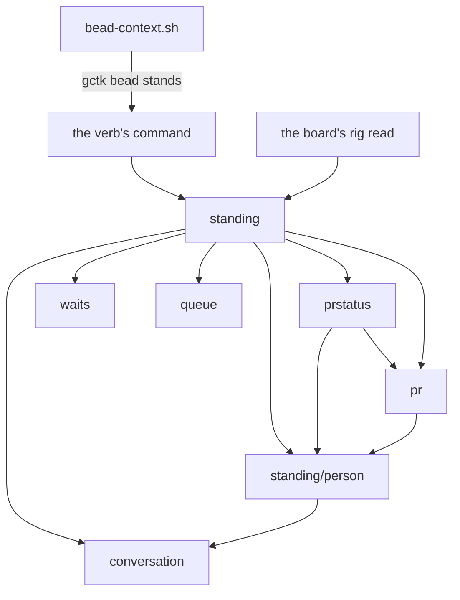

# Design: one owner in gctk for a bead's standing

This is the design record for tk-ssm8qns.28, the design child of
tk-ssm8qns.27. The architecture it adds is in
[docs/gctk-architecture.md](../../docs/gctk-architecture.md): the verb's row,
[the `bead stands` contract](../../docs/gctk-architecture.md#the-bead-stands-contract),
which holds the answer's words, the board's composition, and the debt that
stands until the build lands. The Gas City search is
[gas-city-search.md](gas-city-search.md). The pack was read at main
7d4abd0ab, the commit `integration/tk-ssm8qns.27` points at, and the stores on
2026-11-19.

Today three places decide whether a bead waits on you, is queued or is not
moving:

- **The helm board's rig page** decides it for each row in its table
  (`services/helm/internal/rigboard/table.go`: `table`, `askOf`,
  `holdingVerdict`, `staying` and `gateHold`), with `build.go`'s reads of a
  staying decision, of work held for the Product Owner and of a park. Nothing
  outside the board can ask it.
- **`bead-context.sh`** decides it again in jq (`adv_own`, `adv_anchor` and
  its walk) for the po's epic snapshot and a sitting's preparation. It
  disagrees with the board in the cases
  [listed below](#what-bead-contextsh-reads-differently), three of them filed
  as bugs: tk-y4k5cd5, tk-zk895uj and tk-hwam111.
- **`prstatus`** holds the three rules about one bead that the board and a
  pull request's status both read, in `services/gctk/prstatus/gates.go`:
  whether it is a human gate (`IsHumanGate`), whether only a person clears it
  (`IsPersonBlocker`) and whether it waits on its own work first (`Stays`).
  The pr domain keeps a second copy of the first (`isHumanGate` in
  `services/gctk/pr/admit.go`).

Approving this design moves all three into one owner in gctk. The board and
bead-context.sh ask it, and prstatus asks its rules. The board changes for two
kinds of bead, which [decision 2](#2-the-answers-words) names, and every other
live row reads as it does now. bead-context.sh reads each bead the way the
board does. It serves the belief that human attention is the budget
([foundation.md](../../docs/foundation.md#core-beliefs)): a bead reads as
waiting on you only where it does, wherever you or an agent read it.

## What you decide

### 1. The owner

**Recommended:** a new gctk domain, `standing`, holds the rule, and an agent or
a script asks it with `gctk bead stands <bead>...`.

- It answers from bead ids and gathers its own facts through one read of a
  store. The board hands it the listing it already reads for its page, and the
  verb reads the same listing of the store `--db` names, or of the one gc
  routes the first bead to, as `gctk bead holds` does. So a bead reads alike
  on the board and on the command line.
- The three rules about one bead move to `standing/person`, a package beneath
  `prstatus`. They cannot sit in `standing` itself: `prstatus` asks them,
  `standing` asks `prstatus` where a pull request stands, and Go refuses two
  packages that import each other. The pr domain's copy of the human-gate rule
  goes, and its code asks `standing/person`.
- The verb's word is fresh, `stands`, because `bd status` and a bead's own
  status mean other things and answer differently
  ([the search](gas-city-search.md#the-verbs-word)).
- The package's word is the question's own, a bead's standing. The pack's
  other use of it, a standing record (`assets/scripts/standing-kinds.sh`),
  ends with the liveness sweep (tk-1tfzr71.19), because the conversation on
  standing records (tk-2pvj50q) ruled that the city keeps none.

**Cost:** two packages and one verb. `prstatus` keeps its walk of what holds a
bead that only a person moves (`Holding`). The walk weighs another pull request
it reaches by the PR's own rule, which is `prstatus`'s, and it applies
`standing/person`'s rules to every other bead it reaches.

### 2. The answer's words

**Recommended:** the board's own words, in one answer per bead:

- its group as the board shows it: `waiting-on-you`, `queued`, `not-moving` or
  `closed`, or none for a bead with no move of its own, such as an epic whose
  members are open;
- the rule of the board's table that placed it there, named, such as
  `own-wait`, `parked`, `staying` or `scheduled`;
- what a person owes when the bead is itself the ask: `question`,
  `conversation`, `pull-request`, `routed-to-you` or `ruling`;
- and the beads that rule names.

bead-context.sh's three words follow from the groups. A bead advances when it
is queued and every bead it waits on advances, and is stuck otherwise, on the
bead that stops it. Ready stays `gctk bead holds` reading clear. The
[table below](#the-answer-row-by-row) gives each rule with the board's words
for it.

**Cost:** bead-context.sh reads differently in the cases
[listed below](#what-bead-contextsh-reads-differently). The board changes for
two kinds of bead. One is a bead that is no task and is assigned to `human`:
the board reads it as queued, and the shared answer reads it as routed to you,
and a pull request that waits on one reads as held by it. No store holds one.
The other is a bead a live run works before the run's load-context step
closes, which reads In flight in the Queued group, where the board reads it
Not scheduled in the Not moving group today: the minutes after each pour.

### 3. tk-zk895uj and tk-hwam111

**Recommended:** both end with this work, and neither stays as work to build.

- **tk-zk895uj.** Once bead-context.sh asks the shared answer, a settled pull
  request whose posture is none or commented reads as waiting on your review,
  by prstatus's rule. Two PR anchors in one rig record such a posture.
- **tk-hwam111.** Its premise is gone. It assumed the deferred-dispatch pass
  would close a bead once its `until` targets closed, and nothing in the pack
  acts on an `until` edge any more
  ([deferred-dispatch.md](../../docs/deferred-dispatch.md#a-bead-whose-job-ends-when-other-work-lands)).
  An unrouted bead with only an `until` edge is therefore not moving, which is
  what the board and bead-context.sh both read.

On your approval, each is wired the way tk-y4k5cd5 already is: it waits on
tk-ssm8qns.27, with the validating closer armed to check its case and close
it once the effort lands. Each also leaves the park that holds it
(tk-u5t8h6x), because a check that park holds would wait until you lift it.

**Cost:** two parked bugs leave the backlog unbuilt.

### 4. What bead-context.sh keeps

**Recommended:** everything but its classifier.

- It keeps the subject's core, its context edges, the store it resolves, and
  its frontier and horizon sections with their keys.
- The frontier's verdict and each named bead's `advance` and `stuck_on` come
  from `gctk bead holds` and `gctk bead stands`, each asked once in the
  subject's store.
- It deletes its jq classifier, its walk with the walk's budget, depth and
  `--walk-budget` flag, and its own reads of runs and of other stores' rows:
  about 340 of its 839 lines. The classifier's cases leave its test, and
  `standing`'s Go tests hold each rule.
- `stuck_on.why` takes the shared words, and unit 2 writes them into
  [bead-store-resolution.md](../../docs/bead-store-resolution.md) in place of
  the classifier's.

**Cost:** none for its callers. The po's epic snapshot
(`agents/po/prompt.template.md`), the converse skills and the
context-discipline fragment read the same keys. What stays is shell: this work
moves only the classifier, and the rest, which assembles a bead's context for
an agent, does not grow.

### 5. The order with prstatus's move under the pr domain

**Recommended:** this work lands first, and no wait is added either way.

- The move is the retirement unit of tk-1tfzr71.21, tk-1tfzr71.200, which
  waits on thirteen open beads, five rig cutovers among them. This effort
  waits on nothing outside itself.
- That unit then moves a `prstatus` that holds no rule about one bead and asks
  `standing/person`. The bead-context.sh clauses it planned to delete with the
  posture keys (section 7 of `specs/tk-1tfzr71.161/design.md` on
  `integration/tk-1tfzr71.21`) are gone with the classifier.
- A note on tk-1tfzr71.200 says so. If that unit lands first after all, this
  work moves the three rules out of wherever it put `prstatus`, and nothing
  else changes.

**Cost:** none.

## The answer, row by row

The rules apply in the order of the table, and the first that applies
answers, which is the order of the board's table today. A read that cannot
answer the part a rule needs, such as a pull request whose facts did not read,
answers `unread` there, in no group, and bead-context.sh reads that bead as
stuck on itself, unread. The full rule is
[the contract](../../docs/gctk-architecture.md#the-bead-stands-contract).

| Rule | The bead | Group | The board shows | bead-context.sh reads |
|---|---|---|---|---|
| `closed` | is closed | `closed` | Closed, with how it closed | a count, never a named bead |
| `ask` | is itself what a person owes, one of the asks below, unless it is work that carries `hold:mayor` | `waiting-on-you` | the ask's words | stuck on itself |
| `own-wait` | waits, through a wait of its own, on a human gate or a bead only a person clears | `waiting-on-you` | Waits on your answer, the conversation's words, or Waits on `<id>` | stuck on that gate or bead |
| `further-along` | waits on such a gate or bead further along its waits, an ancestor's included | `waiting-on-you` | Waits on `<id>`, naming that gate or bead on the row's third line | stuck on that gate or bead |
| `parked` | waits on a gate that is no human gate, its own or an ancestor's | `not-moving` | Held by a gate | stuck on the gate |
| `status` | has a status no pool offers, such as deferred | `not-moving` | Deferred, or the status | stuck on itself |
| `staying` | is a conversation its sitting stays in, or a decision a ruling left waiting on the work it sent | `queued` | Waits on `<id>` | advancing while that work does |
| `answers` | is a conversation that answers a question | none | its words, in the question's row | stuck on the question |
| `members` | is an epic or Delivery with open members, or with no members at all | none | its counts | advancing while every open member does, and stuck on itself with no members |
| `gate` | is a gate that is no human gate | none | nothing of its own | stuck on itself |
| `in-flight` | is work in flight: claimed, carrying a branch or merge result, or worked by a live run | `queued` | Pull request #`<n>` with where it stands, or In flight | advancing while what it waits on does |
| `scheduled` | is work that is armed, routed or assigned, and no dispatch hold holds | `queued` | Queued, or Waits on `<id>` | advancing while what it waits on does |
| `not-scheduled` | is any other work | `not-moving` | Not scheduled | stuck on itself |

The asks:

- **`question`:** an open human gate, or an open decision that does not wait on
  work of its own first.
- **`conversation`:** an open conversation its sitting does not stay in, which
  answers no open human gate and tracks no decision that asks.
- **`pull-request`:** a bead whose pull request reads needs-review or
  needs-attention.
- **`routed-to-you`:** any other open bead only a person clears, which is a
  task in your queue that is no conversation, or a bead assigned to `human`.
- **`ruling`:** an epic with members and none of them open, or a landed
  Delivery.

A bead's frontier, the reading bead-context.sh's `--frontier` gives a subject,
is `ready` when `gctk bead holds` reads it clear. Otherwise it is `advancing`
when every wait that answer names advances, and `stuck` on the first that does
not.

## What bead-context.sh reads differently

Each row is a case where bead-context.sh's classifier reads a bead apart from
the shared answer, which is the board's reading wherever the board draws the
bead. The counts are of the city's stores on 2026-11-19.

| A bead that | bead-context.sh reads today | It reads | In the stores |
|---|---|---|---|
| is a decision a ruling left waiting on the work it sent, or a conversation its sitting stays in (tk-y4k5cd5) | stuck: human | advancing while that work does | no decision, since each open one waits only on gates |
| is a settled pull request whose posture is none or commented (tk-zk895uj) | advancing | stuck: `pull-request`, waiting on your review | two anchors in one rig carry that posture |
| is an epic or Delivery in an epic's horizon | stuck: unrouted | advancing while every open member does | three of gc-toolkit's open epics hold one |
| is routed, armed or assigned work that carries `hold:mayor` or `hold:external` | advancing | stuck: `not-scheduled` | none |
| is an old-path review, rework, validation or finding with no route, claim or live run | advancing, by its task kind | stuck: `not-scheduled` | two rework beads, in two rigs, carry no route or claim |
| is armed and has met its sling-failure cap | stuck: capped | stuck on the human gate the armed start files to ask about it, or queued while the conversation it opens instead, for a bead with open children, waits for you | none |
| waits on work nobody routes, behind which a person's move waits | stuck on the work nobody routes | stuck on the person's move, which the board names first | not counted |
| waits on a bead in another store | walks into that store | leaves it out, as `gctk bead holds` does | not counted |

Every other reading keeps its verdict and takes the shared word:
`human` becomes the ask, `own-wait` or `further-along`; `approval`,
`merge-hold` and `merge-blocked` become `pull-request`; `held` becomes
`status`; `unrouted` becomes `not-scheduled`; and `unknown`, `budget` and
`cycle` become `unread`.

The board changes for two kinds of bead. The first is the `routed-to-you`
clause for a bead assigned to `human` that is no task. The board reads such a
bead as queued today, because `queue` counts any assignee as the city's, and
`human` is the operator's queue by the pack's own rule
(`conversation.IsAssignee`). The clause is part of the rule for a bead only a
person clears, so every reader of that rule takes it: a pull request that
waits on such a bead reads as held by it, in its status and on the board's
row, as it is by a decision. No open bead in the city's seven stores is
assigned to `human`, and the two closed ones are tasks, so no reading changes
today.

The second is the `in-flight` rule's clause for a bead a live run works. The
board takes the in-flight test of `waits`, which counts a run only once it has
passed load-context, so between a pour and the close of the run's
load-context step it reads the poured bead, open, unrouted and unassigned, as
Not scheduled. The shared answer reads that bead in flight from the run's
start. bead-context.sh already reads it as advancing, so only the board's
reading changes, for the minutes after each pour.

## Where the code goes

- **`standing/person`** (new) holds `IsHumanGate`, the rule for a bead only a
  person clears (today's `IsPersonBlocker`, with a bead assigned to `human`
  added), and `Stays`, with the row type they read. It imports `conversation`
  alone. Their tests move from `prstatus/gates_test.go`.
- **`prstatus`** asks `standing/person` for all three and holds none. It keeps
  `Holding` and its anchor rule (`awaitsPerson`), `IsMachineGate`, which names
  the gates a review run's failure files and so is a fact of the PR, and
  `Read`, `Derive`, `Render` and the rest of the PR's rule.
- **`pr`** drops `admit.go`'s `isHumanGate` and asks `standing/person`.
- **`listing`** fills its `PersonBlocker` field from `standing/person`.
- **`waits`** exports a read of its run link, whether a live run works a bead,
  which `standing`'s `in-flight` rule asks. Its rule for what holds a bead does
  not change: its in-flight test still counts a run only once the run has
  passed load-context, because that test answers whether an ancestor's wait
  still holds work that has not started.
- **`standing`** (new) holds the answer and its rules: the table and the ask,
  moved from `rigboard`'s `table.go` and `build.go`, and the advance and the
  frontier. It asks `waits`, `prstatus`, `queue`, `conversation` and
  `standing/person` through a `Store`, the reads it gathers through, which
  `listing` implements, as `queue.Order` and `prstatus.Read` take theirs. It
  spells no key.
- **`gctk bead stands [--db <path>] <bead>...`** reads a listing of the store
  and prints each answer, with its row in `services/gctk/README.md`.
- **The board's rig read** asks `standing` for every row it draws. It keeps its
  words, its group labels, the fold of a conversation into the row of the
  question it answers, its counts, its views, its pages and its order of work,
  which it takes from `queue`. `TestFixtureBoard` holds its document to the
  committed golden.
- **Retiring code** changes only at its calls of the moved rules. `gctk merge`
  (`internal/cli/merge.go`, retired by tk-1tfzr71.70) calls
  `prstatus.IsHumanGate` once. The old board's reader
  (`services/helm/internal/board`, retired by tk-1tfzr71.24) calls it once in
  `human.go`, and calls `prstatus.IsPersonBlocker` once in `derive.go`. Each
  call swaps onto `standing/person` in the same change, and nothing else there
  changes. Rule 7 of
  [the rules a domain move follows](../../docs/gctk-architecture.md#the-rules-a-domain-move-follows)
  makes that exception for a shared shell definition a move deletes. The
  definition here is Go, and a call left on it would not build, so the same
  exception applies.

The move follows those rules whole. The intent moves with every caller (rule
1), dependencies point down, as the figure shows (rule 2), `standing` takes
bead ids and a store, never facts a caller gathered (rule 3), and each rule is
tested in Go (rule 5). No test holds two copies equal, because no second copy
stays.

## The breakdown

The implementation child, tk-ssm8qns.29, starts with the graph work, before any
code:

1. It files unit 2 below under tk-ssm8qns with `target` set to
   `integration/tk-ssm8qns.27` in the create, makes it wait on tk-ssm8qns.29,
   arms it on `mol-polecat-work`, and makes tk-ssm8qns.27 and its summary task
   tk-ssm8qns.30 wait on it.
2. For tk-zk895uj and tk-hwam111 each, it removes the arm that would send the
   bug to be built and its edge onto the park tk-u5t8h6x, adds a `blocks` edge
   onto tk-ssm8qns.27, records a close brief in its notes, and arms the
   validating closer, `mol-validate-close`, as tk-y4k5cd5 is wired.
3. It appends a note to tk-1tfzr71.200 saying what this effort changes for that
   unit ([decision 5](#5-the-order-with-prstatuss-move-under-the-pr-domain)).

Then the units:

- **Unit 1, tk-ssm8qns.29 itself: the owner, and the board asks it.** It builds
  `standing/person` and moves the three rules into it. `prstatus`, `pr`,
  `listing` and the retiring code's calls ask it. It builds `standing` with
  the table and the ask moved from the board, and the board's rig read asks
  `standing` for every row. `standing`'s Go tests hold every rule the board's
  table tests held, and `TestFixtureBoard` passes on the golden as committed.
  Two clauses come last, each as a commit of its own with its own test, and
  the golden's diff in each shows every fixture row it changes: the `in-flight`
  rule's clause for a bead a live run works, with the run-link read `waits`
  exports, and the `routed-to-you` clause for a bead assigned to `human`.
- **Unit 2: the verb, and bead-context.sh asks it.** It adds the advance and
  the frontier to `standing`, with the members rule and their Go tests, and
  builds `gctk bead stands` with its README row. bead-context.sh deletes its
  classifier and fills its frontier and horizon from the verb, and its test
  keeps the cases of what it still does. bead-store-resolution.md takes the
  shared words, and the debt entry in gctk-architecture.md comes out. Its done
  includes tk-y4k5cd5's case and tk-zk895uj's, read live.

Unit 2 needs unit 1's packages. The board's move stands alone, with its golden
as the proof, so it lands first.

## What this work does not touch

- The board's direct store reader and its pack-stamped rows
  (`services/helm/internal/board`), which tk-1tfzr71.24 retires, take only the
  two calls above.
- `assets/scripts/liveness-classify.sh` and `liveness-recheck.sh`, which
  tk-1tfzr71.19 retires, and `services/helm/web/contract_parity_test.go`, which
  tk-1tfzr71.25 retires, take nothing.
- `gctk merge` takes only the one call above, and tk-1tfzr71.70 retires it.
- The board's read of a decision's last hand-back stays the board's.
  tk-2zqwmq8, held for placement, bounds that read in the same file the board's
  gathering lives in, `gather.go`, and whichever of the two builds second
  merges with the other.
- `queue` keeps its rule for whether the city takes a bead, and `waits` its
  rule for what holds one. `standing` asks both. `queue` reads armed or routed
  work that carries bd's `human` label as taken, though no pool serves it, and
  tk-whnukvi, held for placement, carries that gap. No bead carries the label.
