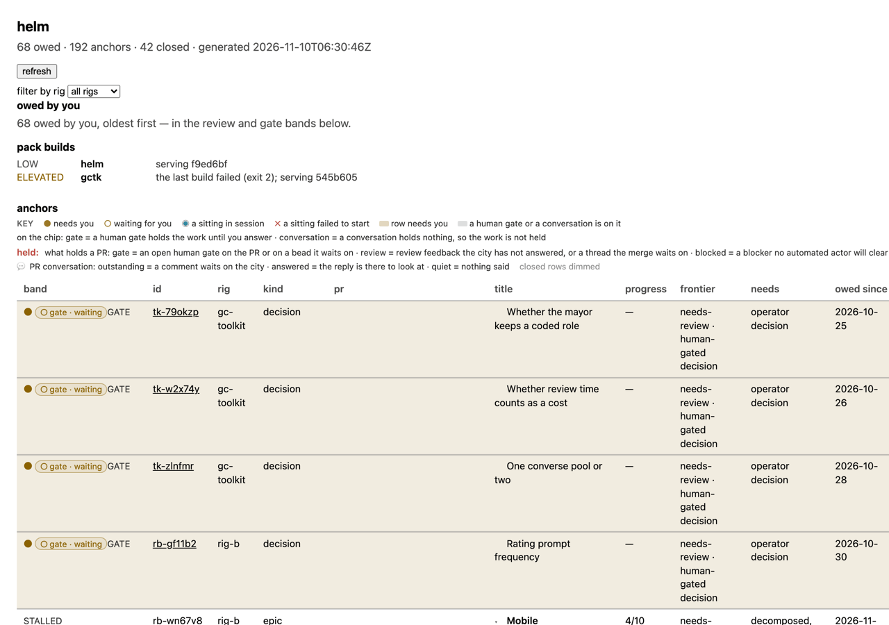
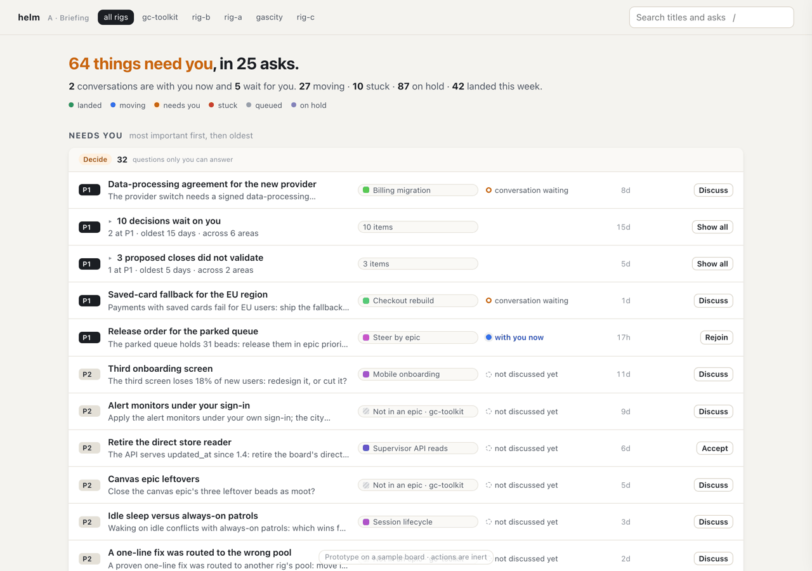
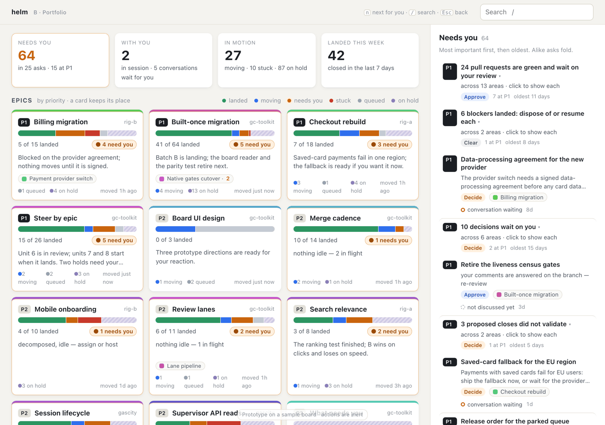
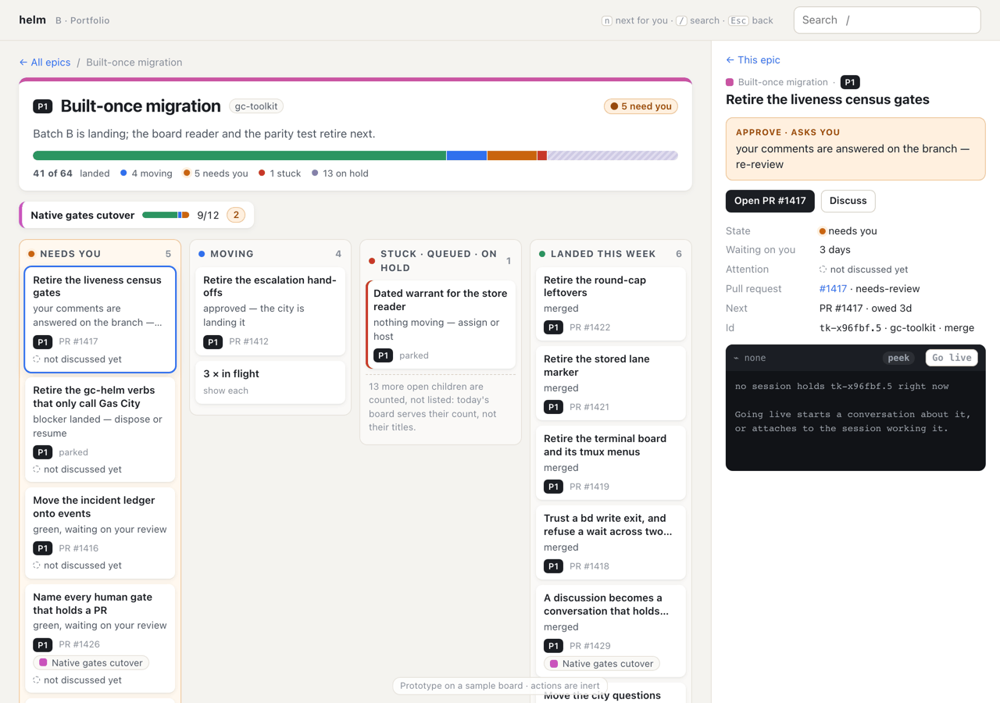
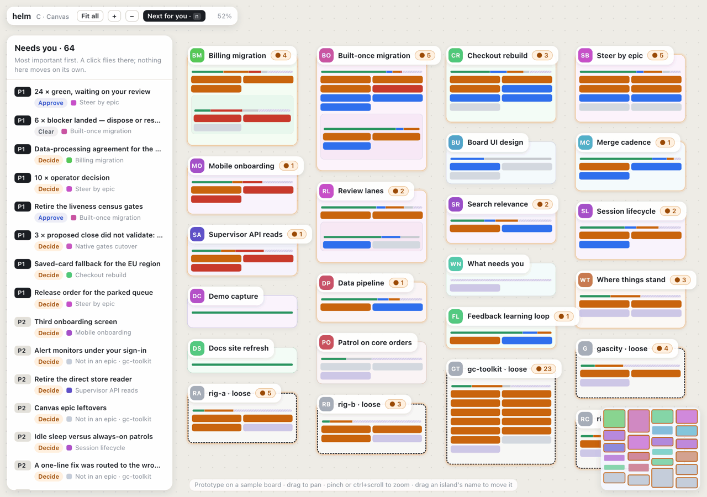
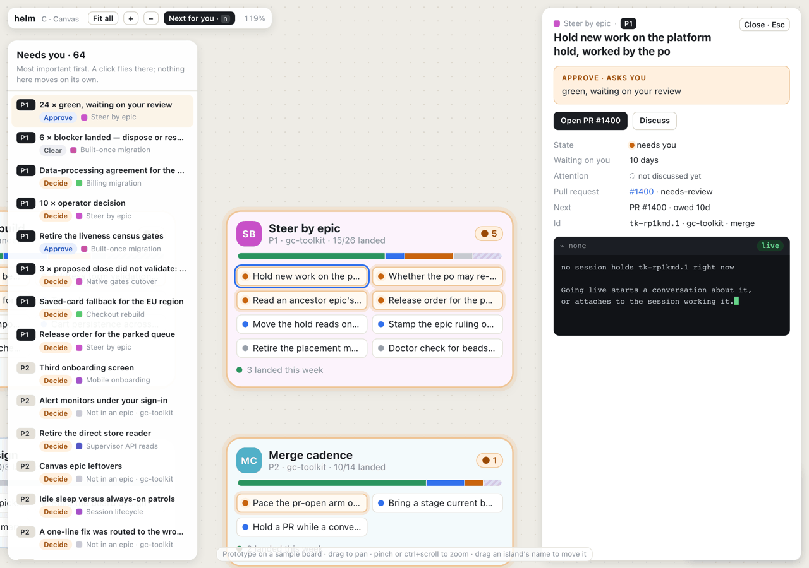

# Helm board design

## Scope

**Mandate.** How the board's web page looks and behaves as a whole: its layout,
its hierarchy, how you get around it, how it shows what needs the operator,
what moves and what is stuck, and where a terminal sits. The page is the
board's one view for people (the operator's ruling of 2026-11-06, recorded on
tk-ikpyzn), so this is the board's design.

**Boundaries.** What the board must tell the operator belongs to the epics
"Where things stand" (tk-ikpyzn) and "What needs you" (tk-99h9ijx): which rows
exist, what counts as owed, and how a row's state derives. This design draws
what the board serves. It gives no work to code the deletion plan retires: the
board's direct store reader and its pack-stamped rows (tk-1tfzr71.24), and the
contract parity test with its TypeScript mirror (tk-1tfzr71.25). A part that
needs a field the board does not serve waits for that work, and the section on
fields names each one.

## Status

Proposed. The operator rules on it at this design's pull request, the design
gate of the effort that carries it (tk-ikpyzn.12). Approving the pull request
rules the proposed direction. A review that names another direction or a blend
sends this document back to state that one instead. The section The ruling, at
the end, records what the operator ruled.

## What the page has to answer

The bar is the operator's own words. On PR #774 (review 5253714163): "still
feels like it takes no consideration of usability into mind at all. It's like
word vomit on the page, just slightly better organized." On PR #911 (review
5371389477): "As far as usable designs, this is pretty poor. We simply indent
titles, that's best practices from 40 years ago." Their direction of 2026-11-08
(conversation tk-kz6jl3a): "The board should show everything, but it's about
how it's presented that makes it guide towards what really needs me. The board
needs to give a holistic executive operator like view, but also the ability to
then dive into the area of interest and see how it's progressing."

The operator's model of 2026-09-30 (tk-ikpyzn.10) asks that a visit answer
three questions at a glance: "Does this need my attention? Has it gotten my
attention? If it got my attention, what is next?" This design asks the same of
every item on the page.

Today's page does not get there, and the live board shows why. Read on
2026-11-10 at 06:00Z (`helm-svc board --all --json --limit=0`), it held 249 open
rows and 251 rows closed in the last week. 91 of the open rows were owed to the
operator, 59 of them gates and 32 pull requests. The rows fell into 214
dependency families, and 199 of those families were a single row, so grouping
by family gives almost no structure. 140 rows were parked work in no epic. The
`phase` word read needs-review on 219 of the 249 open rows, so it cannot tell
the operator what needs them. On a sample board of the same proportions, the
page's first screen shows about four rows of a ten-column table, and the
oldest asks come first, so the first four are alike decisions while the P1
asks sit further down.

## Three directions

Each direction is an interactive prototype under `prototypes/` in this
directory: `a-briefing.html`, `b-portfolio.html` and `c-canvas.html`, which
`index.html` there links. They open from a file or a static server, and nothing in them is wired to the city: the
actions say what the board would do and do nothing. All three read one sample
board, `prototypes/shared/sample-board.js`, which
`prototypes/shared/gen-sample.mjs` writes. The sample is invented, so no rig's
work reaches this public repository, and its proportions follow the live board
above: 192 open rows, 68 of them owed, 42 closed, 21 epics, five rigs. Every
field it carries is a field of today's board contract
(`services/helm/web/src/contract.ts`), so `node gen-sample.mjs --json` feeds
`services/helm/cmd/helm-fixture --board` and today's page draws the same
board. The three share one visual language (`prototypes/shared/base.css`), so
they differ in structure and behavior, not in paint. Each has a narrated clip,
recorded from the scripts in `prototypes/demo/` with the demo-capture skill.

### A, Briefing

One page read top to bottom. A sentence says how much needs the operator.
Then what needs them, grouped by the move it asks for (decide, approve, clear)
and most important first within each group, with alike asks folded into one
line. Then every epic in priority order, one line each with its state in one
bar, opening in place to its work grouped by state. Then the work in no epic,
by rig, with alike rows piled into one line. Then the conversation record.
`j` and `k` move through every row, Enter opens, and `/` searches.

### B, Portfolio

An overview and a page per epic. The overview opens on four answers (needs
you, with you, in motion, landed this week) and every epic as a card in
priority order, with its state bar, its progress, what needs the operator in it
and its headline. The work in no epic is one card per rig. Beside the cards, a
queue lists what needs the operator, most important first, with alike asks
folded. A click on a card opens the epic's page: its header and bar, its
sub-epics one click deeper, and its work in lanes by state. The queue then
narrows to that epic's asks. An item opens in the queue's place, with its ask,
its actions and its terminal. `n` opens the next thing that needs the operator
wherever it is, Escape climbs back out one level at a time, and the "With you"
answer opens the conversation record.

### C, Canvas

The June Attention Canvas on today's board. Each epic is an island whose
place, color and emblem stay put, and each item is a block of its state's
color, so the whole city reads from altitude. Zoom is the level of detail:
from altitude the names float above the islands, and up close each item reads
by its title. A list beside the canvas names what needs the operator, most
important first, and a click flies the camera there. "Next for you" flies to
the next ask. Nothing moves on its own. An island the operator drags keeps its
new place in that browser.

### What each costs

| | What its end state ships | What it asks of the operator | What it costs to build |
|---|---|---|---|
| A, Briefing | one scrolling page; asks grouped by move; epics as one-line rows that open in place | a long scroll, since the sample runs to several screens with everything folded; an epic's state is one bar, and its work needs a click per epic | the least: today's page regrouped, with today's components |
| B, Portfolio | an overview of epic cards beside the asks queue; a page per epic with lanes; the item and its terminal in the queue's place | one click to dive into an epic and Escape to come back; an ask shows twice, once in the queue and once as its epic's badge | medium: a two-pane layout, cards, lanes, routes in the URL, and the item detail moved beside the queue |
| C, Canvas | a zoomable canvas of islands, a jump list, and places the operator can move | a zoom or a jump before anything reads; from altitude only color, counts and names read | the most: pan and zoom, levels of detail, layout, stored places, and tests of geometry |

## The proposed direction: B, Portfolio

B is proposed, with two pieces taken from the others: from A, the folding of
alike asks into one line and the keys that reach every row; from C, each
epic's durable color and the pull to the next ask.

B answers the operator's direction most directly. The overview is the
"holistic executive operator like view": four answers and every epic on one
screen, each card readable without a click. The epic's page is "dive into the
area of interest and see how it's progressing": its progress, its sub-epics,
and its work in lanes by state, with what landed this week. The queue beside
the cards is what "guide[s] towards what really needs me", and the badge on
each card shows what needs the operator in place. Nothing is hidden: every
epic has a card, every rig's loose work has a card, and the epic's page says
how many of its children the board counts but does not list.

B also settles the trade-off the board has carried since 2026-09-29. That day
the operator picked a layout that keeps positions stable and highlights what
needs them in place, and deferred a needs-me-first default view, which the
sitting's notes call "the biggest single lever" (recorded on tk-ikpyzn by
sitting tk-kt2y00). B has both, in two places: the cards never move with state,
and the queue beside them is needs-me-first.

C is not proposed. At today's scale a canvas reads only by zooming: from
altitude the names float and the items are blocks of color, and the islands of
loose work outweigh the epics. Its build costs the most. What made the canvas
worth having, a durable place and color for each topic, B keeps: a card's
place follows its priority and title, never its state, and its color follows
its id. A is not proposed because the overview it gives is a list of rows, so
"where does this stand" still costs a click per epic. A stays the fallback for
an operator who prefers one scroll.

## The design

The build makes direction B. The prototype `prototypes/b-portfolio.html` is
its reference for layout and behavior, and this section is its specification.

### The overview

- **Four answers** head the page. Needs you: the owed count, how many asks it
  folds into, and how many are P1. With you: conversations in session, and how
  many wait for the operator; a click opens the conversation record. In
  motion: moving, stuck and on hold. Landed this week.
- **Epic cards**, in priority order and then by title. A card never moves
  because its state changes. A card shows the priority, title and rig, the
  state bar, "n of m landed", a badge with how many items need the operator or,
  when none do, how many are stuck, the headline (the epic's takeaway, else its
  needs sentence) in at most two lines, its sub-epics as chips with their own
  count of what needs the operator, and a footer with what moves, what is
  queued and what is on hold, and when it last moved.
- **Work in no epic**: one card per rig, named by its biggest piles of alike
  rows.

### The queue

- It lists every owed item, most important first (priority, then the longest
  owed). This follows the hypothesis of "What needs you": "If the board shows
  everything but makes what really needs you stand out, most important first".
- Rows sharing a `cluster_key` fold into one entry that names the count, how
  many are P1, the oldest wait and how many areas they span. A click shows
  each.
- Each entry shows the priority, the title, the ask in at most two lines, the
  move it asks for (approve, decide or clear), the epic's colored chip, the
  attention marker, and how long it has waited.
- On an epic's page the queue narrows to that epic's asks, with a link back to
  all of them.

### The epic page

- A trail back to all epics and to the parent epic.
- A header: priority, title, rig, the count of what needs the operator, the
  headline, a thick state bar, and the counts under it with "n of m landed".
- The sub-epics as buttons, each with its bar, its progress and its count of
  what needs the operator.
- Four lanes: needs you; moving; stuck, queued and on hold, with stuck first
  and marked red; landed this week. Alike rows fold into one card. When the
  epic counts more open children than the board lists, the third lane says how
  many and that the board serves their count, not their titles.

### An item, and its terminal

- An item opens in the queue's place: its epic and priority, its title, the
  ask in a callout, the actions, the recommendation when the item can be
  accepted, its facts (state, how long it has waited, attention, pull request
  and what holds it, progress for an epic, what is next, id, rig and kind), its
  conversations, and the terminal.
- The actions are today's, unchanged: Accept on an item that can be accepted,
  Discuss and Dismiss on any item as the drill panel offers them today, and a
  link to the pull request. A blocker that landed has no one-click route of its
  own: Discuss opens the conversation that rules it.
- The terminal follows the selected item. It rests as a peek and goes live on a
  click. A conversation's terminal attaches to its sitting's session, and any
  other item's attaches to the session the supervisor names as working it.
  With no session, the peek says so and Discuss starts a conversation. Closing
  the item detaches and never ends the session.

### Getting around

- The route lives in the URL (`#area=<id>&item=<id>`), so a page can be
  linked to and the browser's back button works.
- `n` opens the next thing that needs the operator in the queue's order; `j`
  and `k` move through the queue and Enter opens; Escape climbs out one level
  (the item, then the epic); `/` searches. Search dims the cards that do not
  match and narrows the lanes and the queue.

### The visual language

- Six states, one color each, used the same way in every bar segment, dot and
  lane: landed green, moving blue, needs you amber, stuck red, queued gray, on
  hold hatched violet.
- Amber marks only what needs the operator, and red only what is stuck. An
  epic's own hue marks its identity (the card's band, the chip's square) and
  never a state.
- The attention marker has five forms: with you now (a live session), a
  conversation waiting for you, discussed some time ago, not discussed yet, and
  a sitting that failed to start.
- Calm by default. The page shows no toast, no tab badge and no motion except
  a short fade when the main pane changes and the cursor of a live terminal.
  The banner saying the board is old and the warning that a rig did not answer
  stay above everything, because they say what the page's rows are worth.
  The pack builds show as a chip in the header only when one is not well.

### What the page drops

- The ten-column table. The id, rig, kind, band, frontier and owed-since move
  into the item's facts. Progress shows on epics only.
- The legend paragraph. The six state colors are the key. The words for what
  holds a pull request and for its conversation move into the item's facts,
  beside the values they explain.
- The sittings table, which becomes the conversation record behind "With you".
- The terminal at the foot of the page, which moves into the item.
- The `phase` word as a signal of what needs the operator. Only `owed` turns a
  thing amber.

## The open calls

- **A needs-me-first default view, against stable positions.** Settled by
  giving each its own place: the queue is needs-me-first, and the cards keep
  their places and show what needs the operator in place.
- **Progress only where it means something** (tk-ikpyzn.9). Settled: "n of m
  landed" shows on epics and sub-epics only. An item shows its state and its
  ask.
- **Clustering identical NEEDS rows.** Settled: the queue and the lanes fold
  the rows that share the wire's `cluster_key` into one entry, and a click shows
  each.
- **How a parked ask and an engaged one read** (tk-ikpyzn.10). Settled for the
  fields the board serves: the attention marker's five forms. "When you last
  looked" needs the engagement trail tk-ikpyzn.10 adds, and the marker gains it
  when that lands.
- **One live terminal per topic, or the one that follows the click** (folded
  in from tk-mw9qz). Settled: one terminal, in the item, following the
  selection. A terminal per topic spends screen and attention on topics the
  operator is not working at that moment, and "Human attention is the budget"
  (docs/foundation.md) argues against live panes nobody asked for. The
  wiring would allow more: re-checked on 2026-11-10, ttyd runs one
  `gc session attach` per connection, takes the target from the URL's `arg`,
  and admits only a name `assets/scripts/gc-terminal-attach.sh` finds in the
  live session list (services/helm/README.md, section Terminal). So a terminal
  per topic is a layout change if it is ever wanted, and no successor is filed
  for it.

## The June Attention Canvas, re-tested

The June decisions are in `specs/tk-eemvf/`. Each is a claim re-tested here,
not a constraint.

| June decision | Now | What changed, and why |
|---|---|---|
| A web surface, not an OS-native one, as a thin client over the supervisor API and the gc-attention `--json` boundary | Holds, with the boundary moved | The web page is the board's one view for people (2026-11-06). The boundary is helm-svc's `/helm` answer: the board is gathered and ranked in the service, and the page draws it. The drill plane reads the supervisor API directly. The built-once target keeps the supervisor reader and retires the direct store reader (tk-1tfzr71.24). |
| One persistent zoomable canvas, where each anchor keeps a durable place, color and imagery | The place and the color hold; the canvas does not | At today's scale, 249 open rows of which 140 sit in no epic, a canvas reads only by zooming (direction C). The durable place and color hold per epic, not per anchor, because most anchors are single rows that come and go within days: a card's place follows priority and title, and its color follows its id. |
| A pack-local home in gc-toolkit that augments the core gc dashboard and never forks it | Holds | The board is a pack service under the supervisor's `/svc/` seam, and nothing here touches the core dashboard. |
| An embedded terminal whose resting tile is a peek and whose focus is live | Holds, in the item | The terminal moves from the foot of the page into the selected item and follows the selection. |
| Pull, never interrupt: perceptual and spatial grounding, not notifications | Holds | No notification chrome. The pull is the queue, the badge in place, and `n`. The grounding is each card's stable place and hue. |
| Exploration in interactive prototypes, kept apart from implementation by polecats | Holds | The prototypes sit in this spec on a sample board and import nothing from `services/helm`. The build is the implementation child's. |

The core question was whether the spatial canvas still beats evolving the
table the operator uses daily. Neither, as proposed: direction B replaces the
table with an overview and a page per epic, keeps the canvas's durable place
and color, and keeps the table's density in the queue.

## What the build reads

Every part of direction B builds on fields the board serves today except one.

| Part | Fields it reads | Served today |
|---|---|---|
| Epics, nesting and order | a tile's `kind`, `group_root`, `group_parent`, `priority`, `title` | yes |
| An epic's bar and progress | the epic's `n_closed`, `m_total`, `open`, `in_progress_live`, `open_heads`; its rows' `section` and `owed` | yes |
| Work in no epic, by rig | rows whose family root is no epic; `rig`, `cluster_key` | yes |
| The four answers | `owed`, `section`, `closed_at`; the sittings' `state` | yes |
| The queue and its order | `owed`, `priority`, `pr_owed_since`, `needs`, `cluster_key` | yes |
| The move an ask asks for | `pr_number` with `section` (approve), `disposition_due` (clear), any other owed row (decide) | yes |
| The attention marker | `sitting_state`, `takeaway_by`, `takeaway_at` | yes, except "when you last looked" (tk-ikpyzn.10) |
| The item's facts and actions | today's tile fields, `acceptable`, `recommendation`, and today's write routes | yes |
| The terminal following an item | a sitting's `session`; the supervisor's session list (`active_bead`) the drill plane already reads | yes |
| An epic's children by title | none: the board counts an epic's children but lists only the ones that are rows, and the supervisor's bead list, as `drill/gen/supervisor.d.ts` types it, has no parent filter | no (S1 below) |

The build changes `services/helm/web/src` and its committed bundle
`services/helm/web/dist`. It changes no Go type, so it touches neither
`contract.ts` nor `contract_parity_test.go`, and it reads nothing from
`internal/source/beads.go`.

## The build

The implementation child (tk-yhquh93.2) builds direction B on
integration/tk-ikpyzn.12, as these three units. It may land them as one bead or
split them into three, each filed and waited on as its description says. Each
unit runs the helm service's Go and web tests as services/helm/README.md
describes them, rebuilds `web/dist`, and checks the built page on the sample
board through helm-fixture, beside the prototype it builds.

1. **The visual language and the overview.** Its first commit records the
   operator's ruling in The ruling below. It puts tk-ikpyzn.9, which this unit
   delivers, behind itself with a `blocks` edge and a validating arm (the
   `gc-toolkit.waits` skill). It writes the six state colors and the shared
   pieces (the state bar, the priority tag, the move tag, the attention
   marker), the four answers, the epic cards and the cards for work in no epic.
   It retires the table's rendering in `App.tsx` (the family tree, the rows and
   the legend) and replaces its tests in `App.test.tsx`.
2. **The queue and the item.** The queue with its folding, its order and its
   narrowing on an epic's page; the item detail with today's actuation
   (`actuate/`, `open/`); the live bead and session read the drill panel makes
   today, moved into the item; the terminal following the selection
   (`terminal/`); and the conversation record behind "With you".
3. **The epic page and getting around.** The routes in the URL, the trail, the
   header, the sub-epic buttons, the lanes with their folding and the note on
   children the board does not list, the keys, and search.

## Beads this design leaves

- **S1, an epic's children by title on its page** (tk-yhquh93.4): filed under the
  Board UI design epic, waiting by `blocks` edges on tk-1tfzr71.24,
  tk-1tfzr71.25 and this design's build (tk-yhquh93.2), and armed to the
  polecat pool once all three close. It is the one part of the design that
  needs a field the board does not serve.
- **"When you last looked" on the attention marker**: tk-ikpyzn.10 carries it.
  It sits under "Where things stand", which the operator's park holds, so its
  release is the operator's.
- **What this run taught the design-convoy pattern**: tk-zy7hygw, related to
  tk-2gt6r2.

## The ruling

Pending. The operator rules at this design's pull request.
